<!-- MarkdownTOC levels="1,2,3" autolink="true" autoanchor="true" -->

- [DNS 相关常用工具-1](#dns-%E7%9B%B8%E5%85%B3%E5%B8%B8%E7%94%A8%E5%B7%A5%E5%85%B7-1)
    - [命令行工具](#%E5%91%BD%E4%BB%A4%E8%A1%8C%E5%B7%A5%E5%85%B7)
        - [dig](#dig)
        - [nslookup](#nslookup)
        - [whois](#whois)
        - [host](#host)
        - [ping](#ping)
        - [nmap](#nmap)
        - [traceroute](#traceroute)
        - [注意事项](#%E6%B3%A8%E6%84%8F%E4%BA%8B%E9%A1%B9)
    - [其他工具](#%E5%85%B6%E4%BB%96%E5%B7%A5%E5%85%B7)
    - [参考资料](#%E5%8F%82%E8%80%83%E8%B5%84%E6%96%99)

<!-- /MarkdownTOC -->

<a id="dns-%E7%9B%B8%E5%85%B3%E5%B8%B8%E7%94%A8%E5%B7%A5%E5%85%B7-1"></a>
# DNS 相关常用工具-1
<a id="%E5%91%BD%E4%BB%A4%E8%A1%8C%E5%B7%A5%E5%85%B7"></a>
## 命令行工具
<a id="dig"></a>
### dig
dig 应该是功能最全最强大的工具，但全掌握太难也没必要，基本知道常见的功能命令行是什么、看懂返回结果就OK，其他的更进一步功能，用到的时候再搜也可。

```bash
dig www.baidu.com # dig [域名] 默认发送请求 A 记录到默认递归域名服务器，获得该域名对应的 IP 地址
dig @8.8.8.8 www.baidu.com # dig @[IP地址] [域名] 默认发送请求 A 记录到指定的递归域名服务器
```
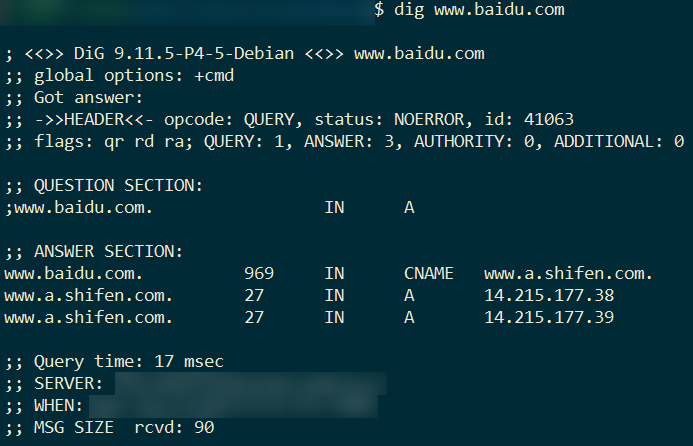
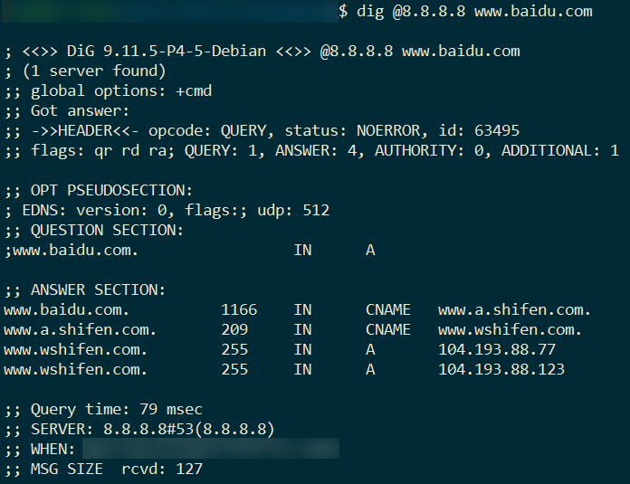

```bash
dig -x 1.1.1.1 # dig -x [IP地址] 发送反向请求 PTR 记录，获得该IP地址对应的域名【注意，域名存在A记录，并不代表该IP地址也存在PTR记录，反之亦然】
dig -x 1.1.1.1 @8.8.8.8 # dig -x [IP地址] @[IP地址] 同上，增加了指定递归域名服务器的IP地址
```
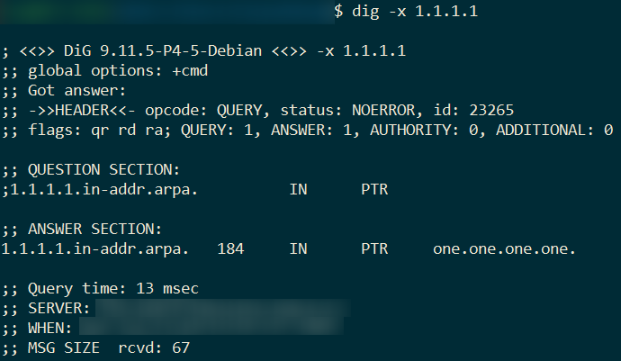
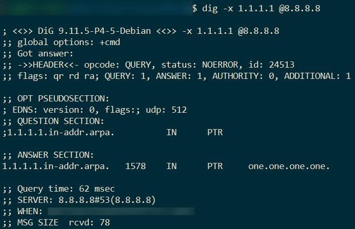

```bash
dig baidu.com +nssearch # dig [域名] +nssearch 查找一个域的权威域名服务器
```
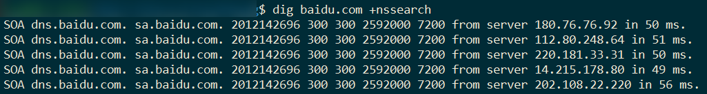

```bash
dig www.baidu.com +trace # dig [域名] +trace 从根服务器开始追踪一个域名的解析过程
```
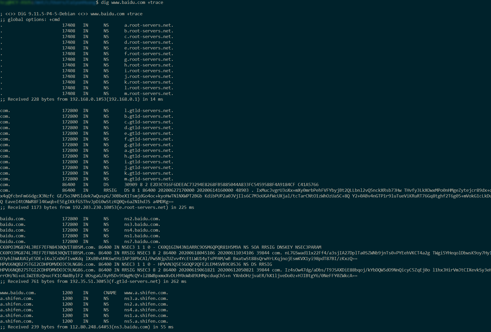

```bash
dig +norec @F.ROOT-SERVERS.NET HOSTNAME.BIND CHAOS TXT # 查看客户端使用的是哪个 F root dns server ，修改 F 成 A-M 任意数字，即可查看客户端使用的是哪个根的哪个镜像名称
```
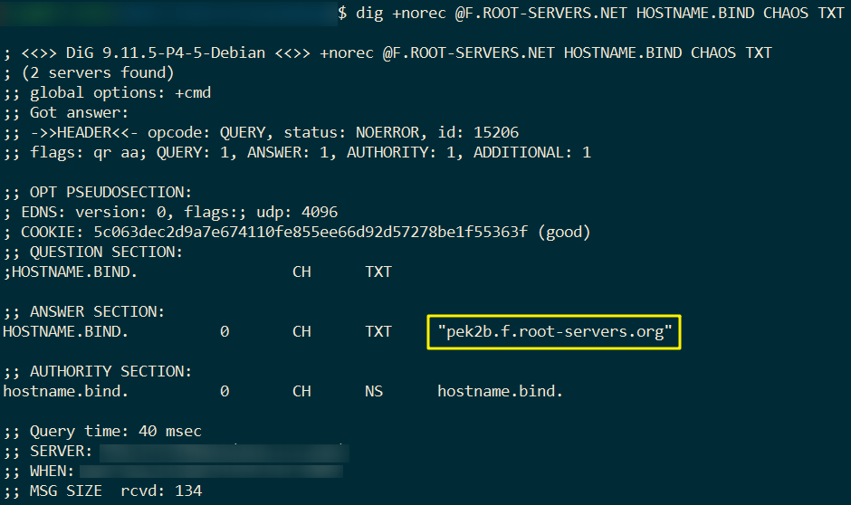

```bash
dig @8.8.8.8 CHAOS TXT version.bind # dig @[IP地址] CHAOS TXT version.bind 查看域名服务器解析软件的版本号
```
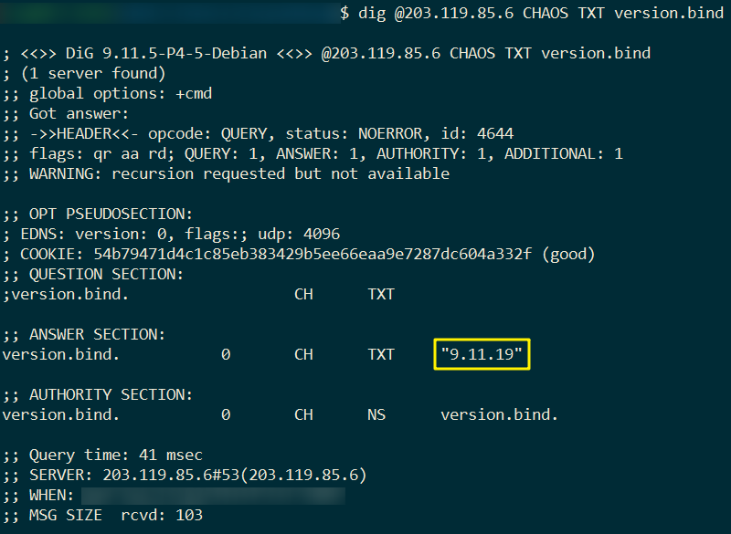

```bash
dig +dnssec www.isoc.org. # dig +dnssec [域名] 验证该域名是否支持 DNSSEC
```
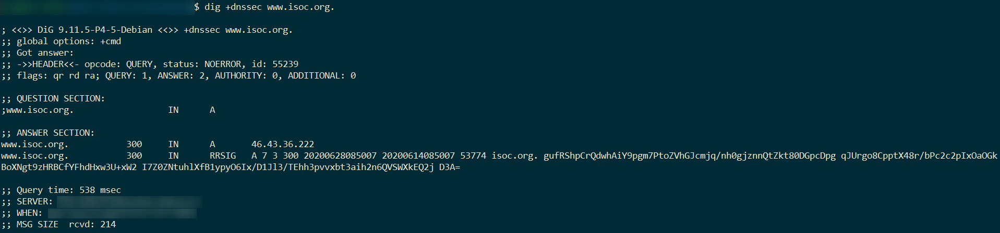

- [常用命令](https://www.cnblogs.com/daxian2012/archive/2013/01/10/2854126.html)
- [dig命令-Linux命令大全](https://man.linuxde.net/dig)
- [dig(1) - Linux man page](https://linux.die.net/man/1/dig)
- [Dig Command in Linux (DNS Lookup)](https://linuxize.com/post/how-to-use-dig-command-to-query-dns-in-linux/)
- [How To Use nslookup Command & Dig Command For DNS Check Test](https://www.a2hosting.com/kb/getting-started-guide/internet-and-networking/troubleshooting-dns-with-dig-and-nslookup)

<a id="nslookup"></a>
### nslookup
nslookup 与 dig 功能类似，但比 dig 要轻量级一些。

```bash
nslookup www.baidu.com # nslookup [域名] 获取指定域名对应的IP地址
nslookup 8.8.8.8 # nslookup [IP地址] 获取指定IP对应的域名，即PTR记录
nslookup -q=A www.baidu.com # nslookup -q=[资源记录类型] [域名] 获取指定域名的某资源记录，类型可以是以下字符【应该不全】，不区分大小写
# SOA 主权威域名服务器
# A 地址记录(Ipv4)
# AAAA 地址记录（Ipv6）
# AFSDB　　Andrew文件系统数据库服务器记录（不懂）
# ATMA　　ATM地址记录（不是自动提款机）
# CNAME　　别名记录
# HINFO　　硬件配置记录，包括CPU、操作系统信息
# ISDN　　域名对应的ISDN号码
# MB　　存放指定邮箱的服务器
# MG　　邮件组记录
# MINFO　　邮件组和邮箱的信息记录
# MR　　改名的邮箱记录
# MX　　邮件服务器记录
# NS　　名字服务器记录
# PTR　　反向记录（从IP地址解释域名）
# RP　　负责人记录
# RT　　路由穿透记录（不懂）
# SRV　　TCP服务器信息记录（将有大用处）
# TXT　　域名对应的文本信息
# X25　　域名对应的X.25地址记录
# ANY      所有相关资源记录
nslookup -debug baidu.com # nslookup -debug [域名] 返回响应资源记录的存活时间 TTL
```
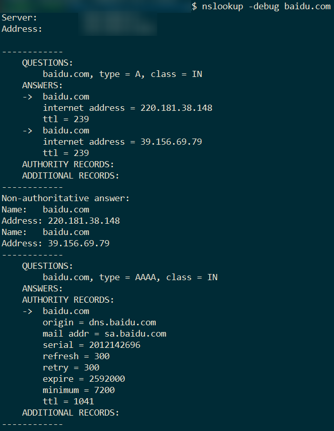


- [Windows操作系统命令行DNS查询](http://www.what21.com/sys/view/windows_windows-basis_1456896379212.html)
- [nslookup(1) - Linux man page](https://linux.die.net/man/1/nslookup)
- [nslookup命令-Linux命令大全](https://man.linuxde.net/nslookup)
- [8 Linux Nslookup Commands to Troubleshoot DNS (Domain Name Server)](https://www.tecmint.com/8-linux-nslookup-commands-to-troubleshoot-dns-domain-name-server/)

<a id="whois"></a>
### whois
whois 主要是用来查询二级域名or私有域名的所属关系，如果是顶级域名和全量域名是查不出来的。【注意：有些顶级域没有whois服务器支持whois查询】

```bash
whois baidu.com # whois [二级域/私有域] 返回指定域名的所属关系
```
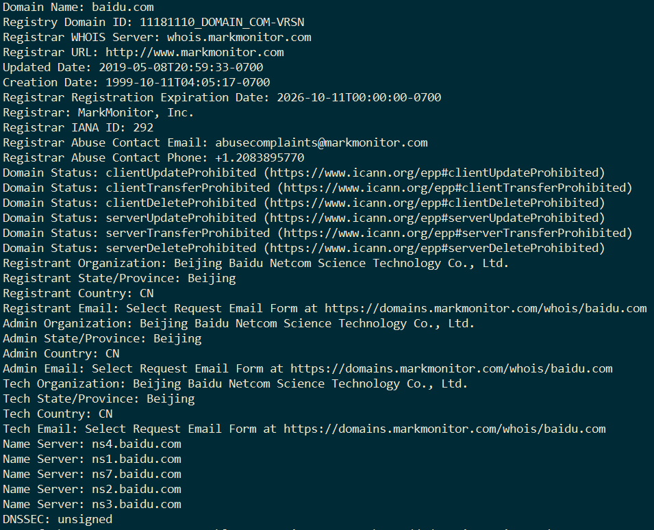

- [Linux whois命令-菜鸟教程](https://www.runoob.com/linux/linux-comm-whois.html)
- [whois(1) - Linux man page](https://linux.die.net/man/1/whois)
- [如何使用WHOIS命令获取域名和IP地址信息](https://www.howtoing.com/whois-command-get-domain-and-ip-address-information)

<a id="host"></a>
### host
同 dig nslookup 类似，功能没有那么强大

```bash
-a：显示详细的DNS信息；
-c<类型>：指定查询类型，默认值为“IN“；
-C：查询指定主机的完整的SOA记录；
-r：在查询域名时，不使用递归的查询方式；
-t<类型>：指定查询的域名信息类型；
-v：显示指令执行的详细信息；
-w：如果域名服务器没有给出应答信息，则总是等待，直到域名服务器给出应答；
-W<时间>：指定域名查询的最长时间，如果在指定时间内域名服务器没有给出应答信息，则退出指令；
-4：使用IPv4；
-6：使用IPv6.
```

- [host命令-Linux命令大全](https://man.linuxde.net/host)
- [host(1) - Linux man page](https://linux.die.net/man/1/host)
- [Linux / UNIX: DNS Lookup Command](https://www.cyberciti.biz/faq/unix-linux-dns-lookup-command/)

<a id="ping"></a>
### ping
检查网络是否通联：如果 IP 不通，可能是路由问题，待检查；如果 IP 通但域名不通，可能是 DNS 问题，检查配置文件

```bash
ping 8.8.8.8 # ping [IP地址] 
ping www.baidu.com # ping [域名] 域名ping通，至少说明DNS没啥问题
```

<a id="nmap"></a>
### nmap
之前主要用 nmap 来批量扫描给定IP地址是否开启了 tcp 和 udp 的 53 端口，以及探测服务器操作系统版本

```bash
-O：激活操作探测；
-P0：值进行扫描，不ping主机；
-PT：是同TCP的ping；
-sV：探测服务版本信息；
-sP：ping扫描，仅发现目标主机是否存活；
-ps：发送同步（SYN）报文；
-PU：发送udp ping；
-PE：强制执行直接的ICMPping；
-PB：默认模式，可以使用ICMPping和TCPping；
-6：使用IPv6地址；
-v：得到更多选项信息；
-d：增加调试信息地输出；
-oN：以人们可阅读的格式输出；
-oX：以xml格式向指定文件输出信息；
-oM：以机器可阅读的格式输出；
-A：使用所有高级扫描选项；
--resume：继续上次执行完的扫描；
-P：指定要扫描的端口，可以是一个单独的端口，用逗号隔开多个端口，使用“-”表示端口范围；
-e：在多网络接口Linux系统中，指定扫描使用的网络接口；
-g：将指定的端口作为源端口进行扫描；
--ttl：指定发送的扫描报文的生存期；
--packet-trace：显示扫描过程中收发报文统计；
--scanflags：设置在扫描报文中的TCP标志。
```

- [nmap(1) - Linux man page](https://linux.die.net/man/1/nmap)
- [nmap命令-Linux命令大全](https://man.linuxde.net/nmap)

<a id="traceroute"></a>
### traceroute
这个命令个人暂时用得比较少，不过有资料推荐

```bash
-d：使用Socket层级的排错功能；
-f<存活数值>：设置第一个检测数据包的存活数值TTL的大小；
-F：设置勿离断位；
-g<网关>：设置来源路由网关，最多可设置8个；
-i<网络界面>：使用指定的网络界面送出数据包；
-I：使用ICMP回应取代UDP资料信息；
-m<存活数值>：设置检测数据包的最大存活数值TTL的大小；
-n：直接使用IP地址而非主机名称；
-p<通信端口>：设置UDP传输协议的通信端口；
-r：忽略普通的Routing Table，直接将数据包送到远端主机上。
-s<来源地址>：设置本地主机送出数据包的IP地址；
-t<服务类型>：设置检测数据包的TOS数值；
-v：详细显示指令的执行过程；
-w<超时秒数>：设置等待远端主机回报的时间；
-x：开启或关闭数据包的正确性检验。
```
- [traceroute(8) - Linux man page](https://linux.die.net/man/8/traceroute)
- [traceroute命令-Linux命令大全](https://man.linuxde.net/traceroute)

<a id="%E6%B3%A8%E6%84%8F%E4%BA%8B%E9%A1%B9"></a>
### 注意事项
1. Linux 下默认本地域名服务器配置文件是 /etc/resolv.conf ，其第一个IP地址，就是默认本地域名服务器地址
2. Windows 下清除本机DNS缓存命令是 `ipconfig /flushdns` ， 展示本机DNS缓存命令是 `ipconfig /displaydns`

<a id="%E5%85%B6%E4%BB%96%E5%B7%A5%E5%85%B7"></a>
## 其他工具
这部分主要是从 [这里](https://www.77169.net/html/259693.html) 挑了一些与 DNS 、域名相关的安全工具，多数偏向扫描搜集数据，获取某个域名下的子域名，都还没有试过，有感兴趣的可以试试。

1. __Knockpy__ ：Knockpy是一个python工具，用于通过单词列表枚举目标域上的子域。它用于扫描DNS区域传输，并自动绕过通配符DNS记录(如果它被启用)。Knockpy现在支持对VirusTotal子域的查询，可以在配置中设置API_KEY。json文件。
2. __Sublist3r__ ：Sublist3r是一个python工具，用于枚举使用OSINT的网站的子域。它帮助渗透测试人员和bug猎手为他们的目标域收集和收集子域。Sublist3r列举了使用许多搜索引擎的子域名，如谷歌、雅虎、必应、百度和Ask。Sublist3r还列举了使用Netcraft、Virustotal、ThreatCrowd、DNSdumpster和ReverseDNS的子域名。
3. __Shuffledns__ ：Shuffledns是一个围绕在go中编写的massdns的包装器，它允许您使用active bruteforce枚举有效的子域，以及使用通配符处理和简单的输入输出支持解析子域。
4. __Subfinder__ ：Subfinder是一个子域名发现工具，使用被动在线资源为网站发现有效的子域名。它有一个简单的模块化架构，并为速度进行了优化。Subfinder只用于做一件事——被动子域枚举，它在这方面做得非常好。
5. __Dnsgen__ ：这个工具从提供的输入中生成一个域名组合。组合是基于wordlist创建的。每次执行都会提取定制词。
6. __Dnscan__ ：Dnscan是一个基于python单词列表的DNS子域扫描器。
7. __Altdns__ ：Altdns是一个DNS侦查工具，它允许发现符合模式的子域。Altdns接收可能存在于某个域下的子域中的单词（例如test, dev, staging），以及一系列已知子域。
8. __Findomain__ ：Findomain提供了一个专门的监控服务，托管在亚马逊(只有本地版本是免费的)，它允许你监控你的目标域名，并在发现新的子域名时向不和和Slack webhook或Telegram聊天发送警报。
9. __Sublert__ ：Sublert是使用Python编写的一种安全和侦察工具，其目的是利用证书透明性，其唯一目的是监视特定组织部署的新子域和已发行的TLS / SSL证书。该工具应该安排为在固定的时间，日期或间隔（理想情况下每天）定期运行。新标识的子域将通过通知推送发送到Slack工作区。此外，该工具执行DNS解析以确定工作的子域。
10. __C99.nl__ ：C99.nl是一种扫描程序，它扫描整个域以找到尽可能多的子域。
11. __Dnsprobe__ ：Dnsprobe是一个建立在retryabledns之上的工具，它允许你用用户提供的解析器列表执行你选择的多个dns查询。
12. __Chaos__ ：Chaos积极扫描和维护互联网范围内的资产数据。该项目旨在加强对DNS变化的研究和分析，以获得更好的见解。
13. __Subjack__ ：Subjack是一款子域名接管工具，在Go中编写，旨在同时扫描一列子域名，并确定哪些可以被劫持。由于Go的速度和效率，这个工具在大规模测试中脱颖而出。总是手动检查结果以排除误报。
14. __Massdns__ ：Massdns是一个简单的高性能DNS存根解析器，针对的是那些想要解析数百万甚至数十亿的大量域名的用户。在没有特殊配置的情况下，MassDNS可以使用公开的解析器每秒解析超过35万个名称。
15. __Rapid7 Forward DNS (FDNS)__：此数据集包含对Rapid7项目Sonar所知道的所有ForwardDNS名称的DNS请求的响应。

<a id="%E5%8F%82%E8%80%83%E8%B5%84%E6%96%99"></a>
## 参考资料
- [Linux命令大全](https://man.linuxde.net/)：可以精确or模糊搜索到大多数linux命令，介绍其相关用法及示例
- [Commonly Used DNS Tools](https://linuxhint.com/common_dns_tools/)：小结了几个与DNS有关的常用工具，包括 nsloopkup、host、Whois、ping、dig、traceroute、IntoDNS、Digdns、Mxtoolbox
- [4 Useful DNS Tools You Should Use](https://www.noip.com/blog/2014/11/13/10-dns-tools-every-sysadmin-know/)：Whois、ping、dig、traceroute
- [DNS Tools](https://dnspropagation.net/dns-tools/)：nslookup dig whois host ping 分不同操作系统介绍了 DNS 相关工具，包括 windows linux MacOS 以及在线 DNS 工具
- [An Introduction to DNS and DNS Tools 2001](https://www.linuxjournal.com/article/4597)：host, dig and nslookup.
- [Top 7 Domain Tools used by Security Researchers](https://securitytrails.com/blog/domain-tools)：Dig Ping Host Whois Nmap Traceroute Mtr；以及在线域名工具， DNSQuery and G-Suite Dig  URLScan Wappalyzer  IP lookup Internet Archive ICANN Whois  ARIN Whois SurfaceBrowser
- [Linux中如何清除DNS缓存](https://leokongwq.github.io/2017/08/30/linux-clean-dns-cache.html)