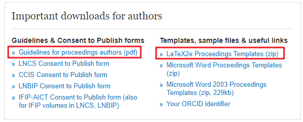
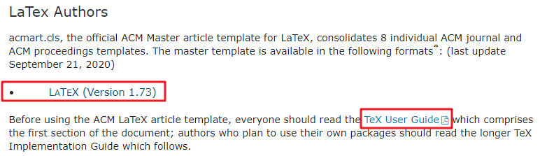
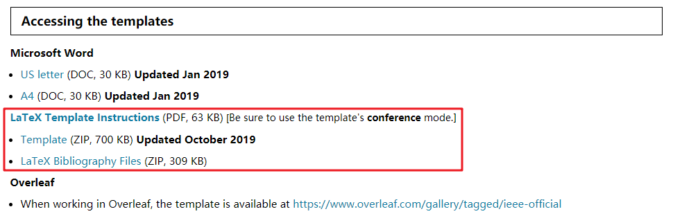
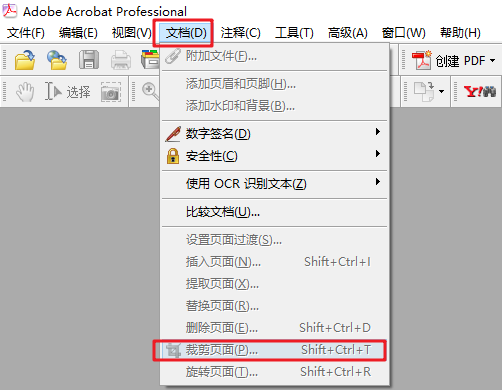
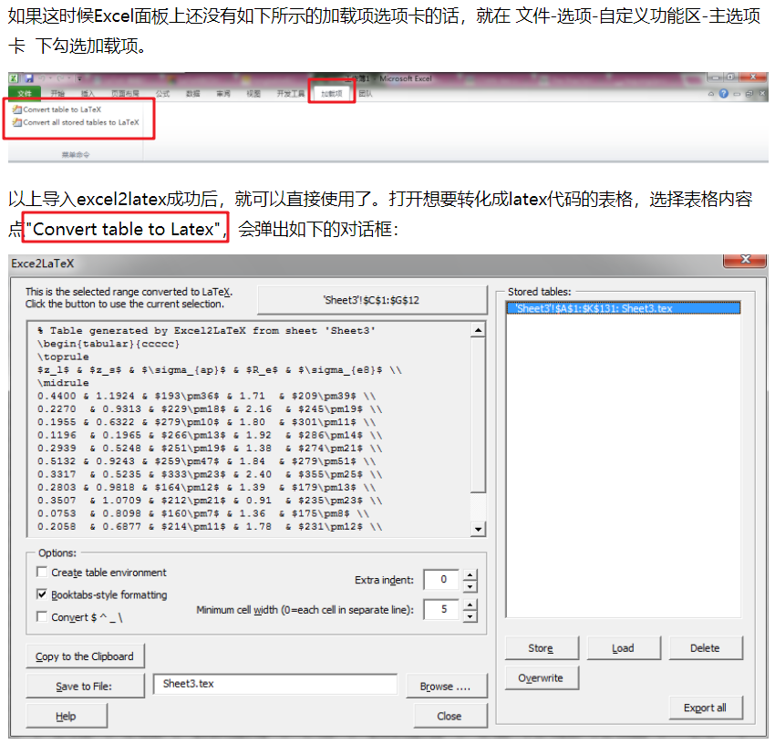
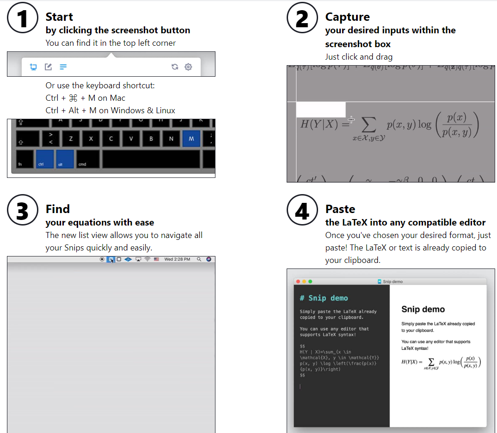

# LaTeX 使用过程问题小结-1
## 会议论文模板 templates
大多数会议论文采用的 LaTeX 模板分 __LNCS、ACM、IEEE__ 这三种，以下页数要求主要是 CCF-C 类的会议，具体要求需仔细阅读每个会议的 __Call For Paper (CFP)__ 。

一般需要注意的主要是，__模板选择、页数限制__（基本页数、是否可以超页、是否包含reference和appendix等）__、是否盲审__（单盲or双盲）。有些会议提交时还需要进行 __页面格式检查__，特别是从 EDAS 论文提交平台提交的，非常容易出现格式错误，建议 __预留时间修改__。

### [Springer LNCS](https://www.springer.com/gp/computer-science/lncs/conference-proceedings-guidelines)：单栏，长文一般要求 10-20 页

### [ACM](https://www.acm.org/publications/proceedings-template)：双栏，长文一般要求 8 页左右

### [IEEE](https://www.ieee.org/conferences/publishing/templates.html)：双栏，长文一般要求 8 页左右

## 基本编译环境 environments
2017.11.21 讲过一次讨论班《论文那些事儿》，是这个系列的第一篇，里面 __第三节__ 对创建 LaTeX 撰写环境进行了详细介绍，大多数工具仍比较好使，部分工具有所更新。

PS：《论文那些事儿》系列相关的 PPT 在讨论班处应该可以找到，感兴趣的可以看看。

- __2017.11.21 《论文那些事儿》__：内容包括 GlobeCom 和 IPCCC 的两次评审意见，论文撰写环境配置（工具篇）、LaTeX写作注意事项（技巧篇）、重要网站列表（资料篇）；
- __2018.3.20 《论文那些事儿-贰》__：内容包括 SFCSD 论文简介、 Networking 评审意见及精读论文推荐小工具；
- __2019.4.16 《论文那些事儿-叁》__：内容包括论文录用后的一系列所里手续及参会流程，如会议注册缴费、论文终稿修改、出国参会准备、汇报报告准备、参会过程记录、参会回来核销、越南参会小结。

### SublimeText 自定义
此 ST 自定义推荐版需要自行下载安装较多的插件，__打造自己的 LaTeX 撰写编译环境__，比较麻烦，有时的确容易出现问题，但 ST 强大的编辑功能和大量的自定义插件，的确非常增色。此外，除采用 ST 自定义打造自己的 LaTeX 编辑器以外，也可以 [采用 VScode 进行配置](https://zhuanlan.zhihu.com/p/58811994)，看个人喜欢。

- 编辑&编译器&自定义插件：Sublime + LaTeXTools + MiKTeX + SumatraPDF (+ LaTeX cwl + LaTeXTab + Cndict + LaTeX Word Count + SublimeGit) 
    + [Sublime Text](http://www.sublimetext.com/)：基本编辑器环境
    + [LaTeXTools](https://packagecontrol.io/packages/LaTeXTools)：LaTeX 编译需要，[文档](https://latextools.readthedocs.io/en/latest/install/)
    + [MikTeX](https://miktex.org/download)：LaTeX 编译需要
    + [SumatraPDF](https://www.sumatrapdfreader.org/download-free-pdf-viewer.html)：PDF 预览需要
    + __以上四个必须下载安装配置，以下自定义插件根据需求下载安装配置__
    + [LaTeX cwl](https://packagecontrol.io/packages/LaTeX-cwl)：LaTeX 命令提示
    + [LaTeXTab](https://packagecontrol.io/packages/LaTeXTab)：复制 Excel 表数据生成 LaTeX 表格代码
    + [LaTeX Word Count](https://packagecontrol.io/packages/LaTeX%20Word%20Count)：论文字数统计（英文）
    + [SublimeGit](https://packagecontrol.io/packages/SublimeGit)：版本控制
    + [Cndict](https://github.com/divinites/cndict)：中文译为英文
    + ST自带的 spell_check (快捷键F6) ：语法检查
    + LaTeX 编译引擎选择：修改引擎 Tools -> build with ，快捷键 Ctril+Shift+B

【参考资料】

- Sublime + LaTeXTools + MiKTeX +SumatraPDF 配置
    + [配置步骤](http://blog.csdn.net/yywan1314520/article/details/50640286)
    + [配置SumatraPDF反向搜索](http://www.latexstudio.net/archives/1169)
    + [一个挺全的配置过程](http://www.cnblogs.com/rfhs/p/6852901.html)
    + [简要配置流程](http://tonghuashuo.github.io/blog/latex-with-sublime-text.html)
    + [配置过程-知乎](https://www.zhihu.com/question/36038602?sort=created)
    + [ST特色插件推荐](https://segmentfault.com/a/1190000004949578)）
- [介绍多个latex插件使用-简书](http://www.jianshu.com/p/51ae1bb01885)

### 集成 IDE
安装 CTEX 中文套装比较简单，自带一套环境，但是个人感觉 Texworks 和 WinEdt 界面都比较丑，不是很好使。

其他的集成 IDE 编辑器如 __TexStudio__ 、 __Texmaker__ 则需要先 [自行安装配置 Texlive 的 LaTeX 环境](https://www.cnblogs.com/1625--H/p/11524968.html)。

- [CTEX中文套装下载](http://www.ctex.org/CTeXDownload)
    + Texworks：软件位置 D:\CTEX\MiKTeX\miktex\bin\texworks.exe
    + WinEdt：软件位置 D:\CTEX\WinEdt\WinEdt.exe
- [TexStudio](http://www.texstudio.org/)
- [Texmaker](https://www.xm1math.net/texmaker/download.html)

## 其他撰写工具 tools
为提交撰写 LaTeX 效率，针对不同撰写需求，有一些不错的软件工具如下：

- __参考文献引用__：[Google学术](https://scholar.google.com/) + [Mendeley](https://www.mendeley.com/?interaction_required=true) + [Zotero](https://www.zotero.org/) 复制粘贴 or 生成到 .bib 文件供 LaTeX 编译使用
- __作图__：Office Visio + Office Excel + Python [Matplotlib](https://matplotlib.org/) + Adobe acrobat__ 剪掉图片 PDF 文件多余白边（可些微增加论文图片显示大小，同时不会减少PDF矢量图精度）__

- 作表：
    + Office Excel ：填写基础表格数据，方便修改
    + [Excel2LaTeX 宏生成 LaTeX 表格代码](https://www.cnblogs.com/Hand-Head/articles/5196340.html)：先 __导入 Excel2LaTeX 宏文件__，然后 __选中需要导出的表格数据__（可对表格进行一些加粗、加线等格式操作），__点击 `加载项->Convert table to Latex`__ ，在 __弹出的框中注意选择__（是否生成浮动体table环境；是否使用三线表booktabs，这种表格相当简洁美观，在科技文档中很常见，但勾选之后记得在插入表格的tex文件的导言区里加个\usepackage{booktabs}；是否将$^_\符号转义，这些都是一般tex文档中有特定作用的符号；），__导出到剪切板中__or文本文件中

- __公式撰写__：
    + [MathType](https://www.mathtype.cn/)：__自己写公式__，可 __复制粘贴出 LaTeX 公式代码__
    + [Mathpix Snip](https://mathpix.com/)：公式来自文献，可 __截图生成 LaTeX 公式代码__ (快捷键ctrl+alt+M)

- __中译英__：[Google翻译](https://translate.google.cn/) + [有道词典](https://youdao.com/) + [必应词典](https://cn.bing.com/dict/?mkt=zh-cn) 
- __版本控制__：[Git](https://git-scm.com/)
- __审阅论文__：[福昕阅读器](https://www.foxitsoftware.cn/pdf-reader/)
- __语法检查__：Office Word (审阅->拼写和语法) + ST 自带的 spell_check (快捷键F6) + mendeley 全文搜索 + Google 学术搜索是否有此用法
    + [grammarly](https://www.grammarly.com/)：可以实现实时语法检查，你边写它就边改，语法问题和修改意见会以标注的形式显示在文档的右侧，方便查看，而且在每条批注下面都会配有详细的解释，告诉你哪里错了，为什么要这样修改。
    + [1checker](http://www.1checker.com/)：一款英文自动检查纠错服务工具，除了可以提供英文写作技巧纠正语法错误和自动润稿修正外，还具体作文批改评分模式，存储常用错字、生字辞典，提供丰富的商用英文书信、作文范本等。
    + [Ginger](https://www.gingersoftware.com/grammarcheck)：一款英文语法校对软件，可以帮你快速检测文章格式、语意，保持语意的完整，大大提升用户的写作效率，同时还具有论文排版功能。
    + [Writefull](https://writefull.com/)：一款完全免费的英语写作和英语语法检测软件，最棒的是可以在各种文字编辑软件中随时调用，快速帮我们查询常用用语、确认特殊文法、搜索可用词汇等。
    + [Typely](https://typely.com/)：一款校对英文写作的在线工具，可以对文章的书写格式进行校对，并找到语句不通的地方，提高英文写作的正确率，目前校对限制在50000个字数。
    + [nounplus](https://www.nounplus.net/)：在线检查语法
    + [Linggle](https://linggle.com/)：作为一个词汇、语法搜索引擎，Linggle提供英文常用语、搭配、近义词等检索，可以根据词性来推测完整搭配，还能帮助学习者分析出更准确的英文写作建议，非常实用。__【这个很不错，结合 Google 学术搜索检查是否存在这样的词组使用】__

【参考资料】

- [学术写作，少了这些英文写作校对工具怎么行](https://mp.weixin.qq.com/s?__biz=MzI4MDYzNzg4Mw==&mid=2247488575&idx=3&sn=ac0c8bd21bae521a322afae9297813ec&chksm=ebb42cebdcc3a5fdb801e8714f07b4dc87b45f5c1c7e8046af7f2bd579b7e172ee42516c7c15&mpshare=1&scene=1&srcid=1127x5Sdme0GDuZ0tcLMWzxn#rd)

## 编写语法技巧 Tips
- [在通讯作者名字处添加小信封](https://blog.csdn.net/ecnu18918079120/article/details/95202360)：以下方法选择前三个的其中之一即可，生成的小信封有些微区别（见原文），最后一个作者尝试编译未通过
    + 引入宏包 `\usepackage{marvosym}` ，在正文中使用命令 `\Letter` ，如 `\author{Tongle Wang\textsuperscript{\Letter}}`；
    + 引入宏包 `\usepackage{bbding}` ，在正文中使用命令 `\Envelope` ，如 `\author{Tongle Wang\textsuperscript{\Envelope}, Ci Wang}`；
    + 引入宏包 `\usepackage{pifont}` ，在正文中使用命令 `\ding{41}` ，如 `\author{Tongle Wang\textsuperscript{\ding{41}}, Ci Wang}`；
    + 引入宏包 `\usepackage[misc]{ifsym}` ，在正文中使用命令 `\Letter` ，如 `\author{Tongle Wang\textsuperscript{\Letter}}`。
- [修改 IEEE 模板关键字 "Index terms" 为 "Keywords"](https://www.cnblogs.com/juking/p/6935183.html)：在模版文件 IEEETran.cls 中修改 `\def\IEEEkeywordsname{Index Terms}` 为 `\def\IEEEkeywordsname{Keywords}` 
- [正确输入双引号](https://blog.csdn.net/dyzok88/article/details/44222765)：左面引号的正确输入法是按两次“Tab上面，数字1左面那个键”；至于右面的引号，可按两次单引号键
- [论文双栏布局最后一页底部对齐](https://www.cnblogs.com/qq952693358/p/9445756.html)：选择其一
    + 引入宏包 `\usepackage{flushend}` ；
    + 引入宏包 `\usepackage{balance}` ，在文末、参考文献前添加命令 `\balance` 。
- __To be continue ...__

## 书籍资料 References
- 《LaTeX 入门》刘海洋著 电子工业出版社
- 《LaTeX2$\epsilon$ 完全学习手册》第二版 清华大学出版社
- [LaTeX 写学术论文的一些小技巧](https://blog.csdn.net/xueshengke/article/details/54932859)
