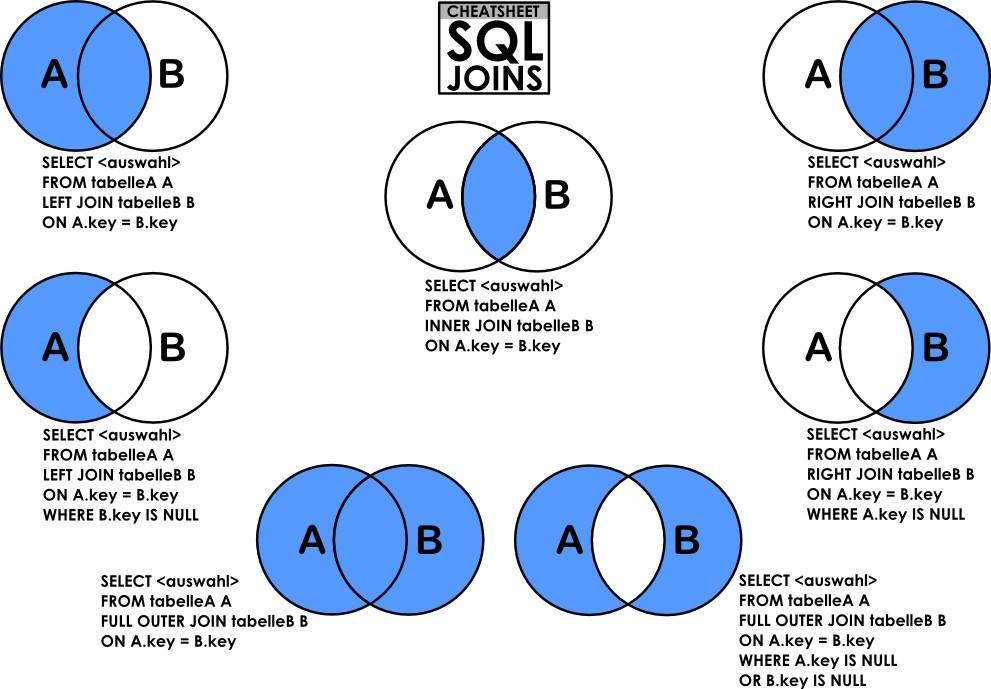

## MySQL 使用过程问题小结
### 查询命令样例
#### [insert into 插入若引起主键冲突则更新数据](https://blog.csdn.net/t894690230/article/details/77996355)
```sql
-- 1. 不存在则插入，存在则更新
-- 如果插入的数据会导致UNIQUE 索引或PRIMARY KEY发生冲突/重复，则执行UPDATE语句，例：
INSERT INTO `student`(`name`, `age`) VALUES('Jack', 19)
  ON DUPLICATE KEY 
  UPDATE `age`=19; -- If will happen conflict, the update statement is executed
-- 2 row(s) affected
-- 这里受影响的行数是2，因为数据库中存在name='Jack'的数据，如果不存在此条数据，则受影响的行数为1

-- 如果插入的数据会导致UNIQUE 索引或PRIMARY KEY发生冲突/重复，则先删除旧数据再插入最新的数据，例：
REPLACE INTO `student`(`name`, `age`) VALUES('Jack', 18);
-- 2 row(s) affected
-- 这里受影响的行数是2，因为数据库中存在name='Jack'的数据，并且id的值会变成2，因为它是先删除旧数据，然后再插入数据，最新的表数据如下：

-- 2. 避免重复插入
-- 关键字/句：insert ignore into，如果插入的数据会导致UNIQUE索引或PRIMARY KEY发生冲突/重复，则忽略此次操作/不插入数据，例：
INSERT IGNORE INTO `student`(`name`, `age`) VALUES('Jack', 18);
-- 0 row(s) affected
-- 这里已经存在name='Jack'的数据，所以会忽略掉新插入的数据，受影响行数为0，表数据不变。
```
#### 插入测试数据带中文字符需要设置编码格式
```sql
-- 以下为向MySQL数据表插入数据通用的 INSERT INTO SQL语法：
INSERT INTO table_name ( field1, field2,...fieldN )
                       VALUES
                       ( value1, value2,...valueN );
INSERT INTO dns_serverview VALUES (NULL, ' google-public-dns-a.google.com','8.8.8.8',NULL,'美国','Versign','CentOS7','BIND9','OPRDNS',500,3000,now());
-- Query OK, 1 row affected (0.02 sec)
--【这里有个问题，插入中文字符的时候，需要设置编码格式，MySQL默认】
```
#### MySQL 判断字段是否为 NULL
```sql
-- 查询 MySQL 数据库表中字段为 NULL 的记录:
SELECT * 表名 WHERE 字段名 IS NULL

-- 查询 MySQL 数据库表中字段不为 NULL 的记录:
SELECT * 表名 WHERE 字段名 IS NOT NULL
```
#### 视图转换成表
```sql
CREATE TABLE 表名 AS SELECT * FROM 视图名
SELECT * INTO 表名 FROM 视图名
```
#### [删除重复数据](https://www.runoob.com/mysql/mysql-handling-duplicates.html)
简单思路：先把不重复的数据查询出来，根据查询出来的数据建个备份表（同原表一模一样，只是表名不同），把这些不重复的数据插入进去，然后把原来表清空，再把这个表的数据插入到原来的表里。__【这样操作虽然麻烦，但是没有查询、更新、性能上的问题】__
```sql
CREATE TABLE tmp SELECT last_name, first_name, sex FROM person_tbl  GROUP BY (last_name, first_name, sex);
DROP TABLE person_tbl;
ALTER TABLE tmp RENAME TO person_tbl;

ALTER IGNORE TABLE person_tbl ADD PRIMARY KEY (last_name, first_name);
```
#### [分组排序topn：MySQL获取分组后的TOP 1和TOP N记录](https://www.cnblogs.com/prayer21/p/6029694.html)
这里说了4种方法：1好使但sql麻烦；2没试对不好使；3试了不好使；4语句麻烦；2自身左连接在表大的情况下，太慢了；3相关子查询，还是采用同样的每个数对比的方式，慢。

#### 求两个表交、并、差各种集合操作sql命令


[求两个表（查询结果）的差集](https://blog.csdn.net/yongh701/article/details/51689976)
```sql
select id FROM usertable LEFT JOIN
(select id as i from blog) as t1
ON usertable.id=t1.i where t1.i IS NULL
```
[求两表各种差、并集查询sql](https://blog.csdn.net/lb876864380/article/details/79560914)

#### 数据库字典表相关(重构需要)
[mysql查询结果替换](https://blog.csdn.net/litongzero/article/details/83579026)
```sql
SELECT id, (SELECT `index_name_cn` FROM `sys_dic` WHERE dic_code='sex ' AND code_index = t.`sex` LIMIT 1) AS  sex FROM user t 
```
#### 查询数据更新另一张表
[mysql查询出数据更新到另一张表](https://blog.csdn.net/qq_41070393/article/details/84067735)
```sql
UPDATE `table_a` r
INNER JOIN (SELECT id,sn,filed1 FROM `table_b`) t ON r.b_id= t.id
SET r.sn = t.sn,r.filed1 = t.filed1
```
#### 查看数据库版本
```sql
-- 方法一
[root@master ~]# mysql --version
mysql  Ver 14.14 Distrib 5.6.17, for Linux (x86_64) using  EditLine wrapper
-- 方法二
mysql> select version();
+-----------+
| version() |
+-----------+
| 5.6.17    |
+-----------+
1 row in set (0.01 sec)
-- 方法三
mysql> status
```
[查看mysql版本&端口号](https://blog.csdn.net/nemo2011/article/details/8990871/)：`show global variables like 'port';`
#### [根据查询结果建表](https://blog.csdn.net/u013803262/article/details/44783111)
```sql
create table 表名 (
  select sno , sname ,dept from s where s.sno in (select sno from sc where sc.grade >= 80)
);
```
### 出错解决方案
#### [解决mysql"Access denied for user'root'@'IP地址'"问题](https://www.cnblogs.com/charlesblc/p/5904522.html)
```sql
-- 查看 MySQL 数据库主机用户密码权限情况
select host, user, Password, grant_priv from mysql.user;
-- +-----------+--------+-------------------------------------------+------------+
-- | host      | user   | Password                                  | grant_priv |
-- +-----------+--------+-------------------------------------------+------------+
-- | localhost | root   | *FD571203974BA9AFE270FE62151AE967ECA5E0AA | Y          |
-- | master    | root   |                                           | Y          |
-- | 127.0.0.1 | root   | *FD571203974BA9AFE270FE62151AE967ECA5E0AA | Y          |
-- | ::1       | root   |                                           | Y          |
-- | localhost |        |                                           | N          |
-- | master    |        |                                           | N          |
-- | %         | lizhao | *6BB4837EB74329105EE4568DDA7DC67ED2CA2AD9 | N          |
-- | localhost | hive   | *4DF1D66463C18D44E3B001A8FB1BBFBEA13E27FC | N          |
-- | %         | hive   | *4DF1D66463C18D44E3B001A8FB1BBFBEA13E27FC | N          |
-- | %         | root   | *FD571203974BA9AFE270FE62151AE967ECA5E0AA | Y          |
-- +-----------+--------+-------------------------------------------+------------+
-- 10 rows in set (0.00 sec)
-- pymysql.err.OperationalError: (1045, "Access denied for user 'root'@'master' (using password: YES)")

-- 1. 首先用 python 脚本连接数据库的操作，被认为是 host 为 master 的操作
-- 2. 其次 host 为 master 和 user 为 root 对应是没有密码的，但用 python 连接时使用了密码

-- 果然，在 python 中注释掉密码后，连接数据库就 OK 了。
```
#### 数据库链接提前关闭导致后续插入出错
```python
# 运行 python 脚本遇到这个错误：
#     raise err.InterfaceError("(0, '')")
# pymysql.err.InterfaceError: (0, '')

# 2019-06-17 20:54:58，出现这个问题看一看是不是数据库链接提前关闭了，导致后续插入接口问题
```
#### [锁超时：MySQL 各种超时参数的含义](https://www.cnblogs.com/xiaoboluo768/p/6222862.html)
innodb_lock_wait_timeout 默认安装时值为50s，超过这个时间会报 ERROR 1205 (HY000): Lock wait timeout exceeded; try restarting transaction 错误。可以通过 `set innodb_lock_wait_timeout=XXX;` 修改参数值。对于这个参数，session和global级别并没有什么特别，session级别只对当前连接生效，global级别只对新的连接生效

【这个最后没有搞定，__如果50s还没有查出来的结果，600s也查不出来__，还是 __写的 sql 语句存在问题__，仔细检查sql语句，一种是语句中同时对一个表进行了查询和更新操作，相当于同时读写，虽然sql语法没有报错，但是会一直锁死，更新不了；一种是直接sql语法提示有问题，无法插入更新】

#### 查看数据库版本是否支持 partition 查找
```sql
        SELECT
        DISTINCT srv.srv_name AS srvname, ip.ip_longitude AS iplongitude, ip.ip_latitude AS iplatitude, srv.srv_ipv4 AS srvIpv4, srv.srv_ipv6 AS srvIpv6, srv.srv_ip_country AS srvipcountry, srv.srv_org_name AS srvorgname, srv.srv_os AS srvos, srv.srv_soft AS srvsoft, srv.srv_role AS srvrole, srv.srv_user_count AS srvusercount, srv.srv_fxcs AS srvfxcs, srv.stat_time AS stattime
        FROM 
          (SELECT *,ROW_NUMBER() over (PARTITION BY srv_role ORDER BY srv_user_count DESC) rn FROM dns_server_view
             WHERE srv_role='RDNS'
          ) srv
    JOIN dns_ip_view ip ON srv.srv_ipv4 = ip.ip OR srv.srv_ipv6 = ip.ip
    WHERE srv.rn <=30
    ORDER BY srv.srv_role, srv.rn

-- 1 queries executed, 0 success, 1 errors, 0 warnings

-- 查询：SELECT DISTINCT srv.srv_name AS srvname, ip.ip_longitude AS iplongitude, ip.ip_latitude AS iplatitude, srv.srv_ipv4 AS srvIpv4, ...

-- 错误代码： 1064
-- You have an error in your SQL syntax; check the manual that corresponds to your MySQL server version for the right syntax to use near '(PARTITION BY srv_role ORDER BY srv_user_count DESC) rn FROM dns_server_view
--    ' at line 4

-- 执行耗时   : 0 sec
-- 传送时间   : 0 sec
-- 总耗时      : 0.001 sec

```

1. [MySQL5.5不支持partition查找](https://blog.csdn.net/bit_sky/article/details/50144389)
2. [MySQL5.6支持分区partition，但采用 plugin 方式](https://blog.csdn.net/dongdong9223/article/details/72291698)
```sql
show variables like '%partition%';
Empty set (0.00 sec)
-- 如果没有看到变量：have_partition_engine 的值为YES，而是为empty，则说明当前mysql的版本就不支持分区。mysql从5.1开始支持分区功能。
-- 但是如果你使用mysql的5.6版本，同样会出现empty的结果。这又是怎么回事呢，难道mysql的5.6版本不支持分区了吗？不是的，5.6依然支持分区，只不过将上面的验证方式抛弃了，改用：
show plugins;
-- 检查里面 partition 状态
-- +----------------------------+----------+--------------------+---------+---------+
-- | Name                       | Status   | Type               | Library | License |
-- +----------------------------+----------+--------------------+---------+---------+
-- | binlog                     | ACTIVE   | STORAGE ENGINE     | NULL    | GPL     |
-- | mysql_native_password      | ACTIVE   | AUTHENTICATION     | NULL    | GPL     |
-- | mysql_old_password         | ACTIVE   | AUTHENTICATION     | NULL    | GPL     |
-- | sha256_password            | ACTIVE   | AUTHENTICATION     | NULL    | GPL     |
-- | MyISAM                     | ACTIVE   | STORAGE ENGINE     | NULL    | GPL     |
-- | MRG_MYISAM                 | ACTIVE   | STORAGE ENGINE     | NULL    | GPL     |
-- | MEMORY                     | ACTIVE   | STORAGE ENGINE     | NULL    | GPL     |
-- | CSV                        | ACTIVE   | STORAGE ENGINE     | NULL    | GPL     |
-- | PERFORMANCE_SCHEMA         | ACTIVE   | STORAGE ENGINE     | NULL    | GPL     |
-- | InnoDB                     | ACTIVE   | STORAGE ENGINE     | NULL    | GPL     |
-- | INNODB_TRX                 | ACTIVE   | INFORMATION SCHEMA | NULL    | GPL     |
-- | INNODB_LOCKS               | ACTIVE   | INFORMATION SCHEMA | NULL    | GPL     |
-- | INNODB_LOCK_WAITS          | ACTIVE   | INFORMATION SCHEMA | NULL    | GPL     |
-- | INNODB_CMP                 | ACTIVE   | INFORMATION SCHEMA | NULL    | GPL     |
-- | INNODB_CMP_RESET           | ACTIVE   | INFORMATION SCHEMA | NULL    | GPL     |
-- | INNODB_CMPMEM              | ACTIVE   | INFORMATION SCHEMA | NULL    | GPL     |
-- | INNODB_CMPMEM_RESET        | ACTIVE   | INFORMATION SCHEMA | NULL    | GPL     |
-- | INNODB_CMP_PER_INDEX       | ACTIVE   | INFORMATION SCHEMA | NULL    | GPL     |
-- | INNODB_CMP_PER_INDEX_RESET | ACTIVE   | INFORMATION SCHEMA | NULL    | GPL     |
-- | INNODB_BUFFER_PAGE         | ACTIVE   | INFORMATION SCHEMA | NULL    | GPL     |
-- | INNODB_BUFFER_PAGE_LRU     | ACTIVE   | INFORMATION SCHEMA | NULL    | GPL     |
-- | INNODB_BUFFER_POOL_STATS   | ACTIVE   | INFORMATION SCHEMA | NULL    | GPL     |
-- | INNODB_METRICS             | ACTIVE   | INFORMATION SCHEMA | NULL    | GPL     |
-- | INNODB_FT_DEFAULT_STOPWORD | ACTIVE   | INFORMATION SCHEMA | NULL    | GPL     |
-- | INNODB_FT_DELETED          | ACTIVE   | INFORMATION SCHEMA | NULL    | GPL     |
-- | INNODB_FT_BEING_DELETED    | ACTIVE   | INFORMATION SCHEMA | NULL    | GPL     |
-- | INNODB_FT_CONFIG           | ACTIVE   | INFORMATION SCHEMA | NULL    | GPL     |
-- | INNODB_FT_INDEX_CACHE      | ACTIVE   | INFORMATION SCHEMA | NULL    | GPL     |
-- | INNODB_FT_INDEX_TABLE      | ACTIVE   | INFORMATION SCHEMA | NULL    | GPL     |
-- | INNODB_SYS_TABLES          | ACTIVE   | INFORMATION SCHEMA | NULL    | GPL     |
-- | INNODB_SYS_TABLESTATS      | ACTIVE   | INFORMATION SCHEMA | NULL    | GPL     |
-- | INNODB_SYS_INDEXES         | ACTIVE   | INFORMATION SCHEMA | NULL    | GPL     |
-- | INNODB_SYS_COLUMNS         | ACTIVE   | INFORMATION SCHEMA | NULL    | GPL     |
-- | INNODB_SYS_FIELDS          | ACTIVE   | INFORMATION SCHEMA | NULL    | GPL     |
-- | INNODB_SYS_FOREIGN         | ACTIVE   | INFORMATION SCHEMA | NULL    | GPL     |
-- | INNODB_SYS_FOREIGN_COLS    | ACTIVE   | INFORMATION SCHEMA | NULL    | GPL     |
-- | INNODB_SYS_TABLESPACES     | ACTIVE   | INFORMATION SCHEMA | NULL    | GPL     |
-- | INNODB_SYS_DATAFILES       | ACTIVE   | INFORMATION SCHEMA | NULL    | GPL     |
-- | BLACKHOLE                  | ACTIVE   | STORAGE ENGINE     | NULL    | GPL     |
-- | FEDERATED                  | DISABLED | STORAGE ENGINE     | NULL    | GPL     |
-- | ARCHIVE                    | ACTIVE   | STORAGE ENGINE     | NULL    | GPL     |
-- | partition                  | ACTIVE   | STORAGE ENGINE     | NULL    | GPL     |
-- +----------------------------+----------+--------------------+---------+---------+
-- 42 rows in set (0.02 sec)
```

#### 数据库密码重置
[Linux下MySQL忘记root密码的完美解决方法](https://www.linuxidc.com/Linux/2018-05/152586.htm)
```sql
-- 一、更改my.cnf配置文件
-- 0、MySQL 版本查看
mysql --version
-- 1、用命令编辑/etc/my.cnf配置文件，即：vim /etc/my.cnf 或者 vi /etc/my.cnf 或者 nano /etc/my.cnf
-- 2.在[mysqld]下添加skip-grant-tables，然后保存并退出
-- 3.重启mysql服务：service mysqld restart

-- 二、更改root用户名
-- 1、重启以后，执行mysql命令进入mysql命令行
-- 2、修改root用户密码
MySQL> UPDATE mysql.user SET Password=PASSWORD('新密码') where USER='root';
MySQL> flush privileges;
MySQL> exit
-- 3、最后把/etc/my.cnf中的skip-grant-tables注释掉，然后重启mysql，即：service mysqld restart
-- OK，下面我们就可以使用root新的密码登录MySQL了。

mysql -u root -p
```
1. [重启服务出现问题：Redirecting to /bin/systemctl restart mysql.service](https://blog.csdn.net/crazyboy12138/article/details/80106481)：先 `ps -ef|grep mysql` 找到 mysqld 的线程号 ，再 `kill -s 9 xxx` 杀了后，再 `systemctl start mysqld.service &` ，之前没加 & 半天没反应，后来再看 ps 才发现启动好了。
```bash
# 使用如下命令重启、启动、停止 mysql 服务：
systemctl restart mysqld.service
systemctl start mysqld.service
systemctl stop mysqld.service
```

2. [修改密码出现问题：Mysql5.7.18.1修改用户密码报错ERROR 1054 (42S22): Unknown Column 'Password' In 'Field List'解决办法](https://www.cnblogs.com/wangbaobao/p/7087032.html)：错误的原因是 5.7版本下的mysql数据库下已经没有password这个字段了，password字段改成了authentication_string
```sql
mysql -u root -p
Enter password: ********
Welcome to the MySQL monitor.  Commands end with ; or \g.
Your MySQL connection id is 12
Server version: 5.7.18-log MySQL Community Server (GPL)

Copyright (c) 2000, 2017, Oracle and/or its affiliates. All rights reserved.

Oracle is a registered trademark of Oracle Corporation and/or its
affiliates. Other names may be trademarks of their respective
owners.

Type 'help;' or '\h' for help. Type '\c' to clear the current input statement.

mysql> use mysql;
Database changed
mysql> select User from user;  #此处为查询用户命令
+-----------+
| User      |
+-----------+
| *******  |
| mysql.sys |
| root      |
+-----------+
3 rows in set (0.00 sec)

mysql> update user set password=password("*******") where user="*******";  #【修改密码报错】
ERROR 1054 (42S22): Unknown column 'password' in 'field list'
mysql> update mysql.user set authentication_string=password('*******') where user='*******';  #修改密码成功
Query OK, 1 row affected, 1 warning (0.00 sec)
Rows matched: 1  Changed: 1  Warnings: 1

mysql> flush privileges;  #立即生效
Query OK, 0 rows affected (0.00 sec)

mysql> quit
Bye

n>mysql -u ******* -p #以该用户登录成功.
Enter password: ********
…………………………
mysql>
```

#### 数据库拒绝sqlyog远程连接问题
[Host is not allowed to connect to this MySQL server解决方法](https://blog.csdn.net/bingjianit/article/details/54384299)：其实是MySQL不允许远程登录，所以远程登录失败了，解决方法如下：

1. 在装有MySQL的机器上登录MySQL mysql -u root -p密码
2. 执行use mysql;
3. 执行update user set host = '%' where user = 'root';这一句执行完可能会报错，不用管它。
4. 执行FLUSH PRIVILEGES;

经过上面4步，可以解决。注: 第四步是刷新MySQL的权限相关表，一定不要忘了，我第一次的时候没有执行第四步，结果一直不成功，最后才找到这个原因。

### 参考资料
1. [一千行 MySQL 学习笔记](https://shockerli.net/post/1000-line-mysql-note/)：总结得很不错，推荐。
2. [关于MySQL的lock wait timeout exceeded解决方案](https://segmentfault.com/a/1190000015314171)：这里说了几种方法可以排查出现锁超时的原因，mark了，没试。
