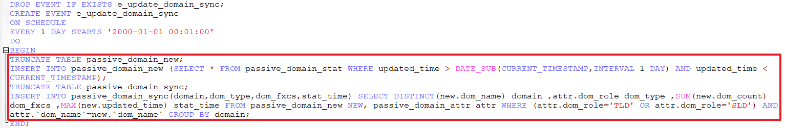

## MySQL 使用过程问题小结-3
### 基本概念释疑
#### 主键、外键、索引
| 项 |                        定义                        |          作用          |          个数          |
|------|------------------------------------------------------|--------------------------|--------------------------|
| 主键 | 唯一标识一条记录，不能有重复的，不允许为空           | 用来保证数据完整性       | 主键只能有一个           |
| 外键 | 表的外键是另一表的主键, 外键可以有重复的, 可以是空值 | 用来和其他表建立联系用的 | 一个表可以有多个外键     |
| 索引 | 该字段没有重复值，但可以有一个空值                   | 是提高查询排序的速度     | 一个表可以有多个惟一索引 |

### 查询命令样例
#### [查看数据库中存储过程、函数、视图、触发器](https://www.cnblogs.com/zejin2008/p/7686585.html)
```sql
-- 查询数据库中的存储过程和函数
select `name` from mysql.proc where db = 'xx' and `type` = 'procedure'   -- 存储过程
select `name` from mysql.proc where db = 'xx' and `type` = 'function'   -- 函数
show procedure status; -- 存储过程
show function status;     -- 函数
-- 查看存储过程或函数的创建代码
show create procedure proc_name;
show create function func_name;
-- 查看视图
select * from information_schema.views   -- 视图
select * from information_schema.tables   -- 表
-- 查看触发器
show triggers [from db_name] [like expr]
select * from triggers t where trigger_name="mytrigger"
```
#### [查看表结构、字段等信息](https://blog.csdn.net/sc_lilei/article/details/78391801)
```sql
-- 查看库结构：
show databases; -- 查看有哪些数据库
use database_name; -- 进入数据库
create database_name; -- 创建数据库
show tables; -- 查看某个数据库内有哪些表

-- 查看表结构：
desc table_name; -- 查看表字段信息（不包含字段内容）
show columns from table_name;   -- 同上
show create table table_name;  -- 查看表字段信息和字符集信息
select * from table_name;  -- 查看表所有内容
select * from table_name where id=?;  -- 查看表指定行
select field_name from table_name; -- 查看表指定列，field意为字段
select * from table_name where field_name like "%???%";  -- 根据字段内容的近似值查找指定行
select field_name1,field_name2 from table_name; -- 查看表指定字段的多个列
update table_name set field_name="abc" where id=?;  --  修改指定字段的内容

-- 增加列：
alter table table_name add field_name int;
alter table table_name add(name1 int,name2 int);
```
#### 日期、时间增减转换等相关操作
- 【精】[mysql 日期操作 增减天数、时间转换、时间戳](https://www.cnblogs.com/wenzichiqingwa/archive/2013/03/05/2944485.html)
- [timestampdiff：MySql计算两日期时间之间相差的天数,秒数,分钟数,周数,小时数](https://blog.csdn.net/mjshldcsd/article/details/78295270)
- [DATE_SUB 函数](https://www.w3cschool.cn/mysql/func-date-sub.html)：w3school的小册子，可供检索


```sql
-- 日期时间获取函数
select now(); -- 获取当前日期和时间 2008-08-08 22:20:46
select curdate(); -- 获取当前日期 2008-08-08
select curtime(); -- 获取当前时间 22:41:30 
select utc_timestamp(), utc_date(), utc_time(), now() -- 获取当前 UTC 日期时间 | 2008-08-08 14:47:11 | 2008-08-08 | 14:47:11   | 2008-08-08 22:47:11 | 。我国位于东八时区，所以本地时间 = UTC 时间 + 8 小时。UTC 时间在业务涉及多个国家和地区的时候，非常有用。

-- 日期时间选择/提取函数
-- 选取日期时间的各个部分：日期、时间、年、季度、月、日、小时、分钟、秒、微秒
set @dt = '2008-09-10 07:15:30.123456';
select date(@dt);        -- 2008-09-10
select time(@dt);        -- 07:15:30.123456
select year(@dt);        -- 2008
select quarter(@dt);     -- 3
select month(@dt);       -- 9
select week(@dt);        -- 36
select day(@dt);         -- 10
select hour(@dt);        -- 7
select minute(@dt);      -- 15
select second(@dt);      -- 30
select microsecond(@dt); -- 123456
select extract(year from @dt); -- 2008
select extract(quarter from @dt); -- 3
select extract(month from @dt); -- 9
select extract(week from @dt); -- 36
select extract(day from @dt); -- 10
select extract(hour from @dt); -- 7
select extract(minute from @dt); -- 15
select extract(second from @dt); -- 30
select extract(microsecond from @dt); -- 123456
--  Extract() 函数除了没有date(),time() 的功能外，其他功能一应具全。并且还具有选取‘day_microsecond’ 等功能
select extract(year_month from @dt); -- 200809
select extract(day_hour from @dt); -- 1007
select extract(day_minute from @dt); -- 100715
select extract(day_second from @dt); -- 10071530
select extract(day_microsecond from @dt); -- 10071530123456
select extract(hour_minute from @dt); --    715
select extract(hour_second from @dt); --    71530
select extract(hour_microsecond from @dt); --    71530123456
select extract(minute_second from @dt); --      1530
select extract(minute_microsecond from @dt); --      1530123456
select extract(second_microsecond from @dt); --        30123456
-- 返回日期参数，在一周、一月、一年中的第几天
set @dt = '2008-08-08';
select dayofweek(@dt);   -- 6
select dayofmonth(@dt);  -- 8
select dayofyear(@dt);   -- 221
-- 日期 '2008-08-08' 是一周中的第 6 天（1 = Sunday, 2 = Monday, ..., 7 = Saturday）；一月中的第 8 天；一年中的第 221 天。
-- 返回日期参数，在一年中的第几周，在一周中的第几天
set @dt = '2008-08-08';
-- 计算“某天”是位于一年中的第几周
select week(@dt);        -- 31
select week(@dt,3);      -- 32 -- MySQL week() 函数，可以有两个参数，具体含义见手册
select weekofyear(@dt);  -- 32 -- weekofyear(@dt) 等价于 week(@dt,3)
-- 返回“某天”在一周中的位置
select dayofweek(@dt);   -- 6 -- 第一天是星期一 (0 = Monday, 1 = Tuesday, ..., 6 = Sunday)
select weekday(@dt);     -- 4 -- 第一天是星期天 (1 = Sunday, 2 = Monday, ..., 7 = Saturday)
select yearweek(@dt);    -- 200831 MySQL yearweek() 返回 year(2008) + week 位置(31)。
-- 返回星期和月份名称函数
set @dt = '2008-08-08';
select dayname(@dt);     -- Friday
select monthname(@dt);   -- August
-- 返回月份中的最后一天
select last_day('2008-02-01');  -- 2008-02-29
-- 计算当前月份中有多少天
select now(), day(last_day(now())) as days; -- | 2008-08-09 11:45:45 |   31 |

-- 日期时间计算函数
-- 为日期增加一个时间间隔：date_add()
-- 为日期减少一个时间间隔：date_sub() 用法类似
set @dt = now();
select date_add(@dt, interval 1 day);        -- add 1 day
select date_add(@dt, interval 1 hour);       -- add 1 hour
select date_add(@dt, interval 1 minute);     -- ...
select date_add(@dt, interval 1 second);
select date_add(@dt, interval 1 microsecond);
select date_add(@dt, interval 1 week);
select date_add(@dt, interval 1 month);
select date_add(@dt, interval 1 quarter);
select date_add(@dt, interval 1 year);
select date_add(@dt, interval -1 day);       -- sub 1 day
--  datediff(date1,date2)：两个日期相减 date1 - date2，返回天数
select datediff('2008-08-08', '2008-08-01');  -- 7
select datediff('2008-08-01', '2008-08-08');  -- -7
-- timediff(time1,time2)：两个日期相减 time1 - time2，返回 time 差值；timediff(time1,time2) 函数的两个参数类型必须相同
select timediff('2008-08-08 08:08:08', '2008-08-08 00:00:00'); -- 08:08:08
select timediff('08:08:08', '00:00:00'); -- 08:08:08

-- 日期、时间转换函数
-- （时间、秒）转换函数：time_to_sec(time), sec_to_time(seconds)
select time_to_sec('01:00:05');  -- 3605
select sec_to_time(3605);        -- '01:00:05'
-- 日期、天数）转换函数：to_days(date), from_days(days)
select to_days('0000-00-00');  -- 0
select to_days('2008-08-08');  -- 733627
select from_days(0);           -- '0000-00-00'
select from_days(733627);      -- '2008-08-08'
-- Str to Date （字符串转换为日期）函数：str_to_date(str, format) 可以把一些杂乱无章的字符串转换为日期格式。另外，它也可以转换为时间。“format” 可以参看 MySQL 手册。
select str_to_date('08/09/2008', '%m/%d/%Y'); -- 2008-08-09
select str_to_date('08/09/08'  , '%m/%d/%y'); -- 2008-08-09
select str_to_date('08.09.2008', '%m.%d.%Y'); -- 2008-08-09
select str_to_date('08:09:30', '%h:%i:%s');   -- 08:09:30
select str_to_date('08.09.2008 08:09:30', '%m.%d.%Y %h:%i:%s'); -- 2008-08-09 08:09:30
-- Date/Time to Str（日期/时间转换为字符串）函数：date_format(date,format), time_format(time,format) 把一个日期/时间转换成各种各样的字符串格式。它是 str_to_date(str,format) 函数的 一个逆转换。
select date_format('2008-08-08 22:23:00', '%W %M %Y'); -- Friday August 2008
select date_format('2008-08-08 22:23:01', '%Y%m%d%H%i%s'); -- 20080808222301
select time_format('22:23:01', '%H.%i.%s'); -- 22.23.01
-- 拼凑日期、时间函数：makdedate(year,dayofyear), maketime(hour,minute,second)
select makedate(2001,31);   -- '2001-01-31'
select makedate(2001,32);   -- '2001-02-01'
select maketime(12,15,30);  -- '12:15:30'

-- 时间戳函数
-- 获得当前时间戳函数：current_timestamp, current_timestamp()
select current_timestamp, current_timestamp(); -- | 2008-08-09 23:22:24 | 2008-08-09 23:22:24 |
-- （Unix 时间戳、日期）转换函数：
select unix_timestamp(); -- 1218290027
select unix_timestamp('2008-08-08'); -- 1218124800
select unix_timestamp('2008-08-08 12:30:00');  -- 1218169800
select from_unixtime(1218290027); -- '2008-08-09 21:53:47'
select from_unixtime(1218124800); -- '2008-08-08 00:00:00'
select from_unixtime(1218169800); -- '2008-08-08 12:30:00'
select from_unixtime(1218169800, '%Y %D %M %h:%i:%s %x'); -- '2008 8th August 12:30:00 2008'
-- 时间戳（timestamp）转换、增、减函数：
-- timestamp(date)                                     -- date to timestamp
-- timestamp(dt,time)                                  -- dt + time
-- timestampadd(unit,interval,datetime_expr)           -- MySQL timestampadd() 函数类似于 date_add()。
-- timestampdiff(unit,datetime_expr1,datetime_expr2)   -- MySQL timestampdiff() 函数就比 datediff() 功能强多了，datediff() 只能计算两个日期（date）之间相差的天数。
select timestamp('2008-08-08');                         -- 2008-08-08 00:00:00
select timestamp('2008-08-08 08:00:00', '01:01:01');    -- 2008-08-08 09:01:01
select timestamp('2008-08-08 08:00:00', '10 01:01:01'); -- 2008-08-18 09:01:01
select timestampadd(day, 1, '2008-08-08 08:00:00');     -- 2008-08-09 08:00:00
select date_add('2008-08-08 08:00:00', interval 1 day); -- 2008-08-09 08:00:00
select timestampdiff(year,'2002-05-01','2001-01-01');                    -- -1
select timestampdiff(day ,'2002-05-01','2001-01-01');                    -- -485
select timestampdiff(hour,'2008-08-08 12:00:00','2008-08-08 00:00:00');  -- -12
select datediff('2008-08-08 12:00:00', '2008-08-01 00:00:00');           -- 7

-- 时区（timezone）转换函数 convert_tz(dt,from_tz,to_tz)
select convert_tz('2008-08-08 12:00:00', '+08:00', '+00:00'); -- 2008-08-08 04:00:00
-- 时区转换也可以通过 date_add, date_sub, timestampadd 来实现。
select date_add('2008-08-08 12:00:00', interval -8 hour);  -- 2008-08-08 04:00:00
select date_sub('2008-08-08 12:00:00', interval  8 hour);  -- 2008-08-08 04:00:00
select timestampadd(hour, -8, '2008-08-08 12:00:00');      -- 2008-08-08 04:00:00
```
#### 设置数据库表event事件定期删除数据
- [mysql开启定时任务：临时开启or永久开启](https://blog.csdn.net/linybo/article/details/39002055)
- [修改mysql配置，默认打开事件](https://www.cnblogs.com/gaogaoxingxing/p/9909970.html)
- [MySQL定时任务删除数据](https://blog.csdn.net/Leytton/article/details/52643875)



```sql
-- 查看事件是否开启：如果看到event_scheduler为on或者PROCESSLIST中显示有event_scheduler的信息说明就已经开启了事件。如果显示为off或者在PROCESSLIST中查看不到event_scheduler的信息，那么就说明事件没有开启，我们需要开启它。
show variables like 'event%'; -- 查看事件相关字段
select @@event_scheduler; -- 查看变量 event_scheduler
show processlist; -- 查看进程信息
show event; -- 查看已有定时事件
-- 临时开启：mysql 服务重启后无效
set global event_scheduler = on;
set @@global.event_scheduler =on;
set global event_scheduler = 1; -- 0代表关闭 
set @@global.event_scheduler = 1;
-- 永久开启：在my.cnf中的[mysqld]部分添加如下内容，然后重启mysql
event_scheduler=ON
service mysqld restart -- mysql 重启命令
-- 编译时开启：
mysqld … –event_scheduler=ON

-- 定时事件样例：通常的应用场景是通过事件来定期的调用存储过程，也可以直接在事件体（begin和end之间）写
-- 每隔一秒自动调用e_test()存储过程
CREATE EVENT IF NOT EXISTS event_test
ON SCHEDULE EVERY 1 SECOND
ON COMPLETION PRESERVE 
DO CALL e_test();
-- 开启事件
ALTER EVENT event_test ON 
COMPLETION PRESERVE ENABLE; 
-- 关闭事件
ALTER EVENT event_test ON 
COMPLETION PRESERVE DISABLE;
-- 从现在开始每隔九天定时执行 
CREATE EVENT EVENT1 
ON SCHEDULE EVERY 9 DAY STARTS NOW() 
ON COMPLETION PRESERVE ENABLE 
DO 
BEGIN 
CALL TOTAL(); 
END 
-- 每个月的一号凌晨1 点执行 
CREATE EVENT EVENT2 
ON SCHEDULE EVERY 1 MONTH STARTS DATE_ADD(DATE_ADD(DATE_SUB(CURDATE(),INTERVAL DAY(CURDATE())-1 DAY), INTERVAL 1 MONTH),INTERVAL 1 HOUR) 
ON COMPLETION PRESERVE ENABLE 
DO 
BEGIN 
CALL STAT(); 
END 
-- 每个季度一号的凌晨2点执行 
CREATE EVENT TOTAL_SEASON_EVENT 
ON SCHEDULE EVERY 1 QUARTER STARTS DATE_ADD(DATE_ADD(DATE( CONCAT(YEAR(CURDATE()),'-',ELT(QUARTER(CURDATE()),1,4,7,10),'-',1)),INTERVAL 1 QUARTER),INTERVAL 2 HOUR) 
ON COMPLETION PRESERVE ENABLE 
DO 
BEGIN 
CALL SEASON_STAT(); 
END 
-- 每年1月1号凌晨四点执行 
CREATE EVENT TOTAL_YEAR_EVENT 
ON SCHEDULE EVERY 1 YEAR STARTS DATE_ADD(DATE(CONCAT(YEAR(CURDATE()) + 1,'-',1,'-',1)),INTERVAL 4 HOUR) 
ON COMPLETION PRESERVE ENABLE 
DO 
BEGIN 
CALL YEAR_STAT(); 
END
```
### 出错解决方案
#### 组合主键由于其中某个字段可以为NULL导致插入重复的问题
insert ignore into 的时候，如果是组合主键，建议组合主键需要全部都默认非NULL，这样才能真正忽视掉，而如果是主键有NULL的情况，这样会导致插入单独一列字段时，重复插入，因为另一个主键为NULL，不在insert ignore into 的 ignore 的列表里。简单的说就是 __mysql 不会对 存在 NULL 的字段的组合主键进行去重__ 。
#### mysqldump 直接运行可以到处文件，但若是通过sh脚本间接调用则导出文件为空的问题
[mysqldump需要全路径，或者需要把mysqldump加到某个系统变量之类的里面](https://blog.csdn.net/sanyuesan0000/article/details/52690492)

#### [MAX()函数作用于字符型字段的比较原理](https://blog.csdn.net/qqxyy99/article/details/79980005)
使用MAX()查询一个字符串类型的字段，进行字符串大小比较时，字符串类型大小比较是先比较首字符的ASCII码的大小，然后依次往后进行比较的。
#### mysql 跨服务器定时增量同步的问题
##### 存在问题
1. 跨服务器同步方式：有哪些方式，可以用于华严环境，具有可行性
2. 是否可以增量同步？
3. 是否可以自动定时同步？

##### 调研的解决方案
1. __直接采用 FEDERATED 存储引擎进行跨服务器查询__，本地只存储表的结构信息，数据都存放在远程数据库上，查询时通过建表时指定的连接符去获取远程库的数据返回到本地：[FEDERATED 存储引擎描述](https://www.cnblogs.com/zhenxing/p/5336624.html) 写的很详细，也有例子，特别是注意事项：
    1. FEDERATED 表可能会被复制到其他的slave数据库,你需要确保slave服务器也能够使用定义在connection中或mysql.servers表中的link的用户名/密码 连接上远程服务器。
    2. 远程服务器必须是MySQL数据库
    3. 在访问FEDERATED表中定义的远程数据库的表前,远程数据库中必须存在这张表。
    4. FEDERATED 表不支持通常意义的索引,服务器从远程库获取所有的行然后在本地进行过滤,不管是否加了where条件或limit限制。查询可能造成性能下降和网络负载,因为查询返回的数据必须存放在内存中,所以容易造成使用系统的swap分区或挂起。——__【这一条非常的不友好，本来以为可以减少同步带来的开销，结果并没有，这相当于是每次查询都进行了一次同步，虽然不占用物理硬盘，但是每次查询的时候都占用了系统内存。】__
    5. FEDERATED表不支持字段的前缀索引
    6. FEDERATED表不支持ALTER TABLE语句或者任何DDL语句
    7. FEDERATED表不支持事务
    8. 本地FEDERATED表无法知道远程库中表结构的改变
    9. 任何drop语句都只是对本地库的操作,不对远程库有影响
2. [利用mysqldump以及linux命令进行定时增量同步__【最后采用的方法】__](https://www.cnblogs.com/ityouknow/p/5923489.html)：此方案完全和mysql的机制无关，而是全程利用 linux 命令工具搞定；先通过 mysqldump 把 mysql 数据库进行备份压缩成 gz 文件，利用 crontab 进行 linux 定时备份的操作，利用 rsync 快速增量备份工具进行同步到其他服务器上， 而 inotify 用来监控文件系统下文件的各种变化；整体一套流程，定期备份，监控文件变化，进行服务器间同步。
    1. mysqldump 导出想要同步的库表及其数据
    2. gzip 压缩成小文件
    3. rsync 进行跨服务器同步（拷贝远程文件到本地or本地文件到远程）【实际中考虑到数据量的问题，并没有实现增量同步，而是直接查询同步定量数据，即只同步统计结果or最近一次的结果，把界面显示需要查询的数据进行同步，其他历史数据不进行同步。】
    4. crontab 设定上述命令定时执行

##### 其他参考资料
1. [mysql利用 FEDERATED 实现跨服务器查询数据](https://blog.csdn.net/banjw_129/article/details/83445849)：提供了另一种解决方案，直接跨服务器进行数据查询，不用导入导出进行备份
2. [MySQL数据库跨服务器数据同步](https://www.jianshu.com/p/6d2e6c28662e)：这个也是利用 mysql FEDERATED 引擎（在mysql5.0版本以上），为远端数据库建立本地映射表，相当于建立了一个客户端，可以直接进行curd操作到远端的数据库中。
3. [跨服务器导出导入数据](https://www.cnblogs.com/chenmh/p/5300370.html)：`mysqldump --host=h1 -uroot -proot --databases db1 |mysql --host=h2 -uroot -proot db2` 将h1服务器中的db1数据库的所有数据导入到h2中的db2数据库中，db2的数据库必须存在否则会报错
4. [mysqldump导出数据](https://www.jianshu.com/p/c3d8366326c1)：【精】参数非常详尽细致，解释清晰，很有用
5. [mysqldump常用参数](https://www.jianshu.com/p/18db0fbb02b8)：参数也还行
6. [mysqldump介绍，利用MySQL全备份（mysqldump），如何只恢复一个库或者一个表？](http://blog.itpub.net/26736162/viewspace-2641620/)：非常详尽，且有例子
7. [MySQL mysqldump数据导出详解](https://www.cnblogs.com/chenmh/p/5300370.html)：也有例子，不错
8. [MYSQL使用mysqldump导出某个表的部分数据](https://blog.csdn.net/xin_yu_xin/article/details/7574662)：mysqldump命令中带有一个 --where/-w 参数，它用来设定数据导出的条件，使用方式和SQL查询命令中中的where基本上相同，有了它，我们就可以从数据库中导出你需要的那部分数据了。命令格式如下：`mysqldump -u用户名 -p密码 数据库名 表名 --where="筛选条件" > 导出文件路径` 从meteo数据库的sdata表中导出sensorid=11 且 fieldid=0的数据到 /home/xyx/Temp.sql 这个文件中 `mysqldump -uroot -p123456 meteo sdata --where=" sensorid=11 and fieldid=0" > /home/xyx/Temp.sql`
9. [linux下mysql数据的导出和导入](https://www.cnblogs.com/hurry-up/p/6829694.html)：只导出某一个表。
10. [mysqldump两种导出命令](https://blog.csdn.net/TAB_YLS/article/details/80031491)：这里提供了两种命令，第一个效率高但是必须两个服务器具有完全一致的库表，每次导入只能导入全部的字段，如果能够保证目标库中所有的数据都只从源表中得到，可以解决这种问题；第二个其实同上面的链接思路，先到处sql文件后再通过网络传输再进行导入，这样可以导出指定的字段，只是操作稍微复杂效率较低（不过如果写shell脚本应该也就还好）；另外这里提供的2个思路，都无法做到自动增量同步，而是需要自己进行设定 where 的取值范围
