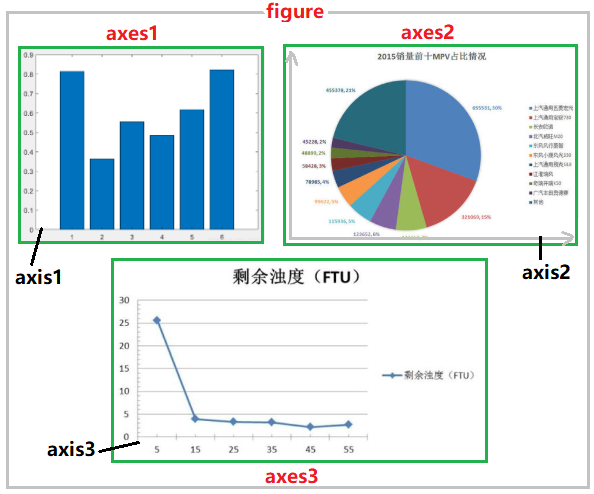
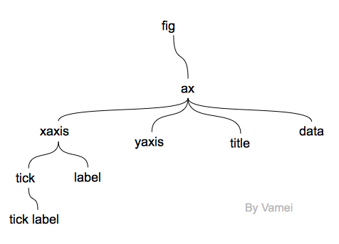
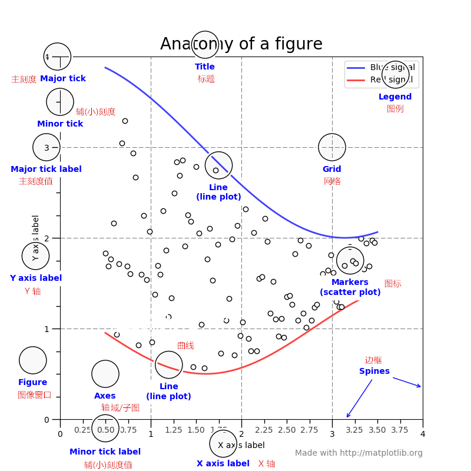
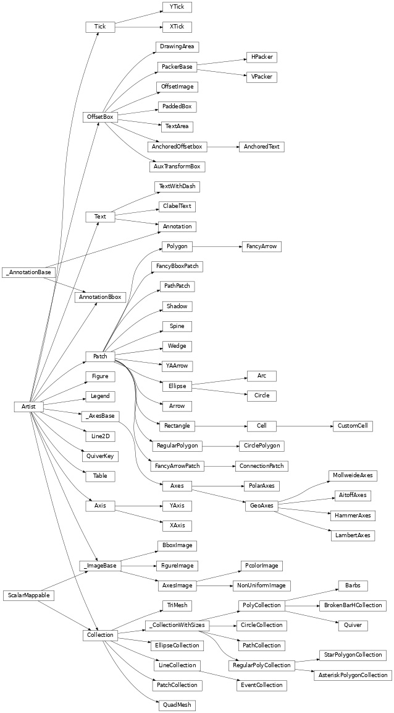
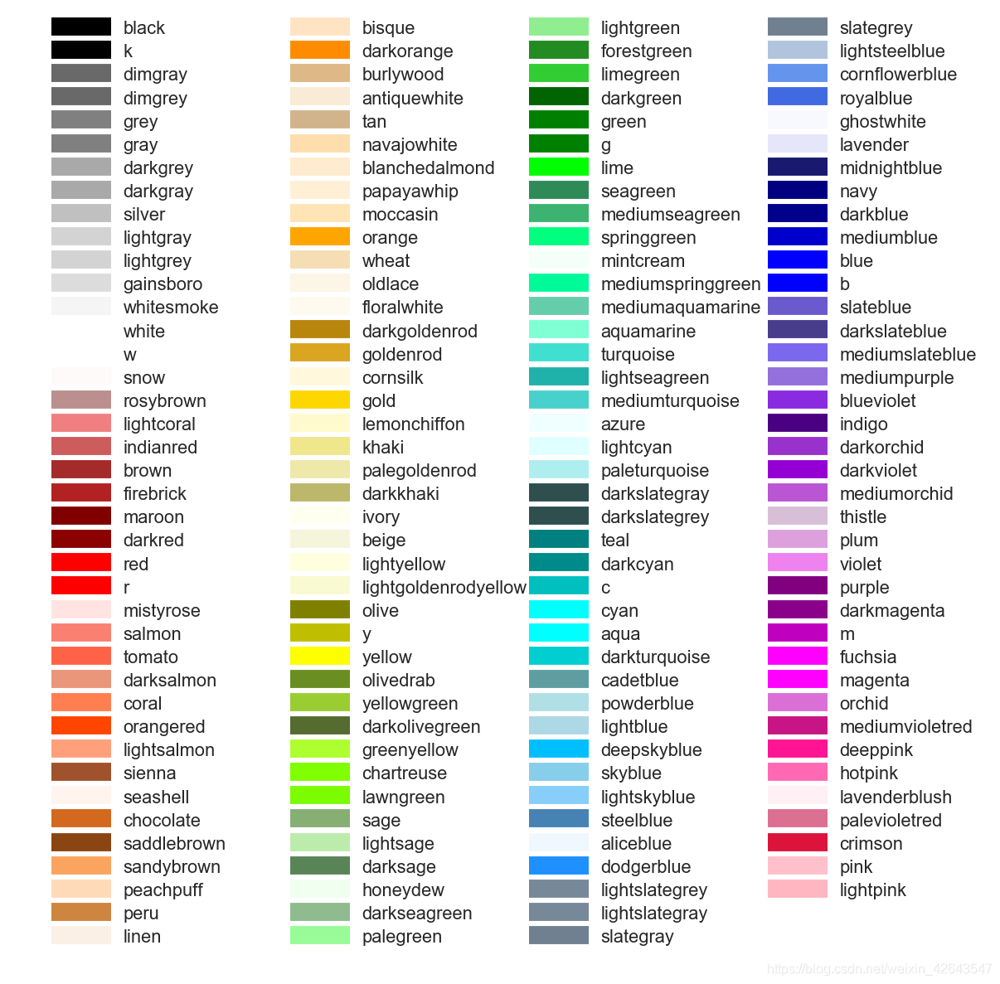
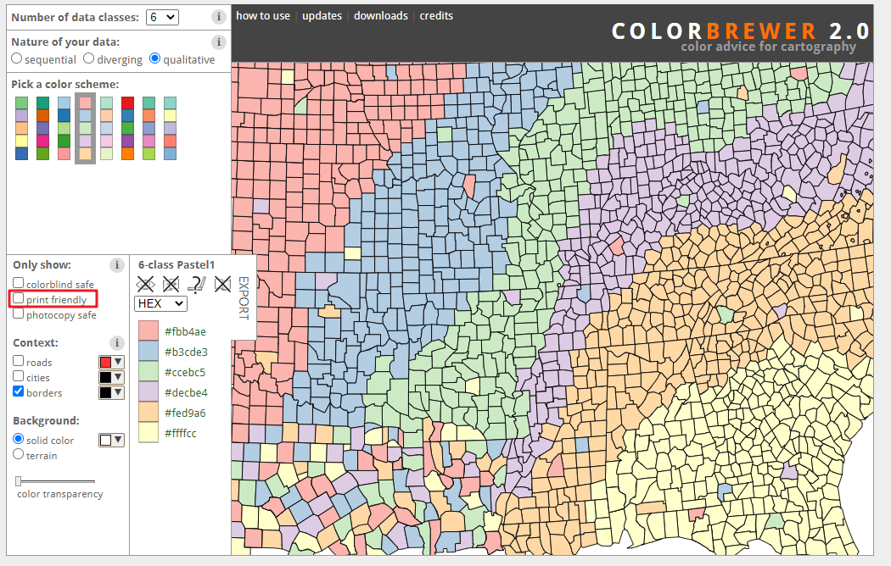

# Python 作图过程问题小结-1
## 宏观作图思想
1. 首先做到准确高效的传达信息，以此为前提下再力求美观
2. 折线图、柱状图等的基线最好要从零开始
3. 尽量使用常见的、可读性强的字体，最好不要使用艺术字
4. 通常来讲，柱状图的间隔应为柱状图宽度的1/2，间距不能过小或过大
5. 饼图的分类要适中，分类数不宜过多，过多分类无法聚焦
6. 一副图中，不同颜色种类不宜过多
7. 考虑打印出来之后的效果进行作图，当颜色信息消失，只剩黑灰白的时候，是否还能够准确识别信息。

参考：[专题第18篇：Python 绘图入门](https://mp.weixin.qq.com/s?__biz=MzI3NTkyMjA4NA==&mid=2247497802&idx=1&sn=c6415b40546ca3f1a5ccbe94035cbd35&chksm=eb7fd581dc085c97143b80c73a7672b99881dc5c27e9a524a75c46b17917e632670f4b3eda76&mpshare=1&scene=24&srcid=1109jOTrf38L0fhxeWVodJ0B&sharer_sharetime=1604881782403&sharer_shareid=5b9bdd8cc7c063922f0b84441b8cdc3e&key=d3655e169ae94d6b57378c3f1de2f07104e584ab904661f94c71388d630e7caa3d142636f2d7a66ae7a9a60ba9e86a5e33757478fe218a47e8101570f1875edd289c935f2b5fa3ad44967c9da7cf1907a1bd64bb928b581b94b2a28329fc56f2acd661ed294a16af9cd22d1d2d5370a9f8e523bf2240374cd511069b4cef725b&ascene=14&uin=NzM5MTc3ODA5&devicetype=Windows+10+x64&version=6300002f&lang=zh_CN&exportkey=A7bfL6cYVfoaLIowZKKFCaU%3D&pass_ticket=hbHljTQ6mdy4rAgjZMz%2F9ZCrqGW%2FUKtbJTAOUXXVeIjh5QwK7p0PeJManaWWMGeM&wx_header=0)

## Matplotlib 作图原理
Python是一种高级编程语言，在Python中，一切皆为对象。因此Matplotlib继承了这一特点。画图的过程，提倡使用面向对象的写法。

- figure(画布)：
    + 隐式创建：当第一次执行plt.xxx()这句绘图代码时，系统会去判断是否已经有了figure对象，如果没有，系统会自动创建一个figure对象，并且在这个figure之上，自动创建一个axes坐标系(注意：默认创建一个figure对象，一个axes坐标系)。也就是说，如果我们不设置figure对象，那么一个figure对象上，只能有一个axes坐标系，即我们只能绘制一个图形。
    + 显示创建：`figure = plt.figure()`
- axes(坐标系)：子图对象。可以这样理解，每一个子图都有x和y轴，axes则用于代表这两个数据轴所对应的一个子图对象。
- axis(坐标轴)：Axis是数据轴对象，主要用于控制数据轴上刻度位置和显示数值。Axis有Locator和Formatter两个子对象，分别用于控制刻度位置和显示数值。
- Artist：基本上所有的对象都是一个Artist对象，包括Figure对象、Axes对象和Axis对象，可以将Artist理解为一个基本类。当提交代码，图像最终呈现时，所有的artist对象都会绘制于canvas画布上




### 作图基本步骤
1. 产生一幅图：`fig=figure()`
2. 建立坐标系：`ax=fig.add_axes()`
3. 画图：`ax.plot()`
4. 显示：`show()`

```python
# 1. 导库
import matplotlib as mpl
import matplotlib.pyplot as plt
# 2. 创建 figure 画布对象：手动创建一个figure对象
figure = plt.figure()
# 3. 根据 figure 对象进行布局设置：1*1、1*2、2*1、2*2……
# 4. 获取对应位置的 axes 坐标系对象
axes1 = figure.add_subplot(2,1,1)
axes2 = figure.add_subplot(2,1,2)
# 5. 调用axes对象，进行对应位置的图形绘制：在不同位置进行作图，是传入数据、进行绘图的一步。对于图形的一些细节设置，都可以在这一步进行。
axes1.plot([1,3,5,7],[4,9,6,8])
axes2.plot([1,2,4,5],[8,4,6,2])
# 6. 显示图形：如果在pycharm中绘图的话，必须要加这句代码，才能显示。如果在notebook中进行绘图，可以不用加这句代码，而是自动显示。
plt.show() 或 figure.show()
```

### 作图亿点细节


* figure 画布
* axes 坐标系，一个画布上可以有多个坐标系
* axis 坐标轴，一个坐标系中可以有多个坐标轴，一般都是二维平面坐标系，或者三维立体坐标系
* title 标题
* legend 图例
* grid 背景网格
* tick 刻度
* axis label 坐标轴名称
* tick label 刻度名称
    * major tick label 主刻度标签
    * minor tick label 副刻度标签
* line 线
* style 线条样式
* marker 点标记
* font 字体相关



参考：

- [Python 绘图，我只用 Matplotlib（二）](https://www.jianshu.com/p/78ba36dddad8)：举例详细，参考这个，可以画出基本的折线图，以及在折线图上对标签、刻度、图例、注释特殊点位进行基本操作，推荐。
- [Python数据处理 matplotlib绘图原理分析](https://blog.csdn.net/wills798/article/details/89322920) ：介绍函数式绘图和面向对象式绘图，推荐使用面向对象式，且列举了基本的对象。
- [matplotlib绘图的核心原理讲解(超详细)](https://blog.csdn.net/weixin_41261833/article/details/104299701)：接上一个参考，更为详细的介绍了 figure axes axis 以及基本作图步骤，推荐。
- [Matplotlib设计的基本逻辑](https://zhuanlan.zhihu.com/p/32693665)：与前述参考类似，但引入了更详细的 Artist 对象图，有点复杂，还看不太懂。
- [深度讲解Python四大常用绘图库的“绘图原理”](https://developer.51cto.com/art/202007/622162.htm) ：matplotlib、seaborn（是matplotlib的更高级的封装、兼容numpy、pandas数据结构）、plotly（基于javascript的绘图库，易于保存与分享，可以与Web无缝集成，默认的绘图结果，是一个HTML网页文件，通过浏览器可以直接查看）、pyecharts（python+Echarts，Echarts是一个由百度开源的数据可视化工具）——虽然可以考虑直接用 seaborn ，但感觉可能还是需要了解一下 matplotlib 这种基本的绘图原理，有助于 seaborn 的使用。
- [4.7Python数据处理篇之Matplotlib系列(七)---matplotlib原理分析](https://www.cnblogs.com/zyg123/p/10512513.html)：部分内容同前述参考一样，但后续对 figure axes axis artist 的解释还不错。

## 作图细节调整
### 配色方案



参考：

- [COLORbrewer2.0](https://colorbrewer2.org/#type=qualitative&scheme=Pastel1&n=6) ：给了几个不错的配色组合，需要注意的是“print friendly”，考虑到打印出来之后的效果进行作图。
- [Python数据分析之Seaborn（配色方案）](https://cloud.tencent.com/developer/article/1670419)：seaborn 的配色方案比 matplotlib 的默认配色是要好看许多的，这里介绍了图形画板的使用，可参考。
- [让matplotlib配色方案更加美观的三种方式](https://medium.com/ken-m-lai/%E8%AE%A9matplotlib%E9%85%8D%E8%89%B2%E6%96%B9%E6%A1%88%E6%9B%B4%E5%8A%A0%E7%BE%8E%E8%A7%82%E7%9A%84%E4%B8%89%E7%A7%8D%E6%96%B9%E5%BC%8F-3f5a91783aba)：这里有一些配色方案链接，可参考。
- [Matplotlib官方配色](https://matplotlib.org/examples/color/colormaps_reference.html)：官方配色及代码，感觉不错的是 Qualitative colormaps ，比较小清新。

### 字体标记刻度
```python
# 调整字体大小：代码中的“...”代表省略的其他参数
ax = plt.subplot(111)
# 设置刻度字体大小
plt.xticks(fontsize=20)
plt.yticks(fontsize=20)
# 设置坐标标签字体大小
ax.set_xlabel(..., fontsize=20)
ax.set_ylabel(..., fontsize=20)
# 设置图例字体大小
ax.legend(..., fontsize=20)

# 一个比较完整的例子
import matplotlib.pyplot as plt
import numpy as np
list1=[1,2,3,4,5,6,2,3,4,6,7,5,7]
list2=[2,3,4,5,8,9,2,1,3,4,5,2,4]
plt.rcParams['font.sans-serif']=['SimHei'] #用来正常显示中文标签
plt.title('显示中文标题')
plt.xlabel("横坐标")
plt.ylabel("纵坐标")
x=np.arange(0,len(list1))+1
x[0]=1
my_x_ticks = np.arange(1, 14, 1)
plt.xticks(my_x_ticks)
plt.plot(x,list1,label='list1',marker = "o",markersize=10)#marker设置标记形状 markersize设置标记大小
plt.plot(x,list2,label='list2',marker = "x",markersize=8)
plt.legend()
plt.grid()#添加网格
plt.show()

# 修改 y 轴刻度标签格式：从小数变为百分数
import matplotlib.ticker as mtick
fmt='%.2f%%'
yticks = mtick.FormatStrFormatter(fmt)
ax2.yaxis.set_major_formatter(yticks) 

```

- [Matplotlib画图之调整字体大小](https://blog.csdn.net/u011008379/article/details/60478927)：代码简单易懂，好使。
- [python画图（标记、marker、设置标记大小、marker符号大全）（图文详细入门教程五）](https://zhuanlan.zhihu.com/p/137828873)：给了一个相对比较完整的例子，可参考进行扩展。
- [添加网格](https://blog.csdn.net/weixin_41789707/article/details/81035997)：对网格的详细格式进行扩展。
- [matplotlib命令与格式：坐标轴数值格式(日期格式,百分比,科学记数)](https://blog.csdn.net/helunqu2017/article/details/78650782)：刻度展现格式从小数变为百分数
- [【Python】matplotlib画图设置标题、轴标签、刻度、刻度标签（系列1）](https://blog.csdn.net/Asher117/article/details/85128463)：参考这个设置了x轴刻度标签
- [Matplotlib 教程](https://www.runoob.com/w3cnote/matplotlib-tutorial.html)：比较全面，非常细致，对基本绘制、相对细节的修饰都有说到，把一些很小的问题，都分别写了出来；但可能一下子内容太多，有点难以理解。
- [官方文档中文翻译-标注](https://wizardforcel.gitbooks.io/matplotlib-user-guide/content/4.5.html)：感觉写得有点复杂，不是很懂很多参数的效果，先收藏。
- [代码示例库](https://www.matplotlib.org.cn/gallery/#text-labels-and-annotations)：有些示例代码写得过于复杂，但整体还是很不错的，先收藏。
- [注释图中文详解](https://www.matplotlib.org.cn/gallery/text_labels_and_annotations/annotation_demo.html)：还是要针对自己的需求，对示例代码进行对照微调，可使，但比较耗时间。
- [详解 matplotlib 中的两种标注方法](https://cloud.tencent.com/developer/article/1685079)：这里有对一些注释相关的参数进行解释，以及举例说明，很不错，可结合上面的进行理解。

### 图片保存
```python
plt.savefig('hah.png',bbox_inches='tight',dpi=200,pad_inches=0.0)
# 其中 bbox_inches = 'tight' 可以去除坐标轴占用的空间（如果只是set_visiable = False，只能不显示，但空间还占用）
# dpi指定为原图的dpi，控制保存图片的质量/分辨率
# pad_inches = 0 这句是重点，去除所有白边

#figsize(12.5, 4) # 设置 figsize
plt.rcParams['savefig.dpi'] = 300 #图片像素
plt.rcParams['figure.dpi'] = 300 #分辨率
# 默认的像素：[6.0,4.0]，分辨率为100，图片尺寸为 600&400
# 指定dpi=200，图片尺寸为 1200*800
# 指定dpi=300，图片尺寸为 1800*1200
# 设置figsize可以在不改变分辨率情况下改变比例
```

参考：

- [图片保存，删除白边](https://blog.csdn.net/cuotiaowei2543/article/details/83623655) ：删除图片白边之后，插入到论文中时，图片可以更大，更清晰的展示内容。
- [dpi选择](https://blog.csdn.net/weixin_34613450/article/details/80678522) ：一般选择 dpi=300 就已经很高了
