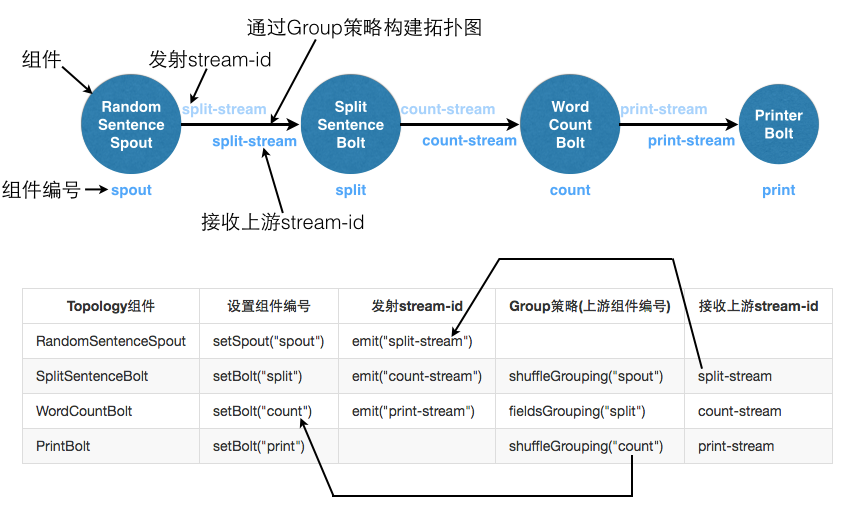
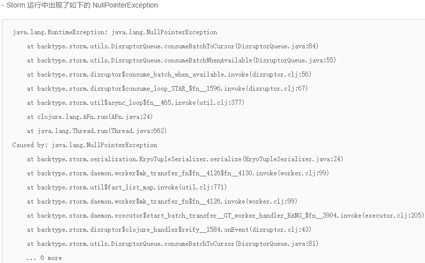
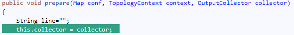

## Storm 开发过程问题小结
### 1. Storm 流分组策略选择

主要用到 Shuffle grouping 随机分组和 Field grouping 按字段分组。

但随机分组无法统计类似 IP 计数这样的问题，如果要统计，则需要对按 IP 字段分组，使同样的 IP 落在同样的 bolt 中进行统计，这样最终结果才是正确的。

但这样按字段分组，可能存在某些 IP 统计量大导致下游 bolt 之间负载不均衡的问题。

Storm 提出 Partial Key grouping 部分字段分组方式，说是能够解决上述不均衡问题，参考论文 [Partial Key Grouping: Load-Balanced Partitioning of Distributed Streams](https://arxiv.org/abs/1510.07623) 【此次并未使用，以后深入试试】

参考：

- [Storm系列(四)并行度和流分组](https://juejin.im/post/5c317c75f265da616b10db41)
- [Storm流之FieldGrouping字段分组](https://blog.csdn.net/Simon_09010817/article/details/80092080)

### 2. spout/bolt 声明多条 streamID 以发送不同格式的流

主要参考 [用实例理解Storm的Stream概念](https://zqhxuyuan.github.io/2016/06/30/Hello-Storm/) 这个帖子，**写得非常好，建议精读多遍**。

### 3. 因 OutputCollector 未同步导致 NullPointerException

**问题描述：**编译出现错误 `Caused by: java.lang.NullPointerException`

**解决方案：**只要在每个 spout 的一开始添加上这一句，对类对象的私有 collotor 进行赋值，用当前prepare传入的参数进行赋值，参考 [并发编程网 – ifeve.com](http://ifeve.com/storm-troubleshooting/) ， [collector同步问题](https://www.cnblogs.com/metoy/p/4456199.html%20) ，[Storm OutputCollector并发问题导致NullPointerException的解决](https://blog.csdn.net/xbw673009796/article/details/51785241)【此问题遇到过两次，第二次仍旧花了不少调试时间，深以为戒】

 

**经验收获：**一开始因为搜的关键字不对，一直找不到解决方案，最后直接把 `invoke` 等深度提示放上去，才搜到了这个解决方案

### 4. 因 kafka-client 版本过低导致 KafkaConsumer 函数调用返回空

**问题描述：**参考网上及师兄源码写 storm 读取 kafka 数据接口， java 代码完全一致， IDEA 提示代码语法有误，修改未果，无法读取 kafka 数据，提示返回指针为空。

**解决方案：**修改 pom.xml 中的 kafka-client 依赖版本为 **高版本即可**，参考 [KafkaConsumer(kafka-clients0.8.2.1)的poll方法返回null的问题](https://blog.csdn.net/a499477783/article/details/79383700) ， [maven 中央仓库的 kafka-client](https://mvnrepository.com/artifact/org.apache.kafka/kafka-clients)

**经验收获：**当有一些莫名奇妙的问题解决不了的时候，看下依赖和源码有可能会有惊喜【特别是从网上随便 copy 下来的代码运行时，很可能存在依赖版本不对的问题】

### 5. java 拼接 SQL 插入数据库

**经验收获：**先在数据库中直接撰写 SQL 测试能够正确输出查询结果 or 插入数据，再在 java 中对 SQL 语句进行拼接；针对某些表同时需要插入新数据以及更新旧数据的情况，可能会导致数据库表锁，超时无法插入数据，最后采用 [insert into 插入若引起主键冲突则更新数据](https://blog.csdn.net/t894690230/article/details/77996355) `INSERT INTO student(name, age) VALUES('Jack', 19) ON DUPLICATE KEY  UPDATE age=19;` 解决；针对批量插入数据入库速度太慢导致超时，发现其实并未真正批量处理，仍是单条执行，参考 [JAVA对MYSQL数据库进行批量操作，addBatch(),executeBatch()方法](https://blog.csdn.net/qq_15003505/article/details/56669256) 修改 rewriteBatchedStatements 参数，默认为false, 需要手工设置为true，`String connectionUrl="jdbc:mysql://192.168.1.100:3306/test?rewriteBatchedStatements=true";  ` 解决，大大提高插入数据效率。

### 其他小问题及知识点
1. [java中静态方法中调用非静态方法](https://blog.csdn.net/jiayi_yao/article/details/51346378)：静态方法调用非静态方法，需要先new一个对象，再通过对象去调用。
2. kafka + storm 的好处：把不均匀的数据流转化成均匀数据流。我们知道storm的作用主要是进行流式计算，对于源源不断的均匀数据流流入处理是非常有效的，而现实生活中大部分场景并不是均匀的数据流，而是时而多时而少的数据流入，这种情况下显然用批量处理是不合适的，如果使用storm做实时计算的话可能因为数据拥堵而导致服务器挂掉，应对这种情况，使用kafka作为消息队列是非常合适的选择，**kafka可以将不均匀的数据转换成均匀的消息流，从而和storm比较完善的结合**，这样才可以实现稳定的流式计算，那么我们接下来开发一个简单的案例来实现storm和kafka的结合。注意，这里我们定义的topic是topic1，正好和前面的topic1数据源对应，是整个kafka保持一致的topic，也就是说 **kafka生产者topic和消费者topic是必须名称相同才可以响应**，下面简单添加了一点时间统计的代码，也很简单。我们的输出文件在哪呢，刚才我们使用storm执行的生产者代码，所以 **输出的kafkastorm.out就在storm的安装目录下**。
3. **每个spout和bolt有一个独一无二的名字**，在setSpout的时候设置好Spout的名字，然后setBolt的时候，需要指出输入的spout或者bolt的名字——这个名字只在topomain中使用；并且指定feild分组的字段（这里指定的分组字段可以比 bolt 中真实发送的分组字段少）；在每个bolt里面，对tuple进行按字段取值 `String line = in.getStringByField("wordcount");`
4. [滑动窗口统计](https://blog.csdn.net/zgc625238677/article/details/52086843)：主要基于 TickTuple 机制，在间隔特定时间后，发送一个特定的 tuple （和其他数据 tuple 不同），检测到是这个 tuple 后，走自己的统计结果输出的逻辑。
5. [java 得到的路径中文乱码](https://blog.csdn.net/dream_broken/article/details/31762807)： windows 下开发，文件夹名有中文，得到的路径名中文乱码，导致找不到配置文件；参考此链接，利用 `URLDecoder.decode(p, "UTF-8")` 解码获取中文路径后即可。
6. [jar包内 jar包外配置文件的读取](https://blog.csdn.net/T1DMzks/article/details/75099029)： 修改了 spout 文件位置后，spout 无法读取配置文件；检查后发现，可能是因为 jar 包管理机制的问题；参考此链接，利用`InputStream is = this.getClass().getClassLoader().getResourceAsStream("dns_demo.txt")` 解决。
7. [Maven学习-处理资源文件](https://www.cnblogs.com/now-fighting/p/4888343.html)：这个讲得很不错。Java项目的 **资源文件，主要用于存储系统的配置信息，以及提供系统集成的配置文件**。项目中的资源文件夹下一般都存储了 **以.properties为后缀的文件以及.xml为后缀**的文件，用于记录系统的上下文关系、log以及jdbc相关的配置信息。为Jar包添加资源文件，在我们使用POM管理项目的时候，我们在进行打包的时候，**需要将项目中的资源文件一起打包到最终的jar包中**。所以，我们需要将那些资源文件放置在Maven可以识别的目录下。在Maven的项目目录下，有一个默认的目录用于存放项目的资源文件：${basedir}/src/main/resources。所有存放在这个目录下的资源文件，当Maven进行打包的时候，就会将该目录下的资源文件一起打包到jar包中。Maven打包的时候，会按照该${basedir}/src/main/resources目录下资源文件组织的目录结构，在jar包的根目录下也会有相同的目录层次结构。**如果我们需要在Java代码中访问项目的资源文件**，比如上面的test.properties文件，我们只需要书写类似下面的代码：`InputStream is = getClass().getResourceAsStream( "/test.properties" );`
8. [JDBC drivers 和 URL 在不同数据库的填写](https://blog.csdn.net/ring0hx/article/details/6152528)： java 关联数据库操作时需要这些参数

### 其他参考资料
1. [Storm V2.0.0 官网文档](https://storm.apache.org/releases/2.0.0/index.html)
2. [storm官方文档翻译](https://www.bookstack.cn/read/Storm-Documents/Manual-zh-Trident-Tutorial.md)
3. [快速搭建storm开发环境](https://blog.csdn.net/weixin_39352976/article/details/79359494)
4. [Storm入门-慕课](https://www.imooc.com/learn/991)：在windows下VMware弄了3台机器搭建Storm集群
5. [storm教程（三）：用Java开发storm](https://blog.csdn.net/qq_37095882/article/details/77624246)
6. [W3Cschool-Storm入门教程](https://www.w3cschool.cn/storm/qk761jzb.html)
7. [storm远程打包](https://blog.csdn.net/kang123488/article/details/79512632)
8. [配置storm开发环境](http://ifeve.com/storm-setting-up-a-development-environment/)
9. [本地模式 LocalCluster 和 StormSubmitter 的对比](http://book.51cto.com/art/201410/453401.htm);：LocalCluster是直接在进程中模拟了一个Storm集群，它不需要安装zookeeper真正进行通信；而StormSubmitter则是同提交到远程集群中一样，它是要提交到真正的Storm集群中的，当然，真正的集群又有两种形式，一种是本地单机，则要安装zookeeper，配置storm.yaml配置到127.0.0.1，一种则是多台机器的真正集群。
10. [storm和kafka集成开发](https://www.cnblogs.com/freeweb/p/5292961.html)：直接在DataProducerInsert方法里面配置好kafka所在的消息输出的IP地址和端口即可直接获取线上的kafka数据进行storm这边的逻辑处理。Storm 中的 Bolt 执行顺序，在 topology 的 main 主类所在的文件中被定义顺序， builder.setBolt 中定义的输入输出 bolt 名字顺序就是数据流的处理顺序。
11. [windows 下安装 storm 开发环境](https://blog.csdn.net/ai_yue/article/details/84330181)：这个写得很不错，比较简洁清晰；1.安装jdk并配置环境变量，2.安装zookeeper并配置环境变量，3.安装python并配置环境变量，4.安装storm并配置环境变量
12. [kafka+storm 代码参考较多](https://cloud.tencent.com/developer/article/1379107)
13. [IDEA 生成 jar 包](https://blog.csdn.net/gslsxqrj/article/details/82624157)
14. [wordcount 的kafka版，都写在一个java里了](http://shiyanjun.cn/archives/934.html)
15. [windows下storm单机运行出问题，修改方案](https://azure.microsoft.com/pl-pl/resources/samples/hdinsight-java-storm-wordcount/)
