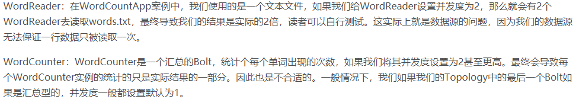
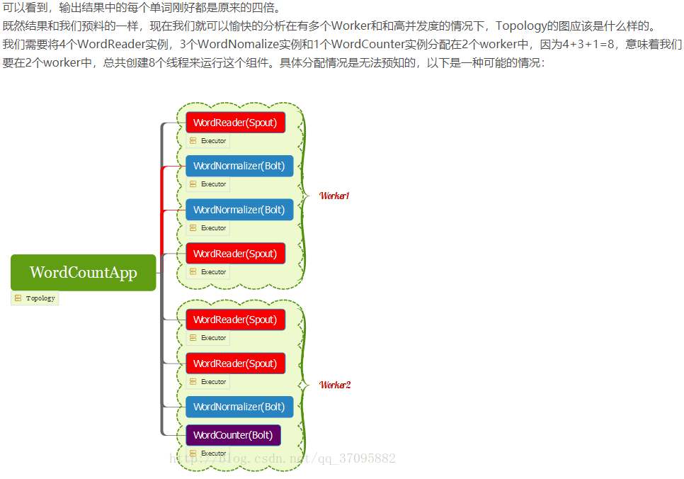
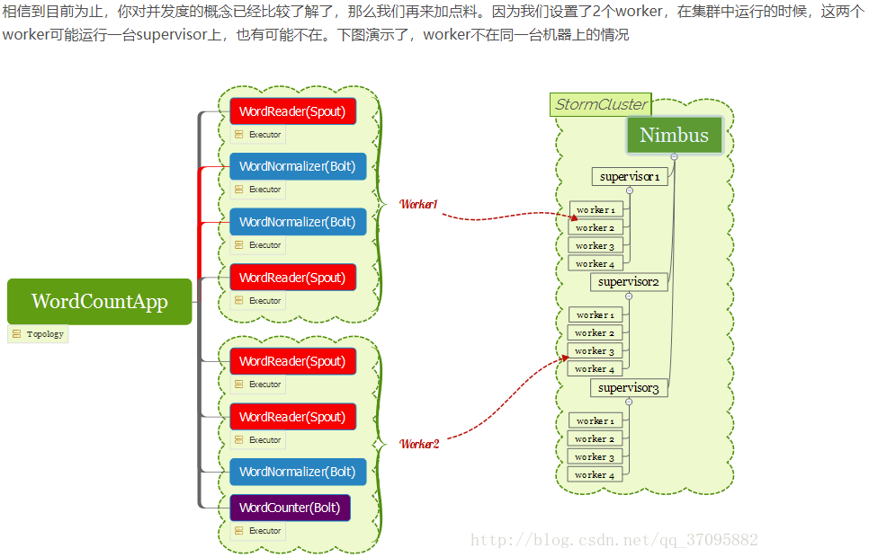
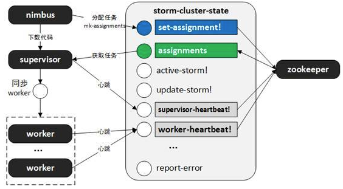
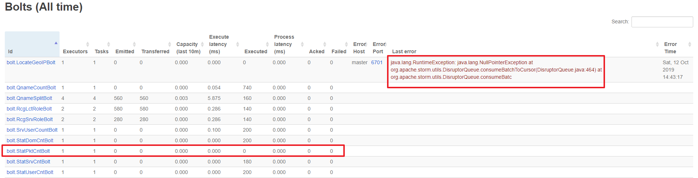
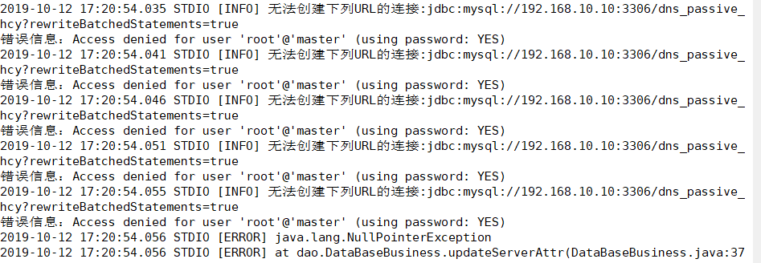

## Storm 开发过程问题小结
### 1. Storm 资源文件 or 配置文件正确读取

__资源文件__主要指一些偏向为程序提供数据的文件，一般文件内容较多，文件大小比较大，比如说批量的IP列表or域名列表；__配置文件__主要指一些程序需要的参数配置，或者是文件名等比较短的数据，比如说统计时间、使用的数据库相关配置等【在我这里】。

因为 Storm 采用分布式集群，存在多台服务器，而这些__资源文件和配置文件是需要同代码文件一起，放在同一台服务器上__，所以在部署 jar 包到远端的时候需要注意资源文件和配置文件能够在该台服务器上找到，否则就会出现文件不存在的错误。

资源文件or配置文件的存放位置一般可以分为两种，__ jar 包内__ or __jar 包外__。

如果放在 jar 包外，那么当把 jar 包上传到 storm 中部署时，就需要__利用 pscp 工具__批量拷贝资源文件到所有的 storm 集群服务器上，一旦资源文件 or 配置文件的参数需要修改时，就__需要再次批量拷贝覆盖__所有服务器上的文件。个人认为过于麻烦【之前写 C 的时候没办法，只能采用这种方式，__可以把部署的 IP 以及命令整合成 shell 脚本，直接运行 shell 脚本__，也还行】。

**建议直接放在 jar 包内部**，直接把相关的文件，__放在 resources 中__，然后利用上次提到的命令 `InputStream is = this.getClass().getClassLoader().getResourceAsStream("dns_demo.txt")`  去获取 resources 中的文件，这个例子命令的这个 `dns_demo.txt` 就是直接放在 resources 下，如果 resources 存在子文件夹 `data` ，则上面命令括号中变成 `data/dns_demo.txt` 即可。

如果资源文件和配置文件放在 jar 包内部【之前我一直以为文件打包入 jar 包之后，就不能修改其内容，每次想要修改内容时都需要重新打包，后来询问钊哥了解到自己理解错误】，当想要修改某个配置参数时，参考 [这里](https://blog.csdn.net/luckykapok918/article/details/82883967) __可以通过 vim 命令直接编辑 jar 包中的文件__【`vim xxx.jar 回车`：首先会列出全部文件；然后输入`/xxx 回车` 来进行检索文件名，定位到对应的 xxx 文件；然后直接 `回车` 进入配置文件内进行编辑；最后输入 `:wq 回车` 保存退出即可】。

__坑：__之前读取文件时，在网上还搜了个代码 `URLDecoder.decode(this.getClass().getResource("/data/RTDNS.txt").getPath(), "UTF-8")` ，直接贴上了，在本机测试时，能够读取 resources 下面的文件，运行也没有问题；然后部署到华严的 storm 集群上，运行也十分OK，能够找到该资源文件，正确运行；结果到了科技网上的 storm 集群，**完全同样的代码**，它就不好使了，找到的文件路径错误，感觉是在 `/data/RTDNS.txt` 之前多了一个 `!` 感叹号。

__解决方案：__最后把所有读取文件的地方，全部改成 `InputStream is = this.getClass().getClassLoader().getResourceAsStream("dns_demo.txt")` 这种形式，最后科技网那边就好使了……

__参考资料：__

- [Maven学习-处理资源文件](https://www.cnblogs.com/now-fighting/p/4888343.html)
- [区分InputStream和InputStreamReader](https://blog.csdn.net/hskw444273663/article/details/85706136)
- [storm 提交拓扑，引用外部配置文件](https://blog.csdn.net/weixin_40294332/article/details/96171449)：这里是把配置文件放在 jar 包外面，通过 main 函数参数 args 进行传参得到配置文件的路径【如果文件个数很多，你想想得写多长？】
- [由提交 storm 项目 jar 包引发对 jar 的原理的探索](https://cloud.tencent.com/developer/article/1198432)：因为之前对 jar 包的理解是类似 C 打包变异成了 .so 的二进制文件，应该是不能够打开 jar 包修改其中的文件内容的，后面发现理解错了。
- [Java JVM 运行机制及基本原理](https://zhuanlan.zhihu.com/p/25713880)
- [Flume+Kafka+Storm+Redis构建大数据实时处理系统](https://yq.aliyun.com/articles/607932)
- [storm发送数据到redis中](https://blog.csdn.net/qq_32292967/article/details/83186125)
- [ idea 忽略某些文件](https://blog.csdn.net/ziwuzhulin/article/details/80252550)
- [maven打包时忽略某些文件](https://blog.csdn.net/sundenskyqq/article/details/49930387)：通过在 pom.xml 中忽略文件
- [storm 读取全局配置后，其他spout和bolt怎么取](http://nathanmarz.github.io/storm/doc/backtype/storm/spout/ISpout.html#open(java.util.Map,%20backtype.storm.task.TopologyContext,%20backtype.storm.spout.SpoutOutputCollector))：spout 中 open 函数及其参数详细解释【之前读取配置文件一直在 topo main 中进行读取，后面需要在 spout 中读取配置文件，本来想法是直接在 main 中把所有的配置读到 conf 中成为全局配置，然后再从 spout open 函数中的 conf 参数获取，但后面发现好像不太可行，最后未采用】
- [打包上传集群运行](https://blog.csdn.net/kang123488/article/details/79512632)：上传 `storm jar jar包名称 类名 参数（可多），回车`，如`storm jar /usr/local/storm-wordcount-0.0.1-SNAPSHOT.jar com.kang.eshop.storm.WordCountTopology wordCountTopology`；杀死 `storm kill topology-name`；通过 ui 观察运行情况 `http://139.199.10.125:8080/index.html`

### 2. storm 架构原理及并行度理解

主要是在添加公开域名后缀 API 使用时，本机 json 文件读取输出时 OK ，但是远端部署到华严后，同样的代码，就是跑不出来结果【由于当时还没有 get 到利用远端 storm 运行日志检查来分析出错的技能，所以__一度怀疑是添加的这个 API 的线程安全，在 storm 分布式的场景下存在一些问题__，由此调研学习了一堆下面的相关资料，但还是没有解决；最后采取的方案是换了另外一种 API ，虽然此 API 对域名格式的校验更为严格，但是至少华严集群跑的时候不会出问题】

__参考资料：__

- [这篇讲并行度讲得算是比较通俗易懂](https://blog.csdn.net/qq_37095882/article/details/77624340)：没有设置并行度和worker数量时，__默认分配一个worker__，__每个spout或bolt各占一个线程，各自并行度为1__；读取数据的并行度为4，最终统计结果应该就是原来的4倍；另外，__输入和输出的汇总型bolt的并行度只能设置为1，以保证结果的可靠性__；【看起来__worker的个数并不影响最终的结果__，是storm自身的机制（__zookeeper保证storm节点之间的信息通信__）__保证了多个worker执行同一个topo时，能够协同合作__】；多worker情况下线程的分配也是根据并行度来的；__同一个topo的多个worker可能运行在不同的节点supervisor上__。

- [为什么不同supervisor上的同一个topology的worker还能够执行一个任务而保证一致性呢？](https://zhuanlan.zhihu.com/p/25414207)：是__利用zookeeper获得相同的心跳和信息__

- [storm架构原理](https://www.cnblogs.com/txfsheng/p/9242539.html)

### 3. Storm 远程部署调试（华严+科技网）

华严这边部署调试相对容易一点，因为有开 __Storm ui ，可以比较直观的看到 topo 的运行情况__，是否正确挂载，每个 bolt 发送的数据量情况，某个 bolt 出问题了会显示日志。

比如说之前添加 IP 定位的 API 接口时遇到的奇怪问题， IP 定位代码在本地读取 json 文件时能够正确运行，华严远程调试时就出错了【由于当时不会使用远程查看 storm 日志，所以通过 ui 显示确定的原因是读取 IP 定位库的那一行出错，当时不确定是什么原因，现在回头想想，__应该是远程文件路径出错导致的问题__】，__更为奇怪的是，LocateGeoIPBolt 出错，导致 StatPktCntBolt 也无法发送数据__，如图。最后实在无法搞定，采用的解决方案是，去掉在线 IP 定位的这个功能，准备交由主动这边离线程序来做。

科技网的环境就相对复杂，__没有 ui 只能通过找到 Storm 运行日志来看__【而非常遗憾的是，在部署的初期阶段，就是因为不知道该怎么进行远端调试，没有找到运行日志以及文件读取/写入路径，使得最初的部署遇到了极大困难，只能通过统计结果最终是否入库来判断程序是否正常运行，如果出现问题，也无法定位和分析出错原因】

所以首先，知道 Storm 运行日志文件路径十分关键！！！！参考 [这里](https://www.jianshu.com/p/32c2e2508718) ：

#### 查看 topo 运行日志：.../logs/worker-number.log
- submit日志在nimbus.log
- 生成work命令行的日志输出在supervisor.log
- 程序运行时的日志在work-xxx.log
- __用storm jar ...将项目提交给storm集群后，想查看本项目的log信息，要到supervisor机器的 storm 安装路径 /logs/worker-number.log（其中的number视实际情况而定）中查看。__
- 如果是用daemontools启动的storm，daemontools监控的目录是/service/storm，那么到/service/storm/logs中查看worker-number.log日志。
- 还可以通过命令行查看是否成功启动topo： `storm list` 

#### 坑：严格来说不是 storm 的锅，应该是 storm+mysql 的锅

__问题描述：__本地读取 json 文件入的数据库和在华严部署 storm 上入的是__完全相同的一个数据库，本地运行OK，但远程 storm 死活无法入库__，查看 storm 日志后发现如下图：

查了一堆后发现，其实是登录 mysql 的主机对应的密码不对，才出现了这个问题。而为什么本地登录密码正确，而远程登录密码就错误了呢？明明是相同的用户名和密码。

__解决方案：__原因是 __mysql 这边登录数据库时，不仅只检查用户名和密码，还会检查登录的 host 主机名/IP地址__。然后检查 10 上 mysql 数据库的用户表发现，本地登录时，host 是 '%' 表示任意 host 均可登录；而__远程登录的时候，用户表中存在  host 为 'master' 的项__，而 storm 登录的时候，就得走这个接口进行密码检查，结果密码出错。最后在 mysql 中运行 `GRANT ALL PRIVILEGES ON *.* TO 'root'@'master' IDENTIFIED BY '111111' WITH GRANT OPTION;` 把 mater 这个 host 对应的密码改成同配置中的一样，最后运行 OK 。

__经验收获：__认真看运行日志，里面藏着非常非常多的信息！！！

__参考资料：__

- [登录mysql的主机对应的密码不对，修改成111111即可](https://blog.csdn.net/u014294325/article/details/81303908)：`GRANT ALL PRIVILEGES ON *.* TO 'root'@'master' IDENTIFIED BY '111111' WITH GRANT OPTION;`
- [mysql 中user表localhost为%的含义](https://www.cnblogs.com/wanghetao/p/3804653.html)：Host列指定了允许用户登录所使用的IP，比如user=root Host=192.168.1.1。这里的意思就是说root用户只能通过192.168.1.1的客户端去访问。　　而%是个通配符，如果Host=192.168.1.%，那么就表示只要是IP地址前缀为“192.168.1.”的客户端都可以连接。如果Host=%，表示所有IP都有连接权限。、　　这也就是为什么在开启远程连接的时候，大部分人都直接把Host改成%的缘故，为了省事。
- [正确认识错误提示](https://www.jianshu.com/p/b1dd63a9b183)：出现这种情况就是一个原因：密码错了。
- [这是第一个提示说需要修改localhost的帖子](https://blog.csdn.net/senvil/article/details/48894173)
