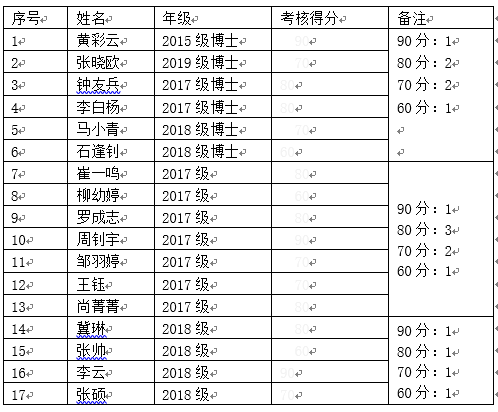

<!-- MarkdownTOC levels="1,2,3" autolink="true" autoanchor="true" -->

- [学生组内科研工作PPT类型](#%E5%AD%A6%E7%94%9F%E7%BB%84%E5%86%85%E7%A7%91%E7%A0%94%E5%B7%A5%E4%BD%9Cppt%E7%B1%BB%E5%9E%8B)
    - [月度工作汇报](#%E6%9C%88%E5%BA%A6%E5%B7%A5%E4%BD%9C%E6%B1%87%E6%8A%A5)
    - [精讲论文](#%E7%B2%BE%E8%AE%B2%E8%AE%BA%E6%96%87)
    - [年终考评](#%E5%B9%B4%E7%BB%88%E8%80%83%E8%AF%84)
    - [成长计划](#%E6%88%90%E9%95%BF%E8%AE%A1%E5%88%92)
    - [答辩报告](#%E7%AD%94%E8%BE%A9%E6%8A%A5%E5%91%8A)
        - [开题报告](#%E5%BC%80%E9%A2%98%E6%8A%A5%E5%91%8A)
        - [中期报告](#%E4%B8%AD%E6%9C%9F%E6%8A%A5%E5%91%8A)
        - [\(预\)答辩报告](#%E9%A2%84%E7%AD%94%E8%BE%A9%E6%8A%A5%E5%91%8A)
    - [学术会议论文报告](#%E5%AD%A6%E6%9C%AF%E4%BC%9A%E8%AE%AE%E8%AE%BA%E6%96%87%E6%8A%A5%E5%91%8A)
    - [项目进展报告](#%E9%A1%B9%E7%9B%AE%E8%BF%9B%E5%B1%95%E6%8A%A5%E5%91%8A)
    - [其他类型](#%E5%85%B6%E4%BB%96%E7%B1%BB%E5%9E%8B)

<!-- /MarkdownTOC -->

# 学生组内科研工作PPT类型
由于讨论班的汇报类型较广（精讲论文、开题/中期报告、工作汇报、调研/研究报告），这里进行了一些细分，主要按频率从高到低的进行介绍。

- 讨论班要求：[confluence](https://docs.mesalab.cn/pages/viewpage.action?pageId=689913)
- 不同类型的汇报，汇报内容重点有所不同；
- 同一内容的汇报，面对不同听众，汇报方式也有所不同；

## 月度工作汇报
- 中文；每月 1 次，最晚20号提交；若需汇报，则主要面向 __刘庆云老师__及其他同学。
- 汇报时间：一般 5 分钟左右，若时间过长而内容刘老师不感兴趣，可能会被中断
- 汇报模板：[confluence上给的白板](https://docs.mesalab.cn/pages/viewpage.action?pageId=691386&preview=/691386/691389/%E6%9C%88%E5%BA%A6%E6%B1%87%E6%8A%A5%E6%A8%A1%E6%9D%BF.pptx)大纲
    + 本月主要任务完成情况
        * 所属项目：
        * 主要任务简述：
        * 原计划完成时间：
        * 目前进度：
        * 加班情况：
        * 请假情况：
        * ...
    + 本月主要产出
        * 论文： 录用XXX
        * 专利：受理XXX
        * 参会报告：贴在mesa知识库的链接
        * 技术调研报告：贴在mesa知识库的链接
        * 讨论班汇报：时间，题目
        * 项目xx的 xx文档
        * ...
    + 本月主要收获分享
        * 事件简述：
        * 收获反思：
        * ...
    + 下月计划
        * 预期目标
        * 预期时间开销
        * …
- __注意事项__：个人考虑，仅供参考，如有错漏，欢迎指出。
    + __做自己的模板__：根据提供的模板大纲，酌情考虑增减调整内容（删减需注意，刘老师关注的重点，别删了）；
    + __页数不要太多__：封面1+上述大纲4-5+结尾1=6-7页；
    + __分享具体的收获__：最好分享大家都可能遇到的情况，如分享解决一个小问题的示例之类，共享经验，经验最好比较具体，不要过于宏观、唯心，可能听/看了就忘了；
    + __撰写内容完整__：之前汇报人数较少，每个月都还是会当场给刘老师进行口述汇报，但当前由于汇报人数过多，取消了当场口述汇报，转而通过阅读方式查看大家的工作，所以建议把一些原本准备通过口述的内容，在PPT中写全，方便理解；
    + __汇报简洁__：若真的当场汇报，则也不用特别展开，挑PPT上重点进行口述，控制时间，若刘老师感兴趣，后面会再问的；
    + __格式转换__：上传至 confluence 上面的 PPT 都转成 PDF 格式再上传，方便观看；

## 精讲论文
- 中文；讨论班每两月 1 次，可选精讲论文；主要面向 __组内各位老师和同学__及可能的外组老师和同学。
- 汇报时间：15 分钟
- 汇报模板：根据 [MESA入组培训](https://docs.mesalab.cn/pages/viewpage.action?pageId=6752173&preview=%2F6752173%2F6752180%2F%E5%88%98%E5%BA%86%E4%BA%91-Mesa%E5%85%A5%E9%97%A8%E5%9F%B9%E8%AE%AD.pdf) 中提到的 所阅文章笔记(七个问题) 改；个人考虑，仅供参考。
    + 前言：
        * 会议简介
        * 作者简介
    + 七个问题：
        * 本文想解决什么问题？
        * 该问题为什么重要？
        * 该问题为什么困难？
        * 前人的研究成果如何？
        * 本文的新贡献何在？
        * 基本结论？
        * 本文方法有何假设或者不足？
    + 收获&思考
- __注意事项__：个人考虑，仅供参考，如有错漏，欢迎指出。
    + 论文挑选要求：
        * 级别：最好是 A/B 类顶会论文，或者至少是 CCF 列表论文；级别太低的论文，即使研究方向很相关，的确应该精读，但是并不值得在讨论班上讲、给其他人分享；
        * 时间：选择较新的论文，3年以内，最好是1年以内；即使这篇老论文非常经典，引用量非常多，的确应该精读，但是也并不适合在讨论班上讲；一方面容易与之前组内讲过的论文撞车，另一方面给大家分享的东西不新，对其他人（特别是在这个方向上已经做了一定研究的老师和同学）来说收获不大；
        * 内容：当然要讲与自己研究方向相关的论文，对自己的研究有启发、有收获的，后续可能会用在自己的开题、中期、(预)答辩报告中，否则没有必要做成PPT，太浪费时间；
    + 调整大纲：上述七个问题的大纲其实并不是对每篇论文都契合，有些同学直接按照论文原文大纲进行介绍，也不是不行，只是可能逻辑上会有点问题；
    + 页数：根据时间来分配讲的时间，20页左右差不太多，如果论文的确内容比较多，可能会30页左右；
    + 酌情删减内容：考虑到时间，其实可以只讲论文的重点内容，不一定要把论文的所有内容都讲出来，只要把论文讲清楚了，就可以；
    + 模板：考虑到后续PPT可能会用于其他的报告中，建议采用所内的经典模板，这样后续若真的需要，改动不大，节约时间；

## 年终考评
- 中文；一般每年1月元旦之后；主要面向组内老师（只要是带学生的老师），可能有外组老师；
- 汇报时间：几分钟，一般6/7分钟，不超过10分钟，过长可能会被打断；2019年要求是“每人汇报10分钟，包括评委提问。个人总结不超过7分钟，排练计时。”
- 汇报模板：每年年终汇报比较正式，会出一个具体要求的 word 文档，参照文档要求准备具体汇报内容和形式即可；下面是2019年度年终考评评分表中包含的汇报内容，自行整理归纳补充；
    + 学术研究：主要包括但不限于在如下方面所做工作，重点介绍主要工作和成果标志物：阅读文献&技术调研&代码收集；技术实现，实验；论文/专利/标准写作；算法包/工具库/技术报告的积累维护（技术积累形式的，学术研究使用）；内部学术交流，学术讨论班，参加&组织各种培训会议；国内外学术交流，外出学术会议，邀请人进行学术讨论；组内学术网站维护与知识共享；
    + 项目研发：主要包括但不限于在如下方面所做工作，重点介绍主要工作和成果标志物：需求跟踪&前期预研（各种需求研讨会、出差、技术推广）;立项建议书，项目申请书，项目申请答辩;方案设计，项目分解（初设，概要设计）;过程执行-代码（工程用算法库/工具库，原型系统，演示系统，测试）;过程执行-文档（中期、年度、合同任务书要求等）材料撰写&工作总结;过程执行-部署（现场部署，联调测试等）;过程执行-运维（系统在线运行维护，系统升级，应急响应）;项目验收&材料归档;项目协调&项目杂项（与甲方、项目合作方等进行各种协调，技术讨论，进度推进，项目各阶段流程办理，出差协调）
    + 科研支撑：主要包括但不限于在如下方面所做工作，重点介绍主要工作和成果标志物：保密工作（培训，流程，相关文档、相关会议等）;质量工作（培训，流程，相关文档，相关会议等）;机房管理&网络管理&设备管理&设备采购;授课&培训（科学院、所内进行授课，给甲方单位培训等）;其他任务（年初规划&年终总结，室务会/例会，科研规划，提交阶段成果汇报，汇总各种数据等）；领导视察（汇报准备、演示准备、现场汇报和演示、反馈跟进等）
    + 团队建设：主要包括但不限于在如下方面所做工作，重点介绍主要工作和成果标志物：招生（宣讲，夏令营，免试生招生，统考生招生，客座招生等）;招聘（宣讲，面试，入职，离职，劳务外派招聘等）;学生管理（开题，中期，预答辩，答辩，毕业，论文指导，编程指导，就业指导，心理辅导等）;团队建设（党团，工会，兴趣小组，组内活动，实验室活动等）
    + 工作纪律：主要考核工作态度、勤奋敬业和遵守劳动纪律情况，员工可介绍个人表现；
- 汇报评分：2019年要求是“大组长：30%，指导老师：30%，评委：20%，互评：20% 组内所有的成员互评(包括自评)”
- __注意事项__：个人考虑，仅供参考，如有错漏，欢迎指出。
    + 尽量不要超时，超时也不要超太多；
    + 突出重要成果，如果实在没有重要成果，那就突出工作量；
    + 如果平时的周报认真写了，参考平日周报总结归纳会快很多；
    + 可以参考之前同学的年终总结，但注意模板使用，最好不要同时采用完全相同的同一个模板。。。撞衫不可怕……（后一句大家都知道）

- 评分表：下面是2019年的评分表；

## 成长计划
- 中文；一般过年后回组2/3月的样子；主要面向刘老师；
- 汇报时间：5分钟左右；
- 汇报模板：要求不会很具体，2020年的要求是“结合组里的科研规划和布局，自己的研究特长和意愿，咨询导师/指导老师，制定自己的发展规划”；下面是个人模板，仅供参考；
    + 组内规划布局vs个人发展目标
    + 自我分析（16型人格测试 & SWOT）
    + 年度目标（SMART）
    + 需要协调的资源和帮助
- __注意事项__：个人考虑，仅供参考。
    + “自知”：分析自己的现状（是一个什么样的人）、思考自己的目标（想成为什么样的人）、为达成该目标的年度阶段目标（怎么成为那样的人）；
    + “知他”：分析实验室、老师的现状（目标、要求、资源……）
    + “计划”：综合上述情报分析，制定满足 SMART 要求的目标，目标要定高一点，要定那种努力够一够能够完成的目标；如果目标最后100%都完成了，说明目标定得太低，如果50%都没有完成，说明定的太高；最好是完成了7/80%，说明目标定得不错；
    + “执行”：这一步可能是最困难的，即使计划已经非常具体，但还是可能由于各种原因没有执行；对我个人来说，我最大的问题是，一下子想得太多，所以我告诉自己的是，“别想那么多，先开始做第一步”
    + “更新”：记录进度，定期、动态调整计划

## 答辩报告
- 中文；各类型仅 1 次；主要面向组内老师（预讲）、__不太熟悉你工作的答辩评审老师__（正式）；
- 汇报时间：标准汇报时间如下，不管博士硕士，不管什么类型，都会预留10min左右给评委老师提问；但需要注意的是，如果汇报人很多、时间紧张，很有可能临时or提前要求减少汇报时间5-10min，要考虑到这种情况下做、讲PPT；时间充分有时间充分的讲法，时间少有时间少的讲法；
    + 博士：开题 30min + 中期 30min + 预答辩 40min + 答辩 40min
    + 硕士：开题 20min + 中期 20min + 预答辩 30min + 答辩 30min
- 汇报模板：[mesalab上已毕业同学的模板](https://mesalab.cn/f/article/articleList?cate=72)
    + 博士：2014级普博-陈志鹏
    + 硕士：很多
- PS：后续可能主要针对博士同学，要求相对较高，硕士同学也可参照，酌情删减；

### 开题报告
- 汇报大纲：所里提供模板要求的是以下一级大纲，二级/三级大纲则是个人考虑，仅供参考。
    + 开展本课题研究的意义(10p)
        * 研究背景(3p)
        * 研究对象(3p)
        * 应用场景(3p)
        * 研究挑战(1p)
    + 国内外研究现状分析(7p)
        * 研究点一(2p)
        * 研究点二(2p)
        * 研究点三(2p)
        * 小结(1p)
    + 研究目标、研究内容和拟解决的关键技术(4p)
        * 研究目标(1p)
        * 研究点一(1p)
            - 研究目标
            - 研究内容
            - 拟解决的关键技术
        * 研究点二(1p)
        * 研究点三(1p)
    + 拟采取的研究方法、技术路线及可行性分析(10p)
        * 研究点一(4p)
            - 研究方法(0.5p)
            - 技术路线(1.5p)
            - 可行性分析(1p)
        * 研究点二(3p)
        * 研究点三(3p)
    + 预期研究成果及创新之处(1p)
        * 预期成果(0.5p)
        * 创新之处(0.5p)
    + 已有工作基础(3p)
        * 论文&专利(1p)
        * 项目(1p)
        * 数据集&系统(1p)
    + 研究计划及预期进展(1p)
    + 参考文献(2p)
- __注意事项__：个人考虑，仅供参考，如有错漏，欢迎指出。
    + 重点在前面，强调开这个题是有用的： __开展本课题研究的意义__ 和 __国内外研究现状分析__；
    + 后面的大概说一下想法，让人相信你能做出来： __研究目标、研究内容和拟解决的关键技术__ 以及 __拟采取的研究方法、技术路线及可行性分析__
    + 由于一般情况下，大家开题之前都有1-2篇相关的小论文，所以至少1/3或者2/3的内容材料是有的，关键是要把工作糅合成一个整体，解决一个总的问题，需要大量调研。

### 中期报告
- 汇报大纲：同开题报告一样，所里提供模板要求的是以下一级大纲，二级/三级大纲则是个人考虑，仅供参考。主要撰写思路则是把开题报告、研究点一和研究点二小论文等3个之前的汇报PPT进行整合，再根据要求添加其他页组成。
    + 学位论文进展情况(6p)
        * 研究背景(1p)
        * 研究对象(1p)
        * 应用场景(1p)
        * 研究挑战(1p)
        * 研究现状(1p)
        * 研究概述(1p)
    + 已完成内容和取得的阶段性成果(35p)
        * 研究点一(15p)
            - 问题背景(0.4p)
            - 研究目标(0.4p)
            - 拟解决的关键技术(0.2p)
            - 研究内容(1p)
            - 技术路线(6p)
            - 实验验证(7p)
        * 研究点二(16p)
        * 研究点三(4p)：由于这个研究点还没做完，“实验验证”改为“实验进展”
    + 与开题报告不符之处(1p)
    + 下一步研究工作计划(1p)：时间+任务
    + 论文撰写情况(1p)：列举学位论文大纲
    + 完成项目及发表论文情况(2p)
        * 项目(1p)
        * 论文&专利(1p)
- __注意事项__：个人考虑，仅供参考，如有错漏，欢迎指出。
    + 还未正式中期，待确定终版最后更新。

### (预)答辩报告
- 汇报大纲：由于还没做过，这里仅有所里要求的一级大纲；预计撰写思路也还是结合开题、中期、对应3个研究点的小论文报告，汇总整理进行撰写；
    + 研究背景与意义
    + 国内外研究现状
    + 研究目标、内容和拟解决的关键技术
    + 主要成果与创新之处
    + 发表论文与完成项目
- PS：待后续补充；

## 学术会议论文报告
论文录用之后，需要参会讲自己的论文，其实质与前述论文精讲类似，只是这里一般得是英文。

- 英文；论文录用参会准备；主要面向大、小同行（非中国人）；
- 汇报大纲：我一般按照论文撰写的顺序，依次进行介绍，而不会像前面总结成7个问题那样；因为考虑到这里我的目标是，循序渐进的介绍自己的工作，而不是上面的目标，大开大阖的讲论文重点；当然，个人考虑，仅供参考。
    + Introduction
        * Motivation
        * Background / Prior Knowledge
        * Related Work
        * Our Work
    + Method
        * Model Framework
        * Module 1
        * Module 2
        * Module 3
        * Module 4
    + Experiment
        * Datasets
        * Steps
        * Metrics
        * Results
    + Discussion
        * Limitations
        * Future Work
    + Conclusion
- __注意事项__：个人考虑，仅供参考，如有错漏，欢迎指出。
    + 关键是英文汇报：字体、字号、排版、演讲稿等等于中文汇报有所不同
    + 可参考之前写的 [《论文那些事儿-叁》](https://docs.mesalab.cn/pages/viewpage.action?pageId=12158780&preview=/12158780/12158781/%E8%AE%BA%E6%96%87%E9%82%A3%E4%BA%9B%E4%BA%8B%E5%84%BF-%E5%8F%81-%E9%BB%84%E5%BD%A9%E4%BA%91.pptx)，里面对英文汇报有所提及；

## 项目进展报告
在做项目的过程中，在一些项目开会的节点，会需要做一些相关的PPT，如课题申请（总体目标、研究论证...）、课题进展、课题验收（验收测试...）等等；

- 中文；根据项目需要；主要面向上一级负责人（子课题负责人、课题负责人、项目负责人等）
- __注意事项__：个人考虑，仅供参考，如有错漏，欢迎指出。
    + 一般从上一级负责人那里会拿到PPT的模板，然后就基于模板的格式，填上自己负责子课题/模块的内容即可，指导老师会负责检查，做得不好可以再改；
    + 项目PPT的材料，其实也一般是从平时做其他事情，如调研、做讨论班、论文、参会报告等事情中积攒而来，如果平时不注意搜集这些相关材料，等到需要的时候再写，是很难写出来的；

## 其他类型
待定