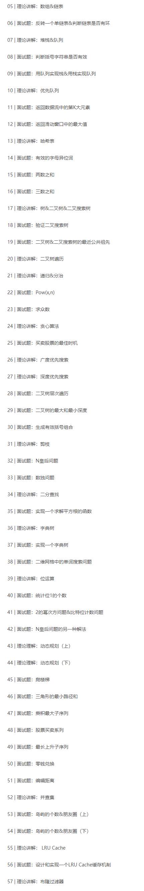
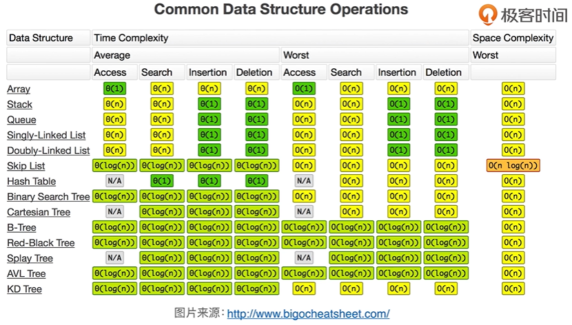
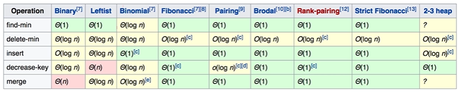

# 极客课程算法面试通关40讲-1
## 课程概述
- __讲师简介__：覃超，Sophon Tech 创始人，拥有卡内基梅隆大学信息安全硕士学位与同济大学计算机科学学士学位。Facebook 早期员工 & 多年面试官、曾作为 Facebook Messenger Tech Lead，主导和参与了 Facebook App、Facebook Messenger、Facebook Phone 等产品的研发工作。
- __课程特点__：
    + 理论讲解：面试常考算法知识点理论讲解
    + 习题实战：LeetCode经典算法题思路剖析及代码实战
- __课程目录__：本节包括 __05-19/57__ 基本数据结构



## 课程内容：05-19/57 基本数据结构
### 本节摘要：
内容涵盖课程 05-19 讲，主要介绍常用的基本数据结构，并通过习题，分析每种数据结构的使用场景和时空效率，包括数组、链表、栈、队列、优先队列（堆）、哈希表、树、图。


### Array 数组
- __特点__：是内存里 __连续的一段存储区域__ 。
- __数组的查找和使用__：利用内存管理器，__根据数组下标__，可以 __随机__ 的 __访问__ 数组中的任意一个元素。线性时间复杂度O(1)。
- __数组的插入和删除__： 为了保证数组元素的逻辑顺序和物理内存的存储顺序一致性，插入/删除的时候，需要把插入/删除位置之后的节点，依次进行挪动。时间复杂度为O(n)。【特别的是】如果插入的位置是在数组的最后一个元素，那么时间复杂度为O(1)，因为不用挪动，平均算下来，其时间复杂度为O(n/2)，也就是O(n)的。

### Linked List 链表
- __动机__：
    + 业务需要大量的插入和删除操作，__为了改善数组插入和删除操作的时间复杂度__
    + 业务不知道具体到底有多少个元素，需要不断添加，如区块链
- __单链表__：
    + 普通形式：一个一个的元素节点，每个节点有一个指针，指向它的下一个节点
    + 变形：在已有的节点指针基础上，额外提供两个指向头结点和尾结点的指针，便于知道链表头尾在什么位置
    + 链表的插入：新建一个节点，把该节点的指针，指向链表本身要插入位置的下一个节点，然后把该插入位置的前一个节点指针修改指向新的节点，共计2次Next指针的操作，O(2)，也就是时间复杂度为O(1)
    + 链表的删除：直接把要删除位置的节点的上一个节点指针，指向删除位置的下一个节点，然后把删除位置节点的空间进行释放即可，时间复杂度也是O(1)
    + 链表的查询：如果要找到第5个元素，必须从头指针挪动5次才能够找到，也就是说 __查找的时间复杂度为O(n)__
- __双链表__：
    + 特点：既有prev前驱节点也有next后继节点，在查询链表时会更为简洁一点

### 面试题
#### [No.206 反转一个单链表](https://leetcode.com/problems/reverse-linked-list/)
- __题意__：给定一个单链表，进行翻转
- __思路__：把每一个节点的next指针从指向后继节点，转变成指向前驱节点即可

```python
class Solution:
    def reverseList(self, head: ListNode) -> ListNode:
        prev, cur = None, head
        while cur:
            cur.next, prev, cur = prev, cur, cur.next
        return prev
```

#### [No.24 两两交换链表中的节点](https://leetcode.com/problems/swap-nodes-in-pairs)
- __题意__：给定一个单链表，反转相邻的两个节点，1234->2143，12345->21435 最后一个单数节点就不用动了
- __思路__：在循环的时候，需要把相邻的两个元素前面的那个元素，也就是一共需要记下来3个指针

```python
class Solution:
    def swapPairs(self, head: ListNode) -> ListNode:
        pre, pre.next = self, head 
        while pre.next and pre.next.next:
            a = pre.next
            b = a.next
            pre.next, b.next, a.next = b, a, b.next 
            pre = a 
        return self.next
```

#### [No.141 判断链表是否有环](https://leetcode.com/problems/linked-list-cycle)
- __题意__：给定一个链表，判断其中是否有环
- __思路__：
    1. 一直往后遍历链表，如果遇到空指针，说明无环，如果遇不到空指针，则有环；可以通过设定一个时间阈值，比如0.5s；缺点是时间开销比较大
    2. 遍历的时候，边遍历边留下印记，也就是把已经遍历过的指针的地址存在 set 集合中进行直接判重，重复则有环，一直不重复直至遇到 null 空指针停止。时间复杂度为 O(n*1) ，缺点是需要 set 这种数据结构，而且还花费了一定空间存节点地址
    3. __快慢指针(龟兔赛跑)__：只需要两个指针，同时对链表进行遍历，慢指针每次走1步，快指针每次走2步，一直走下去，如果链表存在环，则快指针会追上慢指针，两个指针指向的位置相同，如果不存在环，则快慢指针除了最初指向头结点时相遇，直至遍历链表遇 null 结束时，都不会相遇。时间复杂度为O(n)，空间复杂度比第2种方法更好，不好的地方在于不太能想得到

```python
class Solution:
    def hasCycle(self, head: ListNode) -> bool:
        fast = slow = head
        while slow and fast and fast.next:
            slow = slow.next
            fast = fast.next.next
            if slow is fast:
                return True
        return False
```

#### [No.142 判断是否有环且返回环开始的节点](https://leetcode.com/problems/linked-list-cycle-ii)
- __题意__：前面只是判断是否有环，这里需要确定环开始的节点，同上类似。

#### [No.25 反转k个链表节点](https://leetcode.com/problems/reverse-nodes-in-k-group/)
- __题意__：前面是反转2个，这里是k个，同上类似。

### Stack 栈/堆栈
- __特点__：__先入后出 First In Last Out (FILO)__，最先进来的元素，被压制在栈的最下面，然后出去必须等上面的所有元素都出去之后，才能出去。
- __实现__：数组 or 链表（单双都可）

### Queue 队列
- __特点__：__先入先出 First In First Out (FIFO)__。
- __实现__：数组 or 双链表

### 面试题
#### [No.20 判断括号是否合法](https://leetcode.com/problems/valid-parentheses)
- __题意__：给定一个只包含括号的字符串，检测括号是否对应匹配
- __思路__：建立括号的对应关系，利用栈，只要是左括号就入栈，右括号就和栈顶元素出栈对应的符号进行比较，相同则继续，不同则错误，最后栈空仍未错，则返回正确

```python
class Solution:
    def isValid(self, s: str) -> bool:
        stack = []
        paren_map = {')':'(',']':'[','}':'{'}
        for c in s:
            if c not in paren_map:
                stack.append(c)
            elif not stack or paren_map[c] != stack.pop():
                return False
        return not stack
```

#### [No.232 用栈实现队列](https://leetcode.com/problems/implement-queue-using-stacks)
- __题意__：只使用栈的结构，实现队列的效果
- __思路__：利用数学里 __负负得正__ 的效果；只用一个栈是肯定实现不了的，这里要采用两个栈，一个是输入栈，一个是输出栈，只要是有数据进来，那永远都进入输入栈，然后如果要有数字出去时，如果输出栈已有数字，那就先把输出栈的元素进行输出，如果输出栈为空，那就把输入栈的数字全部入到输出栈后，也就是把输入栈进行清空，然后再从输出栈进行输出。

```python
class MyQueue:

    def __init__(self):
        """
        Initialize your data structure here.
        """
        self.inputstack = []
        self.outputstack = []

    def push(self, x: int) -> None:
        """
        Push element x to the back of queue.
        """
        self.inputstack.append(x)

    def pop(self) -> int:
        """
        Removes the element from in front of queue and returns that element.
        """
        if self.outputstack != []:
            return self.outputstack.pop()
        else:
            while len(self.inputstack):
                self.outputstack.append(self.inputstack.pop())
            return self.outputstack.pop()
        
    def peek(self) -> int:
        """
        Get the front element.
        """
        if self.outputstack != []:
            return self.outputstack[-1]
        else:
            while len(self.inputstack):
                self.outputstack.append(self.inputstack.pop())
            return self.outputstack[-1]
        
    def empty(self) -> bool:
        """
        Returns whether the queue is empty.
        """
        if self.outputstack != [] or self.inputstack != []:
            return False
        else:
            return True

# Your MyQueue object will be instantiated and called as such:
# obj = MyQueue()
# obj.push(x)
# param_2 = obj.pop()
# param_3 = obj.peek()
# param_4 = obj.empty()
```

#### [No.225 用队列实现栈](https://leetcode.com/problems/implement-stack-using-queues)
- __题意__：只使用队列的结构，实现栈的效果
- __思路__：主要在入队列的时候进行操作（上面那个在入栈时操作也会代码简洁一些），在入队列的时候，新建一个临时队列接收元素，只要已有的栈队列不为空，那就先把栈队列里面的元素先挪到临时队列里，然后把刚进来的元素放到栈队列中，如果为空，就直接把元素放到栈队列里，然后只要临时队列不为空（也就是说之前存在元素），再把临时队列的元素再全部挪到栈队列中。简单来说就是：要进新元素了，先把栈队列的挪到临时里，新的进临时，然后再把临时的挪过去，这样就 __使得每次进来的元素都在栈队列的第一个__，顺序就倒转了。

```python
from queue import Queue

class MyStack:

    def __init__(self):
        """
        Initialize your data structure here.
        """
        self.stack = Queue()

    def push(self, x: int) -> None:
        """
        Push element x onto stack.
        """
        reserv = Queue()
        while not self.stack.empty():
            reserv.put(self.stack.get())
        self.stack.put(x)
        while not reserv.empty():
            self.stack.put(reserv.get())

    def pop(self) -> int:
        """
        Removes the element on top of the stack and returns that element.
        """
        return self.stack.get()

    def top(self) -> int:
        """
        Get the top element.
        """
        top = self.stack.get()
        self.push(top)
        return top

    def empty(self) -> bool:
        """
        Returns whether the stack is empty.
        """
        return self.stack.empty()

# Your MyStack object will be instantiated and called as such:
# obj = MyStack()
# obj.push(x)
# param_2 = obj.pop()
# param_3 = obj.top()
# param_4 = obj.empty()
```

#### [No.844 带删除键的字符串比较](https://leetcode.com/problems/backspace-string-compare)
- __题意__：给定两个字符串，对比是否相等，其中 # 表示删除键
- __思路__：利用栈，只要不是#，就入栈，然后如果是#，就出一个栈

```python
class Solution:
    def backspaceCompare(self, S: str, T: str) -> bool:
        typeS = []
        typeT = []
        for i in range(0,len(S)):
            if S[i] != '#':
                typeS.append(S[i])
            else:
                if typeS != []:
                    typeS.pop()
        for i in range(0,len(T)):
            if T[i] != '#':
                typeT.append(T[i])
            else:
                if typeT != []:
                    typeT.pop()
        if typeS == typeT:
            return True
        else:
            return False
```

### Priority Queue 优先队列
- __特点__：一个队列，正常入，__按照优先级出__；优先级是优先队列本身可以设置的一个属性，比如最大的、最小的、元素出现次数等
- __实现__：
    + Heap (Binary, Binomial, Fibonacci) 堆（二叉堆、多项式堆、斐波那契堆等）
    + Binary Search Tree 二叉搜索树
- __常用堆__：
    + Mini Heap 小顶堆：数越小的排在越前面，堆顶的数字是最小的，父亲节点比左孩子右孩子都要小；每次获取时，直接取堆顶最小的元素即可；而加入元素时，则需要对堆进行调整，具体调整方式因为不需要实现这里就不讲了，可以自己去搜
    + Max Heap 大顶堆：同理，每个父节点都要大于左孩子和右孩子，在这个二叉树里面最大的元素永远在根节点处
- __对比__：[Heap Wiki](https://en.wikipedia.org/wiki/Heap)



### 面试题
#### [No.703 实时判断数据流中第K大元素](https://leetcode.com/problems/kth-largest-element-in-a-stream/)
- __题意__：实时判断数据流中第K大元素
- __思路__：简化一下，如果只是让大家求最大的元素进来，怎么做？——直接保存一个max，进来一个比一个，然后只保留最大的。同理，要求第K大元素，就对每次进来的元素求最K大的元素，也就是要保存前K大的所有元素，进来一个与第K大的元素进行比较，如果它比第K大的大，那就把第K大扔掉，添加元素，调整排序，如果是比第K大的小，那就把第K大给替换掉，最后流走完了，把第K大的元素输出即可。从实现上来讲有2种方案，后一种比前一种时间复杂度更低的核心原因是采用了堆这个数据结构，对比全排序，堆调整的效率更高：
    + 直接把前K个元素就都记下来，每次对比K个元素中的最小值，如果比最小值大，把最小值踢掉，添加元素，然后进行 Sorted 全排序，最后输出记录的K个值中的最小值。时间复杂度：O(N * k * logk)，对比N次，每次排序采用最快的快速排序复杂度为 klogk。
    + 利用小顶堆，把进来的元素与堆顶进行比较，比堆顶大，则把堆顶扔掉，添加进来，调整堆，如果比堆顶小就不用管，最后返回堆顶。时间复杂度：O(N * (1+logk))= O(N * logk)。

```python
class KthLargest:
    
    def __init__(self, k: int, nums: List[int]):
        self.k = k
        self.minheap = []
        for i in nums:
            if len(self.minheap) < k:
                heapq.heappush(self.minheap,i)
            elif i > self.minheap[0]:
                heapq.heapreplace(self.minheap,i)            
            
    def add(self, val: int) -> int:
        if len(self.minheap) < self.k:
            heapq.heappush(self.minheap,val)
        elif val > self.minheap[0]:
            heapq.heapreplace(self.minheap,val)
        return self.minheap[0]

```

#### [No.239 滑动窗口最大值](https://leetcode.com/problems/sliding-window-maximum/)
- __题意__：给定一个数组和一个固定大小k的窗口，从左到右依次滑动窗口，求窗口中的最大值
- __思路__：
    + 建立一个大顶堆，把3个数加进来，并记录数组下标，移动窗口，删除元素，添加元素，结果就是堆顶元素。时间复杂度：O(N * logk)，logk是调整堆，N是移动N次窗口。
    + 有一个特点，滑动窗口的大小是固定的，也就是说，如果找到一个最大值，其前面的还在滑动窗口中的元素，就可以不用再一个个挪&检查了，直接一次性就挪到最大值的位置，等待步长，窗口再往后走，这样会省一些时间。所以可以不用采用这么复杂的堆的结构，直接采用Queue队列的形式，而且这个队列不仅要从最前面进，还要从最后面出，永远维护k个元素的队列 deque ，使得队列的最大值，永远是最左边的值。时间复杂度：O(N * 1)，移动N次，每次查询1次。评论关键说的是：使用双端队列实现的时候双端队列里存储的 数组索引，而不是元素，这样才能实现 O(n) 的时间复杂度。

```python
class Solution:
    def maxSlidingWindow(self, nums: List[int], k: int) -> List[int]:
        if not nums: return []
        window, res = [], []
        for i, x in enumerate(nums):
            if i >= k and window[0] <= i - k:
                window.pop(0)
            while window and nums[window[-1]] <= x:
                window.pop()
            window.append(i)
            if i >= k - 1:
                res.append(nums[window[0]])
        return res
```
 
### HashTable 哈希表
- HashTable __哈希表__：这里主要是一种抽象性的数据结构，是解释型的数据结构，是一种统称，它具体的实现有很多种。它便于查找，查找时间复杂度 O(1)。
- Hash Function __哈希函数__：md5 等
- Hash Collisions __哈希碰撞__：表示两个不同的项，经过哈希函数之后的值相同。解决方案是在哈希表发生碰撞的位置，建立一个链表，把所有在这个位置发生碰撞的元素存在一个位置（__拉链法__）；也还有其他方法，比如放在该位置的左边一位or右边一位等。
- __形式__：
    + __List__ 列表：可以认为就是一个列，它的实现可以是数组、链表；关键特点是，元素可以是重复的，同时所有元素放在一个表里面；插入一般是O(1)的，如果是查找的话一般是O(n)的，需要从一开始遍历查
    + __Map__ 映射：就是一个映射，建立一个映射关系，Key-Value 键值对
    + __Set__ 集合：与 Map 很相似，可以把它就当成 Map 前面的 Key ；特点就是不允许有重复的元素，也可以人为是 List 去重之后就变成了集合。但是集合的代码一般来说有两种，一种是哈希表，一种是用树、二叉树，所以在查找的时候，一般是O(1) or O(logN) 的时间复杂度，比 List 效率更高。

### Map 映射 和 Set 集合
- __具体实现__：目的是一样的，只是用的 __元素排列方式不同__ ，如果对时间复杂度要求很高的时候，就用 Hash，如果需要相对有序的话，就需要 Tree
    + HashTable 哈希表：HashMap、HashSet，O(1) ；Hash 是乱序的
    + Binary-Search-Tree 二叉搜索树：TreeMap、TreeSet，O(logN) ；所有元素排好序，是相对有序的排列

### 面试题
#### [No.242 有效的字母异位词](https://leetcode.com/problems/valid-anagram/description/)
- __题意__：Anagram 变位词/异位词，表示两个单词的字母都一样，只是字母的顺序不一样。给定两个字符串，检查t是否是s的变位词。
- __思路__：
    + 排序：把字符串中的所有字母按照字母表进行排序，比较排序好的字符串，如果一致，就是，否则不是。时间复杂度：O(NlogN) ，排序，快排，就是NlogN
    + Map 计数：把字符串中的字母，放进 Map ，统计字符次数，对比最后两个Map。时间复杂度：O(N*1)，N是遍历字符串，1是插入Map

```python
class Solution:
    def isAnagram(self, s: str, t: str) -> bool:
        return sorted(s) == sorted(t)

class Solution:
    def isAnagram(self, s: str, t: str) -> bool:
        dic1, dic2 = [0]*26, [0]*26
        for item in s:
            dic1[ord(item)-ord('a')] += 1
        for item in t:
            dic2[ord(item)-ord('a')] += 1
        return dic1 == dic2
```

#### [No.1 两数之和](https://leetcode.com/problems/two-sum/description/)
- __题意__：给定一个数组和一个数字，求解在在这个数组中是否存在两个数的和等于给定的数字并返回结果
- __思路__：
    + 暴力求解：就是要找2个x+y=9，x从数组中遍历，针对每一个x再写一个嵌套循环，循环找y，最后看是否等于9；注意一点的是，这里的x、y不能重复使用，所以x从0循环到len-1，y从i+1循环到len-1。时间复杂度：O(N^2) 两层循环嵌套，所以N^2
    + 用 Set ：因为 x+y=9，所以y=9-x，所以只用枚举，写一个循环，x从0到len-1，然后在set里面查找一下9-x是否在这个数组中；要注意的是，每次循环x的时候，要把x从set中去掉再查找，因为x本身不能重复使用，或者是在把数组元素加入set的时候记得哪些元素用过，哪些没用过。时间复杂度：O(N*1)，N是循环枚举，1是在Set里查找

```python
class Solution:
    def twoSum(self, nums: List[int], target: int) -> List[int]:
        d = {}
        for i in range(len(nums)):
            temp = target - nums[i]
            if temp in d:
                return [i, d[temp]]
            d[nums[i]] = i
```

#### [No.15 三数之和](https://leetcode.com/problems/3sum/description/)
- __题意__：给定一个数组，判断是否存在一个三元组，加起来等于一个固定的数；与上题类似。
- __思路__：
    + 暴力求解：写3层嵌套循环，O(N^3)
    + 枚举了a，b之后，就不用再枚举c了，然后在一个set里面查找是否存在-a-b，也就是时间复杂度为 O(N^2 * 1)，省掉了一层循环，空间复杂度是O(N)，需要额外开一个set把数组存进去
    + sortfind 先排序，再找：把整个数组排序 O(NlogN) 快排，然后第一层循环，枚举其中一个起点元素，枚举a，然后在剩下的数组里面去找b和c即可，由于剩下的数组元素是有序的，所以就用一种从两边向中间夹的办法，b从最左边开始，c从最后边开始，如果a+b+c>0，则移动c，反之移动b；直至bc在中间相遇，看是否存在等于0的情况，存在就找到输出，不存在就继续换一个a。整体时间复杂度是O(N * N)的，N是遍历a，N 是移动bc查找，也是线性的，比上面做法的好处是，空间是常数的，但是，时间其实前面有一个排序的操作，而且相当于是修改了原始的输入

```python
class Solution:
    def threeSum(self, nums: List[int]) -> List[List[int]]:
        if len(nums) < 3:
            return []
        nums.sort()
        res = set()
        for i, v in enumerate(nums[:-2]):
            if i>=1 and v==nums[i-1]:
                continue
            d={}
            for x in nums[i+1:]:
                if x not in d:
                    d[-v-x] = 1
                else:
                    res.add((v, -v-x, x))
        return map(list, res)

class Solution:
    def threeSum(self, nums: List[int]) -> List[List[int]]:
        res = []
        nums.sort()
        for i in range(0,len(nums)-2):
            if i>0 and nums[i] == nums[i-1]:
                continue
            l, r = i+1, len(nums)-1
            while l < r:
                s = nums[i] + nums[l] + nums[r]
                if s<0:
                    l += 1
                elif s>0:
                    r -= 1
                else:
                    res.append((nums[i],nums[l],nums[r]))
                    while l < r and nums[l] == nums[l+1]:
                        l += 1
                    while l < r and nums[r] == nums[r-1]:
                        r -= 1
                    l += 1
                    r -= 1
        return res
```

#### [No.18 四数之和](https://leetcode.com/problems/4sum/submissions/)
- __题意__：给定一个数组和数字，求数组中存在4个数字之和等于给定数字
- __思路__：考虑上面的两数之和、三数之和，进行扩展？那最好也得O(N^3)

### Tree 树
- 比较泛的树：子节点可以任意个，不只是两个
- 一些 __概念__：根节点、左/右子树、父亲/孩子节点、左/右孩子节点、兄弟节点，树分层，第一层是root，层数表示的是距离根节点的距离，所以第一层root距离根节点距离是0

### Binary Tree 二叉树
- __二叉树__：每个节点只有2个孩子节点，左孩子和右孩子。
- __完全二叉树__：假如深度为h，从1~(h-1)层的节点都排满,第h层所有的结点都连续集中在最左边
- __满二叉树__：每一个节点都有一个左孩子和右孩子

### Binary Search Tree 二叉搜索树
- __别称__：Ordered Binary Tree 有序二叉树、 Sorted Binary Tree 排序二叉树
- __特点__：指一棵空树或者具有下面性质的树（__三个条件都要满足__）
    + 左子树上所有节点的值均小于它的根节点的值
    + 右子树上所有节点的值均大于它的根节点的值
    + 递归的，左右子树也分别为二叉搜索树
- __优势__：之前查找链表是O(N)，而现在通过二叉搜索树，与根节点进行对比，每次都可以排除其中一条路，O(logN)；提高了搜索的效率，每次只用找左边或者右边即可。
- __最坏情况__：这棵树只有一条链，每次都只有左子树or右子树，就会退化成链表的O(N)
- __改善__：
    + 重新打乱这棵树，弄成一颗相对平衡的二叉树
    + 红黑树
    + Splay Tree
    + AVL
    + KD

### Graph 图
- __动机__：是否可以把树的叶子节点，又指回去，指到根节点？这个时候就不叫树了，而是图。__树是图的特殊形式__。

### 面试题
#### [No.98 验证二叉搜索树](https://leetcode.com/problems/validate-binary-search-tree/)
- __题意__：给定一个树，验证是否是二叉搜索树。
- __思路__：
    + 中序遍历左根右：组成的array是一个升序的，那就说明是二叉搜索树；小技巧，不用把所有节点保留，只用把前继节点（一个）保留下来就行了，只要判断当前节点大于前继节点即可。时间复杂度O(N)，只会访问1次所有节点。
    + 递归：小技巧，递归函数需要向外面额外传两个值，min和max，直接返回值传2个。数组一进来，先递归左子树，得到左子树的最大值，然后递归右子树，取最小值，然后判断左边的max比根节点小，右边的min比根节点大即可。时间复杂度O(N)。

```python
# Definition for a binary tree node.
# class TreeNode:
#     def __init__(self, x):
#         self.val = x
#         self.left = None
#         self.right = None

class Solution:
    def isValidBST(self, root: TreeNode) -> bool:
        inorder = self.inorder(root)
        return inorder == list(sorted(set(inorder))) # 先set判重再sort排序最后提取成数组判断是否一致；效率较低
    
    def inorder(self, root):
        if root is None:
            return []
        return self.inorder(root.left) + [root.val] + self.inorder(root.right) # 中间型的数组，需要开新的数组，如果树里面的元素比较多的话，这种写法相对比较低效

class Solution:
    def isValidBST(self, root: TreeNode) -> bool:
        self.prev = None
        return self.helper(root)
    
    def helper(self, root):
        if root is None:
            return True
        if not self.helper(root.left):
            return False
        if self.prev and self.prev.val >= root.val:
            return False
        self.prev = root # 这里不用把整个遍历过程都保留，进行中序遍历，只用保留前一个节点数字即可，比较省时间和空间
        return self.helper(root.right)

class Solution:
    def isValidBST(self, root: TreeNode) -> bool:
        def valid(node, lower, upper):
            if not node:
                return True
            if lower is not None and node.val <= lower:
                return False
            if upper is not None and node.val >= upper:
                return False
            return valid(node.left, lower, node.val) and valid(node.right, node.val, upper)
        return valid(root, None, None)
```

#### [No.236 二叉树的最小公共祖先](https://leetcode.com/problems/lowest-common-ancestor-of-a-binary-tree/)
- __题意__：给定一个普通的二叉树，和两个节点，找到这两个节点最小的公共祖先（分叉的地方）
- __思路__：
    + 寻找路径：需要一个父亲指针，两个链表看最早重合的节点，但实际没有父亲节点。所以只能从根开始，往下指，但是还是记录路径到两个节点，看路径最后一个重合的节点，就是它俩的最小的公共祖先了。时间复杂度O(N)，遍历2次左右，3倍的路径查询，代码比较啰嗦
    + 递归：辅助函数（root,p,q），以root为根，去找p和q，找到谁返回谁，两个都找到就随便返回一个。如果root=p or root=q ，否则分别对左子树和右子树调这个函数。时间复杂度为O(N)，每个节点仅访问一次，更加高效，代码更简单。

```python
class Solution:
    def lowestCommonAncestor(self, root: 'TreeNode', p: 'TreeNode', q: 'TreeNode') -> 'TreeNode':
        if root == None or root == p or root == q:
            return root
        left = self.lowestCommonAncestor(root.left,p,q)
        right = self.lowestCommonAncestor(root.right,p,q)
        if left == None and right != None:
            return right
        elif left != None and right == None:
            return left
        elif left != None and right != None:
            return root
```

#### [No.235 二叉搜索树的最小公共祖先](https://leetcode.com/problems/lowest-common-ancestor-of-a-binary-search-tree/)
- __题意__：同上类似，只是修改成为了二叉搜索树
- __思路__：
    + 可以用上面的方法，但由于二叉搜索树的性质，代码会更加简单，只用比较左孩子和右孩子就行了
    + 可以采用非递归的方式

```python
# 递归写法
class Solution:
    def lowestCommonAncestor(self, root: 'TreeNode', p: 'TreeNode', q: 'TreeNode') -> 'TreeNode':
        if p.val < root.val > q.val:
            return self.lowestCommonAncestor(root.left,p,q)
        if p.val > root.val < q.val:
            return self.lowestCommonAncestor(root.right,p,q)
        return root
# 非递归写法
class Solution:
    def lowestCommonAncestor(self, root: 'TreeNode', p: 'TreeNode', q: 'TreeNode') -> 'TreeNode':
        while root:
            if p.val < root.val > q.val:
                root = root.left
            elif p.val > root.val < q.val:
                root = root.right
            else:
                return root
```
