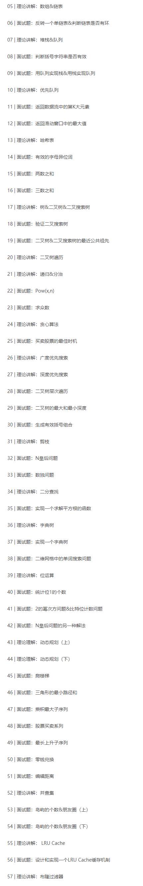

# 极客课程算法面试通关40讲-1
## 课程概述
- __讲师简介__：覃超，Sophon Tech 创始人，拥有卡内基梅隆大学信息安全硕士学位与同济大学计算机科学学士学位。Facebook 早期员工 & 多年面试官、曾作为 Facebook Messenger Tech Lead，主导和参与了 Facebook App、Facebook Messenger、Facebook Phone 等产品的研发工作。
- __课程特点__：
    + 理论讲解：面试常考算法知识点理论讲解
    + 习题实战：LeetCode经典算法题思路剖析及代码实战
- __课程目录__：本节包括 __20-35/57__ 基本搜索算法



## 课程内容：20-35/57 基本搜索算法
### 本节摘要：
内容涵盖课程 20-35 讲，主要介绍常用的搜索相关算法，二叉树遍历、图的DFS/BFS、二分查找，以及中间穿插介绍基本的算法思想，递归+回溯、分治、贪心，并通过习题进行练习巩固。

### 二叉树遍历
遍历的三种方式：主要是指 __根节点的位置__

- __前__序 pre-order ：__根__-左-右
- __中__序 in-order ：左-__根__-右
- __后__序 post-order ：左-右-__根__

```python
def preorder(self, root):
    if root:
        self.traverse_path.append(root, val)
        self.preorder(root.left)
        self.preorder(root.right)
def inorder(self, root):
    if root:
        self.inorder(root.left)
        self.traverse_path.append(root, val)
        self.inorder(root.right)
def postorder(self, root):
    if root:
        self.postorder(root.left)
        self.postorder(root.right)
        self.traverse_path.append(root, val)
```

### Recursion 递归
- __定义__：本质是循环，是 __通过函数体来进行的循环__。从来不停止的递归就是死循环or死递归。不断 __层层递进__ 的结果。

```python
# 递归代码模板
def recursion(level, param1, param2, ...):
    # recursion terminator
    if level > MAX_LEVEL:
        print_result
        return
    # process logic in current level
    process_data(level, data...)
    # drill down
    self.recursion(level+1, p1, ...)
    # reverse the current level status if needed
    reverse_state(level)
```

### Divide & Conquer 分治
- __定义__：divide 先把一些大问题剖析成子问题，然后 conquer 再一一进行解决。__split / merge__ 。

```python
# 分治代码模板
def divide_conquer(problem, param1, param2, ...):
    # recursion terminator
    if problem is None:
        print_result
        return
    # prepare data
    data = prepare_data(problem)
    subproblems = split_problem(problem, data)
    # conquer subproblems
    subresult1 = self.divide_conquer(subproblems[0],p1,...)
    subresult2 = self.divide_conquer(subproblems[0],p1,...)
    subresult3 = self.divide_conquer(subproblems[0],p1,...)
    ...
    # process and generate the final result
    result = process_result(subresult1, subresult2, subresult3, ...)
```

### 面试题
#### 计算n的阶乘
- __题意__：n! = 1 * 2 * 3 * ... * n

```python
def Factorial(n):
    if n <= 1: # 递归的终止条件，这样才不会导致死循环
        return 1
    return n * Factorial(n-1)
```

#### 计算 Fibonacci 数列
- __题意__：F(n) = F(n-1) + F(n-2)

```python
def fib(n):
    if n == 0 or n == 1:
        return n
    return fib(n-1) + fib(n-2)
```

#### [No.50 计算x的n次方](https://leetcode.com/problems/powx-n/description/)
- __题意__：计算x的n次方，x和n都是整数【需要注意的是，__n可能是负数__，如果是负数那就是计算倒数1/x的正数次方了）
- __思路__：
    + 直接调库函数 __pow(x,n)__ O(1) ：不过面试的时候肯定不允许写这个，那还要你来面试干嘛（关于第一种解法，直接调用库函数的话，由于 __库函数的内部实现是O(log n) 的复杂度__，所以严格来讲，第一种解法的复杂度是 O(log n) 。
    + 暴力直接写 __循环__：sum *= x 乘n次 O(n)：
    + __分治__：计算n个x相乘，转化为计算n/2个x相乘，一直转化到x的1次方或者x的0次方停止，然后逐步分n为奇数or偶数往前乘，n刚好是偶数时，res = y * y ，n是奇数时，仍是[n/2]取整，res = y * y * x。时间复杂度 O(logN) ，就是看n可以被切成n/2多少次

```python
# 递归的形式
class Solution:
    def myPow(self, x: float, n: int) -> float:
        if not n:
            return 1
        if n < 0:
            return 1 / self.myPow(x, -n)
        if n % 2:
            return x * self.myPow(x, n-1)
        return self.myPow(x*x,n/2)
# 非递归的形式 & 位运算
class Solution:
    def myPow(self, x: float, n: int) -> float:
        if n < 0:
            x = 1 /x
            n = -n
        pow = 1
        while n:
            if n & 1:
                pow *= x
            x *= x
            n >>= 1 # 相当于 n = n / 2
        return pow
```

#### [No.169 求众数](https://leetcode.com/problems/majority-element/description/)
- __题意__：给定一个数组，返回数组中的众数，__众数表示该元素的出现次数大于n/2，即数组长度的一半__。广义上并不是所有的数组都存在众数，不过这里题目注释有说，给的所有测试用例都有众数，简化的处理流程，不用判断是否存在众数。
- __思路__：
    + __暴力__：先一层循环枚举x，再一层循环计算x的出现次数，最后返回。O(N^2)
    + __Map__ ：涉及到计数都会考虑到Map这个最佳的数据结构，写一层循环，把元素x都放到map里面去计算count，最后再看Map的值最大的元素x是谁，返回即可。时间复杂度 O(1*N+1)=O(N) 每次放进去1，放N次，取最大的1，所以是O(N)；空间复杂度，由于开了一个map，所以是 O(N)
    + __sort__ ：先对数组进行排序，排序之后重复的元素就会放在一起，然后就依次遍历计算元素的出现次数是否大于n/2。时间复杂度 O(NlogN+N) ，排序是 NlogN ，每次比较1，比较N次，最后加起来就是 O(NlogN)
    + __分治__：把数组一分为二，找左边的众数left，找右边的众数right。如果left=right，就找到了最大值，如果不等，就返回比较之后count较大的那一个，最后就可以找到最终的众数。时间复杂度 O(NlogN)，每次找是O(N)的，一分为二会分成logN次。

### Greedy 贪心算法
- __定义__：又叫贪婪算法，在对问题求解的时候，__总是做出在当前看来是最好的选择__
- __缺点__：能够解决的问题比较有限，每次都只在当前做最好的选择的话，也就是局部最优，但 __局部最优不一定是全局最优__
- __优点__：有一类问题用这个方法的确比较简单一点
- __适用 Greedy 的场景__：
    + 简单的说，问题能够分解成子问题来解决，__子问题的最优解能递推到最终问题的最优解__。这种子问题最优解称为最优子结构。
    + 贪心算法与动态规划的不同在于它对每个子问题的解决方案都 __做出选择，不能回退__ ；而动态规划会保存以前的运算结果，并根据以前的结果对当前进行选择，有回退功能。

### 面试题
#### 凑出36金额的钱
- __题意__：用纸币凑出36块钱，求最少需要多少张纸币
- __思路__：每次都用能够匹配的最大面值的钱，所以，就是20/10/5/1。 __因为纸币数设计的时候的间隔比较合理__ ，用贪心法就可以直接得到最少需要的纸币；比如假设面值没有20，只有3种面值10/9/1，让匹配18，这时候，最小的就应该是2个9，而不是先10，然后8个1了；所以贪心法主要在某些场景下是适用的，比如20/10/5/1成倍数的这种情况下。

#### [No.122 买卖股票的最佳时机](https://leetcode.com/problems/best-time-to-buy-and-sell-stock-ii/description/)
- __题意__：给定一个数组，每个元素是股票每天的价格；规则是，只能持有0-1股，当天可以买卖无数次，而且没有交易的手续费，最终赚钱最多；但是由于每天的股价是一致的，所以当天的买入卖出是没有任何收益的，所以考虑每天买入or卖出
- __思路__：
    + __DFS__ ：每天的状态有两种，买1股or卖1股，但卖之前得之前买过，每一步遍历买卖两个仓位；也就是一棵树，不断地买卖，深度一层一层遍历下去，最后到树的叶子节点，对比结果取最大的，记录下它的买卖操作。时间复杂度是 __O(2^n)__ ，虽然不是最优的，但它能够把所有的情况都遍历出来。
    + __贪心__：只要后一天的价格比今天高，那就在今天进行买入，明天进行卖出。也就是对数组进行遍历，每次都锁定一天的利润，因为可以买卖无数次，那么不会存在卖早了的情况。时间复杂度 __O(N)__ ，因为只用遍历一遍数组，而且仅遍历一遍即可。
    + __DP__ 动态规划：把每一步的结果状态都要记录下来，然后用当前的情况，去更新之前的步骤的状态。时间复杂度 __O(N)__ ，但是 DP 能够解决的问题比贪心算法更多，不过写起来复杂度也要高一点。

```python
class Solution:
    def maxProfit(self, prices: List[int]) -> int:
        profit = 0
        for i in range(0,len(prices)):
            if i == len(prices)-1:
                return profit
            if prices[i] < prices[i+1]:
                profit += prices[i+1] - prices[i]
        return profit
```

### 广度优先搜索 Breadth-First-Search
- __为什么需要 BFS__ ：经常发现我们需要在一个很大的集合（树、图、状态集）中寻找特定的节点or元素；人可以直接看图就发现节点位置，但机器不行，它只能够通过一个一个节点遍历去扫，扫的时候的顺序以及保证不扫漏，且只扫描一次。如果扫了多次，说明效率不高；如果有漏点，说明有问题
- __定义__：广度优先搜索，就是 __从根节点开始，一层一层遍历开来__ 。
- __实现__：用队列实现遍历的顺序，首先根节点先进来，然后进来孩子节点，根节点遍历完就出去，一层出去一层进来，__先入先出__。

```python
# 这个代码不仅适用于树，还适用于图
def BFS(graph, start, end):
    queue = []
    queue.append([start])
    visited.add(start) # 记录判重已经被访问过的节点就不再继续访问了；visited是一个set

    while queue:
        node = queue.pop() # 只要队列头元素不为空，那就把队列头取出
        visited.add(node) # 然后标记队列出来的元素为已经访问的状态

        process(node)
        nodes = generate_related_nodes(node) # 2步，取出该节点的儿子后继节点，且判断该孩子未被访问过，就生成
        queue.push(nodes) # 再插入到队列里

    # other processing work
```

### 深度优先搜索 Depth-First-Search
- __起因__：计算机在搜索的时候，默认会 __采用一种栈的数据结构__ ；BFS是队列；所以如果代码用计算机的思维来考虑的话，会快一点？
- __定义__：先从根节点一直往下层访问到叶子节点，然后回退检查是否有儿子节点，再一直往下到叶子节点，再回退检查，不断重复直至遍历到根节点的最后一个儿子的最后一个叶子节点。

```python
# 递归写法：更简单，因为本身递归实现了这么一个栈的结构，不断的深入访问下去
visited = set()
def dfs(node, visited):
    visited.add(node)
    # process current node here.
    ...
    for next_node in node.children():
        if not next_node in visited:
            dfs(next_node, visited)
# 非递归写法：
def DFS(self, tree):
    if tree.root is None:
        return []
    visited, stack = [], [tree.root]
    while stack:
        node = stack.pop()
        visited.add(node)
        process(node)
        nodes = generate_related_nodes(node)
        stack.push(nodes)
    # other processing work
```

### 面试题
#### [No.102 二叉树层次遍历](https://leetcode.com/problems/binary-tree-level-order-traversal/)
- __题意__：给定一个二叉树，返回其层次遍历结果，每一层是一个数组，所有层数组加起来是一个大数组
- __思路__：
    + __BFS__ 广度优先搜索：关键是怎么判断这个节点是这一层的末节点了，两个办法，一个是把每一层的level信息贾导queue里面去，但这样的话queue里面的元素就比较复杂，既包含元素本身又包含层级；另一个办法是，在进行BFS的时候，再写一个循环，把当前这一层扫描完，也就是在进行BFS循环体的时候，每次是一层一层的进行扫描的（批处理 batch processing）。时间复杂度 __O(N)__，每个节点只访问一次，且仅访问一次。这里放到数组中的时候，是一层一层遍历完了，新建数组放进去的。
    + __DFS__ 深度优先搜索：一开始把大的数组建好，每一层都有它对应的空的子数组，DFS循环的时候，本身就要把level给放下去，所以每一次，都按照其相应的深度，灌倒相应的数组的元素层中去。时间复杂度也是 __O(N)__ 的。这里放的时候，是先把数组建好，一个一个根据层级放进去的，进入数组的顺序会有点不一致。

```python
# BFS
class Solution:
    def levelOrder(self, root: TreeNode) -> List[List[int]]:
        if not root: return []
        
        result = []
        queue = collections.deque()
        queue.append(root)
        
        # visited = set(root)
        
        while queue:
            level_size = len(queue)
            current_level = []
            
            for _ in range(level_size): # 保存上一个临时变量的值
                node = queue.popleft()
                current_level.append(node.val)
                if node.left: queue.append(node.left)
                if node.right: queue.append(node.right)
            
            result.append(current_level)
        return result

# DFS
class Solution:
    def levelOrder(self, root: TreeNode) -> List[List[int]]:
        if not root: return []
        self.result = []
        self._dfs(root, 0)
        return self.result
    
    def _dfs(self, node, level):
        if not node: return
        if len(self.result) < level + 1:
            self.result.append([])
        self.result[level].append(node.val)
        self._dfs(node.left, level + 1)
        self._dfs(node.right, level + 1)
```

#### [No.104 二叉树的最大深度](https://leetcode.com/problems/maximum-depth-of-binary-tree/)
#### [No.111 二叉树的最小深度](https://leetcode.com/problems/minimum-depth-of-binary-tree/description/)
- __题意__：给定一个棵二叉树，求最大深度和最小深度，根节点深度为1
- __思路__：
    + __递归__：左边最深，右边最深，对比两边取大的再+1
    + __DFS__ ：每次深度遍历一个节点的时候，也是要记住它的level，放在变量里，同时，如果是叶子节点的话，就还要更新最小深度和最大深度，每次对比发现的叶子节点层数是否比当前最小深度小，小的话进行替换；对比层数是否比最大深度大，大的话进行替换
    + __BFS__ ：按层扫荡，扫到最后一层没有节点可以扫的时候，就是最大深度；最小深度则是每层扫描的时候，判断节点是否是叶子节点，是发现的第一个叶子节点，输出层数，就是最小深度。

```python
# 利用递归进行分治
# 求最大深度
class Solution:
    def maxDepth(self, root: TreeNode) -> int:
        if not root: return 0
        return 1+max(self.maxDepth(root.left),self.maxDepth(root.right))
# 求最小深度
class Solution:
    def minDepth(self, root: TreeNode) -> int:
        if not root: return 0
        if not root.left: return 1 + self.minDepth(root.right)
        if not root.right: return 1 + self.minDepth(root.left)
        return 1 + min(self.minDepth(root.left),self.minDepth(root.right))
```

#### [No.22 括号生成](https://leetcode.com/problems/minimum-depth-of-binary-tree/description/)
- __题意__：给出n代表生成括号的对数，写一个函数，生成所有可能且有效的括号组合，每个组合是数组中的一个字符串元素
- __思路__：
    + __数学归纳法__：n=1的时候只有()，n=2的时候只能在1的左边加or嵌套，然后逐步分析，一直推到给定的n进行输出
    + __递归+DFS__ ：当n给定的时候，字符串的长度也就给定了，相当于给定2n个格子，每个格子里面有两种选择，可以是(，也可以是)，总共生成2^2n这么多候选人，然后再判断是否合法。这里递归的实现意思是，从第一个格子开始，可以加(，也可以加)，然后类似一棵树，不断加下去，深度优先，最后对生成的字符串进行判定。时间复杂度 __O(2^2n)__ ，相当于把所有的搜索情况都做了
    + __改进__：在这里加的时候，不要傻加(，和傻加)了，因为肯定有n个(，和n个)，在上面所谓的搜索，加了一个剪枝；剪枝的思路，一个是如果是局部不合法，比如在已有拼好的括号的基础上，使用)，就不合法，不再递归；另一个是，要每次分配的时候，记住(用了几个，)用了几个。最后时间复杂度 __O(2^n)__ 

```python
class Solution:
    def generateParenthesis(self, n: int) -> List[str]:
        self.list = []
        self._gen(0,0,n,"")
        return self.list
    
    def _gen(self,left,right,n,result):
        if left == n and right == n:
            self.list.append(result)
            return
        if left < n:
            self._gen(left+1,right,n,result+"(")
        if left > right and right < n:
            self._gen(left,right+1,n,result+")")
```

### 剪枝
- __应用__：剪枝是在搜索中经常用到的一种优化策略，是搜索中基本上必用的一种手段。
- __BFS 和 DFS 的共同点__：都会 __把所有节点访问一次，且仅访问一次__
- __含义__：一个节点可能有多个分支，根据一些判定条件or优胜劣汰，可以 __找一个局部最优的分支继续往下走__
- __解决现实问题__：
    + __状态集合非常大__，直接蛮力搜索并不高效
    + 很多在 __分岔的时候__ ，已经得到了优先级or优胜劣汰的判断之后，__直接找我们认为最优的分支继续，把差了的直接剪掉__
        * 非常确定，最优分支只有一条：那就直接走
        * 不太确定当前分支是否是全局最优分支，则可能每个分支都需要遍历一次，但要把局部优先分支优先搜索一遍

### 面试题
#### Tic Tac Toe 棋类游戏
- __题意__：两个人在九宫格里各执一个符号，一来一往，谁先排成三行or三列or三斜线，则赢了
- __思路__：每下一步，就是在算对方可能会下的所有位置，然后再针对对方的位置，考虑自身所有可能的位置，会 __生成一个很大的树状一层（一步）的状态集__，有些时候，胜利在第一、二步就确定了；如果剪枝做得好，就可以不用去搜索那些分支的可能。

#### 八宝盒问题
#### [No.51 N皇后问题](https://leetcode.com/problems/n-queens/)
#### [No.52 N皇后问题2](https://leetcode.com/problems/n-queens-ii/)
- __题意__：如何将 n 个皇后放置在 n x n 的棋盘上，且使皇后彼此之间不能相互攻击。皇后可以攻击的范围就是横、竖、斜。打印出所有可能的 n 个皇后的期盼
- __思路__：这样的一种递归，和搜索之前已经在回溯的时候说过很多次了
    + __DFS__ ：每一行，就是所谓的层数/深度，递归的终止条件是，到了第N层就结束；每层里面，枚举每一列，每一层只能放一个皇后，所以每到一层就要去处理那一个皇后的位置；关键在于怎么判断这个格子能不能放
        * __暴力__：对这个位置，把整个棋盘重新扫一遍，去看在它的横、竖、撇、捺的位置是否已经有皇后，没有就可以放
        * __数组__：需要剪枝判断剩下的枝叶不用再搜索，__构建一个数组，把已经存的位置记录下来__，下次搜索的时候就不用了；建立列的数组，把数组元素标记为1表示已经被占，一层一层扫的时候，就可以不用做判断，进行了剪枝，关键在于撇和捺的问题，分析可得，如果是撇，则 x+y=c 撇上的元素行列索引相加，和相同是一个常数；而如果是捺，则是 x-y=c 是一个常数

```python
class Solution:
    def DFS(self, n, row, cur_state):
        if row >= n:
            # print(row)
            self.result.append(cur_state)
            return
        for col in range(n):
            if col in self.cols or row+col in self.pie or row-col in self.na:
                continue
            self.cols.add(col)
            self.pie.add(row+col)
            self.na.add(row-col)
            
            self.DFS(n, row+1,cur_state+[col])
            
            self.cols.remove(col)
            self.pie.remove(row+col)
            self.na.remove(row-col)
    def _generate_result(self,n):
        board = []
        for res in self.result:
            for i in res:
                board.append("."*i + "Q" + "."*(n-i-1))
        # print(self.result,board)
        return [board[i:i+n] for i in range(0,len(board),n)]
    def solveNQueens(self, n: int) -> List[List[str]]:
        if n < 1: return []
        self.result = []
        self.cols = set(); self.pie = set(); self.na = set()
        self.DFS(n, 0, [])
        return self._generate_result(n)

# 位运算：在N皇后的问题里，有很多的解法，但是位运算是所有解法里面最好最快最简洁最高效的解法

```

#### [No.36 有效的数独](https://leetcode.com/problems/valid-sudoku/description/)
- __题意__：判断一个 9x9 的数独是否有效，只需要根据以下规则，1-9在每行、列只出现一次，且每个粗实线分割的3x3九宫格内只能出现一次。
- __思路__：
    + __搜索+剪枝__：关键是去判断是否满足上述规则。__直接写两个for循环的嵌套__，判断行和列里面都没有重复的1-9，同时3x3的小个子里面也没有重复的1-9。row[9] col[9] block[3][3] , [i/3][j/3] 以此来进行对应，ij每次加3，在这3个数组里面，标记1-9出现的次数

#### [No.37 数独解决器](https://leetcode.com/problems/sudoku-solver/#/description)
- __题意__：给定一个上述有空格的数独，把它填满
- __思路__：搜索+剪枝：和N皇后一样，对于重复的数，怎么进行有效的标记和判重。和人的思维一样，枚举到一个空格的位置，检查这个空格可以填的数字有哪些，这些就是所谓的分支，然后对每条分支都继续往下走，走到某一步的时候，它存在一个唯一分支，这个时候，就可以把这个数字进行填充。填充之后，会对之前的可填写的搜索结果进行一个反向剪枝
    + Naive __暴力__ DFS：从(i,j)每一次都开始枚举各自，loop 1-9，check_valid
    + __加速__ ：借鉴人的思路。__先枚举可能性/选项少的格子开始扫__。或者 __使用预处理__，扫的时候，先把这个位置上可选数进行枚举，再根据可选数的个数进行一个排序，然后根据可选数最少的格子，依次去进行一个搜索DFS的操作。loop 格子的可选数，然后去 check_valid。第三种则是采用高级的数据结构（有很多种，都便于调整坏数什么的），比如 dancinglink，另外还有一种在判重的时候，采用bitwise位运算

```python
# 直接转 java 成 python 会超时，可能得采用优化加速的办法才行。
class Solution:
    def solveSudoku(self, board: List[List[str]]) -> None:
        """
        Do not return anything, modify board in-place instead.
        """
        if board == None or len(board) == 0:
            return
        self.solve(board)
        
    def solve(self, board: List[List[str]]):
        character = ['1','2','3','4','5','6','7','8','9']
        for i in range(0,len(board)):
            for j in range(0,len(board[0])):
                if board[i][j] == '.':
                    for k in range(0,len(character)):
                        if self.isValid(board,i,j,character[k]):
                            board[i][j] = character[k]
                            if self.solve(board):
                                return True
                            else:
                                board[i][j] = '.'
                    return False
        return True
        
    def isValid(self, board, row, col, c):
        for i in range(0,9):
            if board[i][col] != '.' and board[i][col] == c:
                return False
            if board[row][i] != '.' and board[row][i] == c:
                return False
            if board[3*(row//3) + i//3][3*(col//3)+i%3] != '.' and board[3*(row//3) + i//3][3*(col//3)+i%3] == 'c':
                return False
        return True
```

### Binary Search 二分查找
- __适用场景条件__：不是所有问题都适合使用二分查找
    + Sorted __已排序__（单调递增or单调递减）：这是二分查找之所以快的核心
    + Bounded（__存在上下界__）：每次都要一分为二，必须存在明确的上下界
    + Accessible by index（__能够通过索引访问__）：当确定好左右键之后，中间的数可以直接通过所以访问得了【Tips：所以说数组是非常适合二分查找的，但是链表则是非常不适合】
- __时间复杂度__：__O(logN)__ log底数是2

```python
# 二分查找代码片段，假设数组是单调递增的
left, right = 0, len(array) -1
while left <= right:
    # mid = (left + right) / 2
    mid = left + (right - left) / 2 # 为避免出现溢出问题
    if array[mid] == target:
        # find the target !!
        break or return result
    elif array[mid] < target:
        left = mid + 1
    else:
        right = mid - 1
```

### 面试题
#### [No.69 实现 int sqrt(int x) 函数](https://leetcode.com/problems/sqrtx/)
- __题意__：计算并返回x的平方根，其中x是非负整数，由于返回类型是整数，结果只保留整数的部分，小数部分将被舍去。
- __思路__：
    + __二分法__：不断的枚举数字，看它的平方根是比给定的数大还是小，然后 __不断二分逼近结果__。真因为y=x^2是单调递增的，所以才可以用二分查找的办法。这里就是给定下界可以是0，然后上界就是给定的数字x，mid就等于x/2，然后不断的mid，然后循环，最后终止条件是，左键和右键的差，float(abs(l-r)) 小于 10^-5 或者 -9 次方 1e^-9
    + __牛顿迭代法__：偏数学一点，但在程序实现的时候，更多是这么做的。__不断的枚举，求切线，切线的根__，最后推导的结果就是，可以用 X(n+1) = X(n) - f(Xn)/f'(Xn) 来进行迭代，最后推导就是 X(n+1) = (Xn+Y0/Xn)/2

```python
class Solution:
    def mySqrt(self, x: int) -> int:
        if x == 0 or x == 1:
            return x
        l = 1
        r = x
        while(l <= r):
            m = (l+r)//2
            if m == x//m:
                return m
            elif m > x//m:
                r = m-1
            else:
                l = m+1
                res = m
        return res

# 牛顿迭代法
class Solution:
    def mySqrt(self, x: int) -> int:
        r = x
        while r * r > x:
            r = (r + x / r) / 2
        return r
```

#### [No.367 Valid Perfect Square](https://leetcode.com/problems/valid-perfect-square/)
