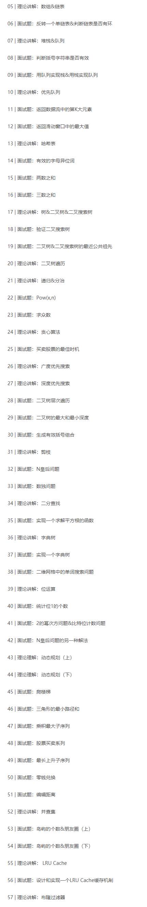

# 极客课程算法面试通关40讲-3
## 课程概述
- __讲师简介__：覃超，Sophon Tech 创始人，拥有卡内基梅隆大学信息安全硕士学位与同济大学计算机科学学士学位。Facebook 早期员工 & 多年面试官、曾作为 Facebook Messenger Tech Lead，主导和参与了 Facebook App、Facebook Messenger、Facebook Phone 等产品的研发工作。
- __课程特点__：
    + 理论讲解：面试常考算法知识点理论讲解
    + 习题实战：LeetCode经典算法题思路剖析及代码实战
- __课程目录__：本节包括 __36-57/57__ 特殊数据结构



## 课程内容：36-57/57 特殊数据结构
### 本节摘要：
内容涵盖课程 36-57 讲，主要介绍特殊应用场景的数据结构，包括字典树、并查集、LRU缓存、BloomFilter，以及较难掌握的动态规划算法及位运算，并通过习题进行练习巩固。

### Trie 字典树
- __实际要解决的问题__：搜索引擎搜索框根据频次提供搜索备选
- __定义__ ：Trie 树，即字典树，又称单词查找树，树形结构，是一种哈希树的变种。典型应用是用于统计和排序大量字符串（但不仅限于字符串），所以经常被搜索引擎系统用于文本词频统计。
- __优点__：最大限度的减少无谓的字符串比较，查询效率比哈希表高。并且，当查询到BAT的时候，它会把前缀相同的，孩子分支按频次进行排序
- __数据结构__：不是用节点来存，而是 __用边来存字母__，每个节点上的标签，就是该节点到根节点的边上字符组成的字符串，__叶子节点表示是一个单词__，且有一个数字表示出现次数。节点上的字符不会记录下来，__需要把它的路径记录下来拼接在一起__，即字符是保存在边上的。__字符串的长度就等于走过的路径边个数__。单词长度最多20？__树的深度20多__。而每个节点的孩子节点分支的极限就是26个（字母），加上大小写就52，加上一些特殊字符如连字符等，__分支不会超过100个__。
- __核心思想__：是 __以空间换时间，利用字符串的公共前缀来降低查询时间的开销以达到提高效率的目的__。
- __基本性质__:
    + 根节点不包含字符，除根节点外每一个节点都只包含一个字符
    + 从根节点到某一节点，路径上经过的字符连接起来，为该节点对应的字符串
    + 每个节点的所有子节点包含的字符都不相同

```python
class TrieNode:
    # Trie node class
    def __init__(self):
        self.children = [None] * ALPHABET_SIZE
        # isEndOfWord is True if node represent the end of the word
        self.isEndOfWord = False
```

### 面试题
#### [No.208 Implement Trie (Prefix Tree)](https://leetcode.com/problems/implement-trie-prefix-tree/)
- 题意：实现一个 Trie 字典树
- 思路：直接写

```python
class Trie:

    def __init__(self):
        """
        Initialize your data structure here.
        """
        self.root = {}
        self.isEndOfWord = "#"

    def insert(self, word: str) -> None:
        """
        Inserts a word into the trie.
        """
        node = self.root
        for i in range(0,len(word)):
            node = node.setdefault(word[i],{}) # 如果这个char已经在字典中的key存在的话就把它在字典中的值取出来，不然的话就是把字典设置到这个字典中去；类似于get，只是如果没有这个字典的话，会set一个空的字典
            # self.children = word[i]
            # self.isEndOfWord = False
            # self = self.children
        node[self.isEndOfWord] = self.isEndOfWord

    def search(self, word: str) -> bool:
        """
        Returns if the word is in the trie.
        """
        node = self.root
        for i in range(0,len(word)):
            if word[i] not in node:
                return False
            node = node[word[i]]
            # elif self.isEndOfWord and i+1<len(word):
            #     return False
            # else:
            #     self = self.children
        # if self:
        #     return True
        return self.isEndOfWord in node

    def startsWith(self, prefix: str) -> bool:
        """
        Returns if there is any word in the trie that starts with the given prefix.
        """
        node = self.root
        for char in prefix:
            if char not in node:
                return False
            node = node[char]
        return True
        
# Your Trie object will be instantiated and called as such:
# obj = Trie()
# obj.insert(word)
# param_2 = obj.search(word)
# param_3 = obj.startsWith(prefix)
```
#### [212. Word Search II](https://leetcode.com/problems/word-search-ii/)
- __题意__：单词搜索2。输入一个单词的数组，以及一个可选字符的board矩阵，输出这些单词是否在二维矩阵中存在。存在的要求是，字母是相邻的，且不能重复使用，依次填过去。只要是相邻的字符，前后左右都可以走，一笔划过。
- __思路__：
    + __DFS__：每一个word都是一个候选词，依次枚举矩阵，看字符是否对得上，对上了之后（第一层），枚举它周围的字符作为分支，继续看是否对得上，再继续，从头到尾遍历二维矩阵，直至遍历结束，若仍不存在则不存在。
    + __Trie__：这个题目的特点是，候选词已经帮你找好了。先对候选词进行一次预处理，先把所有的候选词放到Trie里面来，行程以这些候选词构成的一个Trie树

```python
from collections import defaultdict

dx = [-1, 1, 0, 0]
dy = [0, 0, -1, 1]

END_OF_WORD = "#"

class Solution:
    def findWords(self, board: List[List[str]], words: List[str]) -> List[str]:
        """
        :type board: List[List[str]]
        :type words: List[str]
        :rtype: List[str]
        """

        if not board or not board[0]:
            return []
        if not words:
            return []

        self.result = set()
        root = defaultdict()

        for word in words:
            node = root
            for char in word:
                node = node.setdefault(char, defaultdict())
            node[END_OF_WORD] = END_OF_WORD

        self.m, self.n = len(board), len(board[0])

        for i in range(self.m):
            for j in range(self.n):
                if board[i][j] in root:
                    self._dfs(board, i, j, "", root)
        
        return list(self.result)


    def _dfs(self, board, i, j, cur_word, cur_dict):
        cur_word += board[i][j]
        cur_dict = cur_dict[board[i][j]]

        if END_OF_WORD in cur_dict:
            self.result.add(cur_word)
            
        tmp, board[i][j] = board[i][j], "@"
        for k in range(4):
            x, y = i + dx[k], j + dy[k]
            if 0 <= x < self.m and 0 <= y < self.n \
                and board[x][y] != "@" and board[x][y] in cur_dict:
                self._dfs(board, x, y, cur_word, cur_dict)
        board[i][j] = tmp

```
### 位运算
- __定义__：直接对整数在内存中的二进制位进行操作。这里的“位”表示的是 __二进制位__，不是十进制、十六进制等。
- __优势__：计算机是采用二进制位来存储的，由于 __位运算直接对内存数据进行操作__，不需要转成十进制，因此 __处理速度非常快__
- __常用操作__：&与，|或，^异或，~取反，<<左移，>>右移
    + XOR ^ __异或：相同为0，不同为1__，也可用不进位加法来理解。

```python
# 基本操作
x^0=x
x^1s=~x # 1s=~0 # 1s表示一个全1的数
x&(~x)=1s
x^x=0 # 非常有趣且重要的结论
a^b=c ->a^c=b,b^c=a # swap 交换
a^b^c=a^(b^c)=(a^b)^c # associative

# 实战常用的位运算操作，同时也是面试的时候经常会问到的一些操作
X & 1 == 1 OR == 0 # 判断奇偶 x%2==1
X=X &(X-1) # ->清零最低位的1
X&-X # ->得到最低位的1

# 更为复杂的位运算操作：让大家了解，不一定要记得每一个
x & (~0 << n) # 将 x 最右边的 n 位清零
(x >> n) & 1 # 获取 x 的第 n 位值（0 or 1）
x & (1 << (n - 1)) # 获取 x 的第 n 位的幂值
x | (1 << n) # 仅将第 n 位置为 1
x & (1 << n) # 仅将第 n 位置为 0
x & ((1 << n) - 1) # 将 x 最高位至第 n 位(含)清零
x & (~((1 << (n+1)) - 1))# 将第 n 位至第 0 位(含)清零
```

### 面试题
#### [No.191 统计位1的个数](https://leetcode.com/problems/number-of-1-bits/)
- __题意__：输入一个无符号整数，返回其二进制表达式中数字位数为 1 的个数（被称作 Hamming weight）
- __思路__：
    + __直接枚举所有位数看是否为1__：每次 x % 2 取模，如果余数为1的话，就++；然后 x= x >> 1 右移一位。时间复杂度，这个数字有多少位就是要除多少次，一般来说是32位的整数，还是常数的复杂度。
    + __X=X &(X-1) 每次把最后一位的1给打掉__；循环 while x!=0 每次计数，打掉最后的一个1，直至全0。时间复杂度就不是32了，而是看你到底有多少个1

```python
class Solution:
    def hammingWeight(self, n: int) -> int:
        rst = 0
        mask = 1
        for i in range(32):
            if n & mask:
                rst += 1
            mask = mask << 1
        return rst

class Solution:
    def hammingWeight(self, n: int) -> int:
        res = 0
        while n != 0:
            res += 1
            n = n & (n -1)
        return res
```

#### [2的幂次方](https://leetcode.com/problems/power-of-two/)
- __题意__：给定一个数，判断它是不是2的幂次方数，如4,8,16。
- __思路__：
    + mod 2 一直到最后看是否存在余数，看是否能够被2整除
    + 使用数学函数，看 log2 是不是一个整数
    + x!=0 且 x&(x-1)==0

```python
class Solution:
    def isPowerOfTwo(self, n: int) -> bool:
        return n != 0 and n & (n-1)==0
```

#### 比特位计数问题
- __题意__：给定一个非负整数 num ，对于 0 <= i <= num 范围中的每个数字 i ，计算其二进制数中的 1 的数目，并将它们作为数组返回
- __思路__：
    + 写一个 for 的循环遍历到 n ，单独计算每个数字的 1 的个数
    + 考虑一个O(n)的解法：开一个数组，把每个计算得到的结果进行保存， count[i] = count[i&(i-1)] +1 使用这一个递推的式子，就可以不用对 i 本身，每次计算它1的个数了。去除最低位1之后的个数再加上一个1

```python
class Solution:
    def countBits(self, num: int) -> List[int]:
        count = [0]*(num+1)
        for i in range(1,num+1):
            count[i] = count[i&(i-1)] + 1
        return count
```
#### [No.52 N皇后问题2](https://leetcode.com/problems/n-queens-ii/)
- __位运算解法__：在N皇后的问题里，有很多的解法，但是 __位运算是所有解法里面最好__最快最简洁最高效的解法。
- 具体思路：
    + DFS 部分还是一层一层的扫，不变
    + __重点是判重的部分，不再使用 set 和 数组进行判重，而是直接采用整数__，N皇后，使用N位的3个整数，遍历每一行，用 col 列，pie 撇，na 捺这3个整数，的最后四位二进制位表示这一行中，如果为1，表示在这一行中，该位置上的元素，在 列or撇or捺的方向上存在冲突，如果是0表示没有冲突，可以放；也就是说最终判重的时候，把这个三个数字进行按位与&，如果与完之后还有为0的，表示三个位置上都不存在冲突，可以放

```python
class Solution:
    def totalNQueens(self, n: int) -> int:
        if n < 1: return []
        self.count = 0
        self.DFS(n, 0, 0, 0, 0)
        return self.count
    
    def DFS(self, n, row, col, pie, na):
        # recursion terminator
        if row >= n:
            self.count += 1
            return
        bits = (~(col|pie|na)) & ((1<<n)-1) # 得到当前所有的空位
        while bits:
            p = bits & -bits # 取到最低位的1
            self.DFS(n, row+1, col|p, (pie|p)<<1, (na|p)>>1)
            bits = bits & (bits -1) # 去掉最低位的1
```
### 动态规划 Dynamic Programming
- __实质__：就是 __动态递推__
    1. __递归+记忆化 -> 递推__：对一个基本的动态规划的题，不知道怎么做，首先先按照基本的递归的思路去做，再加上记忆化中间过程的结果进行搜索，基本上可以解决这个问题；然后再思考怎么做成递推。
    2. __状态的定义__： opt[n], dp[n], fib[n]；动态规划的关键点有两个，一个是状态的定义，定义成一个数组；
    3. __状态转移方程__： opt[n] = best_of(opt[n-1],opt[n-2])：第二个就是通过这个定义，推导出状态转移方程，也就是所谓的BP方程，也就是从前面第n-1个值，得到最优的第n个值，
    4. __最优子结构__：上面两个完了之后，动态规划的题目通常有一个特点，就是最优子结构，也就是说，前面n-1个状态存在一个最优子结构，可以推导出第n个状态，就是动态规划存在的一个基础条件。
- __DP vs 回溯 vs 贪心__
    + 回溯（递归）——重复计算
    + 贪心——永远局部最优
    + DP——记录局部最优子结构/多种记录值

### 面试题 
#### 斐波那契数列
__递推公式__： F[n] = F[n-1] + F[n-2]；F(0) = 0， F(1) = 1
```python
# 最简单的递归的代码：
def fib(n):
    return n if n <= 1 else fib(n-1)+fib(n-2)

# “记忆化”加速：关键在代码部分增加一个缓存【空间换时间】
def fib(n,memo[]):
    if n <= 1:
        return n
    elif memo[n] == 0:
        memo[n] = fib(n-1)+fib(n-2)
    return memo

# DP（递推）：不再自上而下，而是自下而上，递推就是把递归的顺序反过来
def fib(n):
    F = []
    F[0] = 0
    F[1] = 1
    for i in range(0,n+1):
        F[i] = F[i-1] + F[i-2]
    return F[n]
```

#### 计算棋盘路径个数
- __题意__：一个N乘M的棋盘格子，从棋盘的最左上方，求走到最右下方的路径个数，棋盘某些格子被石头挡住无法直行；只能向右或者向下走，每次走一步。
- __思路__：如果没有石头，这就是一个排列组合的问题，C(m+n)(m) 中走法
    + 如果假设使用递归的话，应该怎么想？只分析一步的状态，每次只能向右or向下走，也就是说，当前格子的路径个数，是下面和右边格子的路径个数进行相加得到，也就是说递归的从上到下的公式得到了。__每次只用想下一步走到哪里，不要想太多步，想太多步就想不清楚了__。特别的是，如果是石头，也就是说不能走，要返回0，而如果是终点，则说明直接走过去，只有一种走法，返回1
    + 而在计算简单递归的时候，会存在重复计算，这也就是可以加速的地方。
    + 而递推，则反过来，从下而上进行计算。因为最终点的状态是确定的，只能从终点的上方和左方格子走过来，而这两个各自走到重点的路径个数都是1。
    + __状态转移方程__：if a[i,j] == '空地': opt[i,j] = opt[i-1,j] + opt[i,j-1] else: opt[i,j] = 0 只用去管相邻状态就行了。
    + __时间复杂度__：如果是递推的话，只用写一次循环即可，一个嵌套的循环i从m到0，以及j从n到0，也就是有多少个格子，时间复杂度就是这么多 O(MN) 。这比之前指数级的复杂度就快了不少
    + __最优子结构__：除了解决最开始的起点到终点的问题，其实也解决了很多中间的子问题的最优解，求任意一个格子到终点的路径个数，都可以直接得到。它存在很多最优子结构的问题，依托出了最后的这个问题。这种最优子结构使得程序不需要反反复复的回溯到终点，只需要依赖它前一个状态的最优值

#### [No.70 爬楼梯](https://leetcode.com/problems/climbing-stairs/description/)
- __题意__：给你一个台阶，自己上一步or上两步，最后走到最上面去。
- __思路__：
    + 回溯/递归：所有这种楼梯不断走、格子不断走的问题，采用回溯是OK的。就傻搜就行了，每一步看可以走1步or2步，然后继续搜（调用）就行了。
    + 递推/DP：就是直接初始化，写一个从2到n的循环。时间复杂度是 O(N) ，而且这里的变量可以不用数组存储，直接只用两个变量保存前两个楼梯的值，也就是总共三个变量即可。空间复杂度是 O(1)
    + O(n) 并不是最快的，解斐波那契有 O(logN) 的解法

```python
# 记忆化
class Solution:
    def climbStairs(self, n: int) -> int:
        fib = []
        fib.append(1)
        fib.append(1)
        for i in range(2,n+1):
            fib.append(fib[i-1] + fib[i-2])
        return fib[n]
# DP递推
class Solution:
    def climbStairs(self, n: int) -> int:
        if (n == 0 or n == 1):
            return n
        last_one = 1
        last_two = 1
        rst = 0
        for i in range(2,n+1):
            rst = last_one + last_two
            last_two = last_one
            last_one = rst
        return rst
# 进一步简化
class Solution:
    def climbStairs(self, n: int) -> int:
        x, y = 1, 1
        for _ in range(1,n):
            x, y = y, x+y
        return y
```

#### [Medium 120. Triangle](https://leetcode.com/problems/triangle/description/)
- __题意__：给定一个三角形的二维数组，求三角形自顶向下的最小路径和，没到达一个点，只能往下面相邻的两个点走
- __思路__：其实就是可以想象是一棵树，从顶点到叶子节点路径和最小的值
    + 递归/回溯：Traverse(i,j) 继续往下递归调用 i+1,j 和 i+1,j+1 ，遍历把每条路径的和都求出来，最后求和的最小值；时间复杂度 O(2^n) ，因为需要把每条路径都遍历一下，同时可以加一些缓存or记忆化的方式进行加速，但其实不是很高效
    + 贪心？：如果只是简单的从当前层进行贪心的话，是没办法解决的，存在测试用例结果会错
    + DP：时间复杂度 O(M*N)；空间复杂度也是 O(M*N) ，因为要定义一个二位数组
        * 状态定义：从下往上想进行递推 dp[i,j] 表示从下面一层的两个节点，走到 i,j 这个点上的路径和最小值；所以最底下一层的值为递推的初始值，就是节点本身的值，倒数第二层的值，则是其下层相邻两个节点最小值加上第二层节点本身值的和，依次类推到最终 i=0,j=0
        * DP方程：dp[i,j] = min(dp[i+1,j],dp[i+1,j+1]) + trangle[i,j] ；dp[m-i,j] = trangle[m-1,j]

```python
# DP 巧妙的反复使用一个一维数组，以减少空间
import copy
class Solution:
    def minimumTotal(self, triangle: List[List[int]]) -> int:
        # mini = [[0]*len(triangle[i]) for i in range(len(triangle))]
        # mini = [0] * len(triangle[-1])
        mini = copy.deepcopy(triangle[-1])
        # print(mini)
        for i in range(len(triangle)-2,-1,-1):
            for j in range(0,len(triangle[i])):
                mini[j] = triangle[i][j] + min(mini[j],mini[j+1])
        return mini[0]

class Solution:
    def minimumTotal(self, triangle: List[List[int]]) -> int:
        if not triangle: return 0

        res = triangle[-1] # 如果直接这样拷贝的话，会把 triangle 最后一层的值改变
        for i in range(len(triangle)-2,-1,-1):
            for j in range(len(triangle[i])):
                res[j] = min(res[j],res[j+1]) + triangle[i][j]
        print(triangle)
        return res[0]

```

#### [Medium 152. Maximum Product Subarray](https://leetcode.com/problems/maximum-product-subarray/description/)
- __题意__：给定一个数组，从中选择一个连续的子序列，里面的数相乘，值是多少，即求乘积最大子序列的值返回
- __思路__： 先假设它不用连续，会是一个什么样的子序列。如果每个数都可以选择要or不要，那就直接用递归，穷举，对比最终的值，求最大；时间复杂度 O(2^n)。更简单的办法是，把其中大于0或者大于1的数都挑出来，然后乘即可，如果有双数的负数，那也可以乘进来。
    + 暴力求解：采用递归暴力求解，每次遍历数字，都可以选择乘or不乘，如果乘就记下来，不乘的话，下一个还是从1开始；并且在每一个递归的乘积里面，都要去记录最大的max，最后全局的max就是最终的结果。
    + DP：
        * 状态定义：DP[i] 表示从0开始看到i，最大乘积子序列的值为多少，并不代表一定要从0开始选到i，这只能保证i一定被选；所以最后的结果，是 DP[n-1] 一直到 DP[0] 之间最大的值，返回。——一维不够。DP[i][2] 一个表示正数，也就是最大值，一个表示负数，也就是最小值。
        * 方程：DP[i,0] = if a[i] > 0 : DP[i-1,0] * a[i] else DP[i-1,1] * a[i] ； DP[i,1] = if a [i] >= 0 : DP[i-1,1] * a[i] else DP[i-1,0] * a[i] ；最后的结果在 DP[i,0] 的位置，求它的所有的最大值即可

```python
class Solution:
    def maxProduct(self, nums: List[int]) -> int:
        if nums is None: return 0
        
        dp = [[0 for _ in range(2)] for _ in range(2)]
        dp[0][1], dp[0][0], res = nums[0], nums[0], nums[0]
        
        for i in range(1,len(nums)):
            x, y = i % 2, (i - 1) % 2
            dp[x][0] = max(dp[y][0] * nums[i], dp[y][1] * nums[i], nums[i])
            dp[x][1] = min(dp[y][0] * nums[i], dp[y][1] * nums[i], nums[i])
            res = max(res, dp[x][0])
            
        return res

class Solution:
    def maxProduct(self, nums: List[int]) -> int:
        if nums is None: return 0
        
        res, curMax, curMin = nums[0], nums[0], nums[0]
        
        for i in range(1, len(nums)):
            num = nums[i]
            curMax, curMin = curMax * num, curMin * num
            curMin, curMax = min(curMax, curMin, num), max(curMax, curMin, num)
            # print(curMin, curMax)
            res = curMax if curMax > res else res
        return res
```

#### [Easy 121. Best Time to Buy and Sell Stock](https://leetcode.com/problems/best-time-to-buy-and-sell-stock/#/description)
- __题意__：只能买卖一次，怎么达到股票利润的最大化
- __思路__：遍历一次，记录最小值，然后用当前数减去之前的最小值，得到利益值，最后输出利益值最大的情况

```python
class Solution:
    def maxProfit(self, prices: List[int]) -> int:
        if not prices: return 0
        
        res = 0
        profit = [[0 for i in range(3)] for i in range(len(prices))]
        profit[0][0], profit[0][1], profit[0][2] = 0, -prices[0], 0
        
        for i in range(1,len(prices)):
            profit[i][0] = profit[i-1][0]
            profit[i][1] = max(profit[i-1][1], profit[i-1][0] - prices[i])
            profit[i][2] = profit[i-1][1] + prices[i]
            res = max(res, profit[i][0], profit[i][1], profit[i][2])
            
        return res
```

#### [Easy 122. Best Time to Buy and Sell Stock II](https://leetcode.com/problems/best-time-to-buy-and-sell-stock-ii/)
- __题意__：可以买卖无数次，怎么达到股票利润的最大化
- __思路__：只要后一天的价格比前一天高，就可以买；也就是相邻两个值相减，只要是正数就进行相加，一直到最后的和就是所有的利润最大值

#### [Hard 123. Best Time to Buy and Sell Stock III](https://leetcode.com/problems/best-time-to-buy-and-sell-stock-iii/)
- __题意__：只能买卖两次，第二次买之前必须先卖出去，交易只能两次且同时不能有两笔交易，求买卖股票的最佳时机
- __代码选讲__：
    + discuss/39611/Is-it-Best-Solution-with-O(n)-O(1) 效果貌似最好
    + discuss/39615/My-explanation-for-O(N)-solution
    + discuss/39608/A-clean-DP-solution-which-generalizes-to-k-transactions

```python
class Solution:
    def maxProfit(self, prices: List[int]) -> int:
        if not prices: return 0
        
        profit = [[[0 for _ in range(2)] for _ in range(3)] for _ in range(len(prices))]
        profit[0][0][0], profit[0][0][1] = 0, -prices[0]
        profit[0][1][0], profit[0][1][1] = -inf, -inf
        profit[0][2][0], profit[0][2][1] = -inf, -inf
        
        for i in range(1,len(prices)):
            profit[i][0][0] = profit[i-1][0][0]
            profit[i][0][1] = max(profit[i-1][0][1], profit[i-1][0][0] - prices[i])
            
            profit[i][1][0] = max(profit[i-1][1][0], profit[i-1][0][1] + prices[i])
            profit[i][1][1] = max(profit[i-1][1][1], profit[i-1][1][0] - prices[i])
            
            profit[i][2][0] = max(profit[i-1][2][0], profit[i-1][1][1] + prices[i])
            
        end = len(prices) - 1
        return max(profit[end][0][0], profit[end][1][0], profit[end][2][0])

```

#### [Medium 309. Best Time to Buy and Sell Stock with Cooldown](https://leetcode.com/problems/best-time-to-buy-and-sell-stock-with-cooldown/)
- __题意__：加了一个 __cooldown__ ，也就是卖完了之后，第二天不能马上买，必须要隔一天

#### [Hard 188. Best Time to Buy and Sell Stock IV](https://leetcode.com/problems/best-time-to-buy-and-sell-stock-iv/)
- __题意__：是 123 的泛化版本，最多可以 __进行 k 笔交易__

#### [Medium 714. Best Time to Buy and Sell Stock with Transaction Fee](https://leetcode.com/problems/best-time-to-buy-and-sell-stock-with-transaction-fee/)
- __题意__：__添加交易手续费__如何解决
- __思路__：用一个 DP ，只用对方程进行细微的修改，通用解决上述所有的题目。
    + 状态定义：
        * MP [i] 表示到第 i 天的 max profix ， 最后输出 MP[n-1] —— 当你发现状态定义不够，或者是没法进行递推的时候，表示你在那一天的状态不够了，所以要做的是增加一个维度 or 增加一个数组。
        * MP[i][j] j 取值范围是 0 表示手里没有股票， 1 表示手里有股票； 0 的时候没有股票只能买， 1 的时候手里有股票只能卖——还不够，还需要一维来记录交易了多少次
        * MP[i][j][k] 
        * MP[i][k][j]
    + DP 方程：这样就可以解决121-123/188 的题目了；而 309 cooldown 类似，只用把 k 次变成一个表示前一天是否交易过的一个 cooldown 的状态记录，整体DP方程也还是3维的。
        * dp[i][0][k] = MAX{ dp[i - 1][0][k], dp[i - 1][1][k-1] + a[i]};
        * dp[i][1][k] = MAX{ dp[i - 1][1][k], dp[i - 1][0][k] - a[i]};
        * 最终结果： Max(MP[n-1][0:k][0])
        * 时间复杂度： O(N*K*2)=O(nk)
        * 空间复杂度： O(N*K*2)=O(nk)
    + 扩展：当前所有题都还是只能 hold 1股，如果改成可以 hold X 股，只是每次仍只能买卖 1 股，最后的 DP 方程就是把 j 这一维表示是否 hold 股票的两种取值，变为可以从 0 到 X 的多个取值。【Tips】思路有了，但是细节在 j 维上会有很多数组的边界问题，要注意。

#### [Medium 300. Longest Increasing Subsequence](https://leetcode.com/problems/longest-increasing-subsequence/)
- __题意__：最长上升子序列的长度。这里的最长上升子序列，表示不需要是连续的，如果是连续的，就会是 continuous sequence 或者 subarray 。元素位置不能变化，如果能够变化，那就直接排个序就好了
- __思路__：
    + 暴力求解（递归）：遍历每个元素，都可以选or不选，同时加上一些剪枝，比如前面这个数选了的话，后面选的数一定要比前面这个数要大，否则就不用继续递归查找了。这样的时间复杂度 O(2^n)
    + DP
        * 状态定义：dp[i] 表示从头选中 i 元素的最长子序列的长度；结果是从 max(dp[0:n-1])
        * DP 方程：dp[i] = max(dp[j]) + 1； j 是从 0 到 i-1 的，且 a[j] < a[i]
        * 时间复杂度：O(N^2)
    + 比较 trick 的方法，时间复杂度为 O(NlogN) ，利用二分搜索：主要的关键是在于 DP 的第二个循环 j 从 0 到 i-1 ，对它进行加速，转换成二分查找。
        * 维护数组 LIS
        * 对每一个新元素，去插入 LIS 更新：这里的更新逻辑是，来一个元素，和数组中的最后一个数进行比较，如果比它大，那就直接添加在后面，如果比它小，那就二分查找找到可以插入的位置，把该位置的元素替换掉。由于此题只想要求最长上升子序列的长度，不用求最长上升子序列，最长序列本身不能直接用最后结果，而是需要记录每个数的前序数，然后专门生成最后需要的最长上升子序列。
        * 最后的这个数组就是最终的上升子序列，其长度就是所求
- __扩展__：假设必须是连续or相邻的怎么求？
    + 思路：其实如果是连续的会更加容易，采用各种办法，枚举一下or直接往后面不断地走就可以了

```python
class Solution:
    def lengthOfLIS(self, nums: List[int]) -> int:
        if not nums: return 0
        
        res = 1
        dp = [1] * (len(nums)+1)
        
        for i in range(1,len(nums)):
            for j in range(0, i):
                if nums[j] < nums[i]:
                    dp[i] = max(dp[i], dp[j] + 1)
            res = max(res,dp[i])
        return res
```
c++ 的代码
```c++
int lengthOfLIS(vector<int>& nums){
    vector<int> res;
    for(int i =0; i < nums.size(); i++){
        auto it = std::lower_bound(res.begin(), res.end(), nums[i])
        if (it == res.end())
            res.push_back(nums[i]);
        else *it = nums[i]
    }
    return res.size()
} 
```
#### [Medium 322. Coin Change](https://leetcode.com/problems/coin-change/)
- __题意__：零钱兑换，给一个不同面值的硬币放在数组中，给定一个数字，需要花费几个硬币，如果无解，则返回 -1
- __思路__：因为硬币是可以无限求的，所以其实可以把题转换成爬梯子的问题，最后要走到第11阶，每次可以爬几阶
    + 暴力求解：写一个深度优先搜索，从最大的开始遍历选择or不选，可以选几个
    + 贪心：每次就选面值最大的硬币，但是这种之前说过，依赖于给定的硬币的数组是否合适，如果不合适，就会导致非全局最优。
    + DP：类似于上楼梯的问题
        * 状态定义：dp[i] 表示要上到第 i 阶调节的最少步数
        * DP 方程： dp[i] = min(dp[i-coins[j]]) + 1 ；最终结果 dp[x] 
        * 时间复杂度： O(X*N) 
        * 空间复杂度： O(X) 一个一维数组即可

```python
class Solution:
    def coinChange(self, coins: List[int], amount: int) -> int:
        Max = amount + 1
        dp = [Max] * Max
        dp[0] = 0
        for i in range(1, amount+1):
            for j in range(len(coins)):
                if coins[j] <= i:
                    dp[i] = min(dp[i], dp[i-coins[j]] + 1)
        # print(dp)
        return -1 if dp[amount] > amount else dp[amount]
```
#### [Hard 72. Edit Distance](https://leetcode.com/problems/edit-distance/)
- __题意__：求编辑距离。给定两个字符串单词，从单词1变成单词2，最少需要操作的次数；操作只能有3种，插入、删除、替换。
- __思路__：
    + 暴力求解：用 BFS ，每次都选择插入、删除、替换这3个操作，直至这两个字符一致时，看树的最小路径长度即可。
    + DP：
        * 状态定义：dp[i][j] i 表示单词1所在的字符位，j 表示单词2所在的字符位，整体含义就是 word1 的前 i 个字符要替换到 word2 的前 j 个字符最少需要的操作次数。最后的解就是 dp[m][n]
        * 方程：两个嵌套的for，dp[i][j] = dp[i-1][j-1] if word1[i] = word2[j] else 1+ min(dp[i-1][j], dp[i][j-1], dp[i-1][j-1])
        * 初始状态：递推的最初始的值有时候也是需要分析的，不是name简单就定义为0即可
        * 时间和空间复杂度：O(M*N)
        * 扩展：如果3种操作的步数存在权重，也可以直接在DP方程上min()中进行加不同的步数来进行求解

```python
class Solution:
    def minDistance(self, word1: str, word2: str) -> int:
        m, n = len(word1), len(word2)
        dp = [[0 for _ in range(n+1)] for _ in range(m+1)]
        
        for i in range(m + 1): dp[i][0] = i
        for j in range(n + 1): dp[0][j] = j
            
        for i in range(1, m + 1):
            for j in range(1, n + 1):
                dp[i][j] = min(dp[i-1][j-1] + (0 if word1[i - 1] == word2[j - 1] else 1), dp[i-1][j] + 1, dp[i][j-1] + 1)
        
        return dp[m][n]
```
### Union & Find 并查集
- __应用场景__：在现代的分布式系统中经常使用；最近比较火的比特币的网络里面也一直在使用；以及在google的 MapReduce 也一直在使用。
- __定义__：并查集是一种树型的数据结构，用于处理一些不交集 Disjoint Sets 的合并及查询问题。
    + Find：确定元素属于哪一个子集，它可以被用来确定两个元素是否属于同一子集。
    + Union：将两个子集合并成同一个集合
    + 不支持拆分
- __生活中的例子__：做了一个加速or路径压缩的情况
    + 小弟 -> 老大
    + 帮派识别：
    + 两种优化方式
        * 小组织和大组织之间合并的时候，优化的合并，使得合并的更快
        * 路径压缩：直接用一个总的老大or帮派标识来进行识别，不用从最小的小弟，依次往上找老大
- __数据结构的实现__：一般采用数组，取名 roots ，初始化的方式 roots[i] = i 。如果把 roots[i] 的值改为某个 j ，就表示这两个数字在一个集合里。若要判断某个元素属于哪个集合，就不断的找 roots[roots[roots[i]]] ，一直找到 root[a] = a 为止。
- __并查集的优化__：优化1和优化2一般在实现的时候是共用的，但是优化2会更加的有效，同时一般来说，用了优化2的话，优化1相对的可以不用去做了。因为优化1本身还需要多创建一个变量来存rank，多多稍稍花费了额外的内存。
    + 优化1：在合并的时候，怎么让合并之后的链/树深度降低，深度越低，其查找效率越高。也就是说在合并的时候，要考虑树的深度，在并查集中，把深度称之为 rank 。原则：在merge的时候，将rank较低的子集，修改指向到rank较高的另一个子集，得到总体rank较低的一个并查集。
    + 优化2：存在一种极端情况，并查集的指向是一个单链表，调用 find(d) 的时候，进行路径压缩，把除了最终被指向的节点以外，把其他节点的值，直接全都修改成指向最终的节点，把链表转变成了一棵多子分支的树

```python
# 伪代码：构造并查集
function MakeSet(x):
    x.parent := x

function Find(x):
    if x.parent == x
        return x
    else
        return Find(x.parent)

function Union(x, y):
    xRoot := Find(x)
    yRoot := Find(y)
    xRoot.parent := yRoot

# 优化1：合并时考虑rank
function MakeSet(x):
    x.parent := x
    x.rank := 0

function Union(x, y):
    xRoot := Find(x)
    yRoot := Find(y)
    if xRoot == yRoot:
        return
    if xRoot.rank < yRoot.rank
        xRoot.parent := yRoot
    else if xRoot.rank > yRoot.rank
        yRoot.parent := xRoot
    else
        yRoot.parent := xRoot
        xRoot.rank := xRoot.rank + 1

# 真实构造代码
class UnionFind(object):
    def __init__(self, grid):
        m, n = len(grid), len(grid[0])
        self.count = 0
        self.parent = [-1] * (m*n)
        self.rank = [0] * (m*n)
        for i in range(m):
            for j in range(n):
                if grid[i][j] == '1':
                    self.parent[i*n + j] = i*n +j
                    self.count += 1
    def find(self, i):
        if self.parent[i] != i:
            self.parent[i] = self.find(self.parent[i])
        return self.parent[i]

    def union(self, x, y):
        rootx = self.find(x)
        rooty = self.find(y)
        if rootx != rooty:
            if self.rank[rootx] > self.rank[rooty]:
                self.parent[rooty] = rootx
            elif self.rank[roox] < self.rank[rooty]:
                self.parent[rootx] = rooty
            else:
                self.parent[rooty] = rootx
                self.rank[rootx] += 1
            self.count -= 1
```

构造并查集 & 优化2：java代码
```java

public class QuickUnionUF {
    private int[] roots;

    public QuickUnionUF(int N) {
        roots = new int[N];
        for (int i = 0; i < N; i++) {
            roots[i] = i;
        }
    }

    private int findRoot(int i) {
        int root = i;
        while (root != roots[root])
            root = roots[root];
        while (i != roots[i]) { // 优化2
            int tmp = roots[i];
            roots[i] = root;
            i = tmp;
        }
        return root;
    }

    public boolean connected(int p, int q) {
        return findRoot(p) == findRoot(q);
    }

    public void union(int p, int q) {
        int qroot = findRoot(q)
        int proot = findRoot(p);
        roots[root] = qroot;
    }
}

```

### 面试题
#### [Medium 200. Number of Islands](https://leetcode.com/problems/number-of-islands/)
- __题意__：给定一个由1（陆地）0（水）组成的二维网格，求岛屿的个数。一个岛被水包围，并且它是通过水平方向或垂直方向上相邻的陆地连接而成的（上下左右连通，但是斜线不连通）。可以假设网格的四个边均被水包围。
- __思路__：
    + 染色问题 FloodFill ：先写一个循环，遍历二维网格，如果是0就不管，是1的话，count++，持续把它周围的节点，全部都染色。所谓的染色，就是把它周围的节点（这里是一个递归的过程：DFS；BFS），全部变成0。最后返回count。
    + 并查集：
        * 初始化：针对所有为1的节点，把它指向它自己
        * 遍历所有节点，进行相邻的合并：1合并，0不管（直接在这一步进行统计即可
        * 遍历查询总共有多少不同的 parents（最后这个实际可以不用遍历）

```python
# 染色：
# DFS
class Solution(object):
    
    def numIslands(self, grid: List[List[str]]) -> int:
        if not grid or not grid[0]: return 0
        self.max_x = len(grid)
        self.max_y = len(grid[0])
        self.grid = grid
        self.visited = set()
        return sum([self.floodfill_DFS(i,j) for i in range(self.max_x) for j in range(self.max_y)])
    
    def floodfill_DFS(self, x, y):
        dx = [-1,1,0,0]
        dy = [0,0,-1,1]
        if not self._is_valid(x, y):
            return 0
        self.visited.add((x, y))
        for k in range(4):
            self.floodfill_DFS(x + dx[k], y + dy[k])
        return 1
    
    def _is_valid(self, x, y):
        if x < 0 or x >= self.max_x or y < 0 or y >= self.max_y:
            return False
        if self.grid[x][y] == '0' or ((x, y) in self.visited):
            return False
        return True
# BFS ：未测试
def floodfill_BFS(self, x, y):
    if not self._is_valid(x, y):
        return 0

    self.visited.add((x, y))
    queue = collections.deque()
    queue.append((x, y))

    while queue:
        cur_x, cur_y = queue.popleft()
        for i in range(4):
            new_x, new_y = cur_x + dx[i], cur_y + dy[i]
            if self._is_valid(new_x, new_y):
                self.visited.add((new_x, new_y))
                queue.append((new_x, new_y))
    return 1

# 并查集
class Solution(object):
    def numIslands(self, grid: List[List[str]]) -> int:
        if not grid or not grid[0]:
            return 0
        uf = UnionFind(grid)
        directions = [(0, 1), (0, -1), (-1, 0), (1, 0)]
        m, n = len(grid), len(grid[0])
        
        for i in range(m):
            for j in range(n):
                if grid[i][j] == '0':
                    continue
                for d in directions:
                    nr, nc = i + d[0], j + d[1]
                    if nr >= 0 and nc >= 0 and nr < m and nc < n and grid[nr][nc] == '1':
                        uf.union(i*n+j, nr*n+nc)
        return uf.count
```

#### [Medium 547. Friend Circles](https://leetcode.com/problems/friend-circles/)
- __题意__：给定一个N表示多少个人，他们每个人与每个人两两之间的关系用一个二维矩阵表示（类似相关系数矩阵）。任何一个格子表示两人是否认识，1表示认识，0表示不认识（对角上永远为1，因为自己肯定认识自己；而且是一个按照对角线，对称的矩阵），求最后到底有多少个朋友圈。
- __思路__：采用并查集
    + 转换为上面的岛屿问题
    + 直接看B和A认识，放在一个集合里面

### LRU Cache
- __特点__：
    + 记忆：类似人类记忆，很快，但易逝的，有时候会丢；经常要用的or刚用完的记在缓存中
    + 钱包-储物柜：cache 容量一般比较小
- __应用__：
    + CPU Socket 本身也就做了很多层的 cache ：L1 D-Cache, L1 I-Cache, L2 Cache, L3 Cache。对于多和处理器来说，每个核都有L1 D/I ，他们共用一个大的 L3 。缓存容量依次最大，但同时访问速度越慢。[当前 CPU 的处理架构](https://www.sqlpassion.at/archive/2018/01/06/understanding-the-meltdown-exploit-in-my-own-simple-words/)。
- __性能__：
    + Least recently used （__最近使用页面置换算法__）：是缓存替换算法的一种
    + Double LinkedList
    + O(1) 查询：由于是采用双向链表实现，所以查询第一个和最后一个都是O(1)的，查询中间肯定不是，但由于缓存本身的特性，它只会查询第一个，所以查询总是O(1)的。
    + O(1) 修改、更新

### LFU Cache
- __Least Frequently Used 最不常用页面置换算法__：不仅是最近的往前排，还会统计元素在历史上出现的频次，把频次越高的往前排。整个是按照历史频次进行排序的。如果缓存已满，一个新的元素进来，即使它的频次为1，且小于缓存中最小的频次元素，但是，仍要将它放进缓存，替换最后一个末尾元素。
- __推荐阅读__：
    + [中文](https://zh.wikipedia.org/wiki/快取文件置换机制)
    + [英文](https://en.wikipedia.org/wki/Cache_replacement_policies)

### 面试题
#### [Medium 146. LRU Cache](https://leetcode.com/problems/lru-cache/#/)
- __题意__：实现一个 LRU Cache

```python
class LRUCache:

    def __init__(self, capacity: int):
        self.dic = collections.OrderedDict()
        self.remain = capacity

    def get(self, key: int) -> int:
        if key not in self.dic:
            return -1
        v = self.dic.pop(key)
        self.dic[key] = v # set key as the newest one
        return v

    def put(self, key: int, value: int) -> None:
        if key in self.dic:
            self.dic.pop(key)
        else:
            if self.remain > 0:
                self.remain -= 1
            else: # self.dic is full
                self.dic.popitem(last=False)
        self.dic[key] = value

# Your LRUCache object will be instantiated and called as such:
# obj = LRUCache(capacity)
# param_1 = obj.get(key)
# obj.put(key,value)
```

### Bloom Filter 布隆过滤器
- __应用场景__：在分布式系统、网络、当红的比特币的应用场景中用得非常多。
- __定义__：布隆过滤器和哈希函数类似，但是它不是映射到一个数组的下标，而是直接映射到一个 bit 位中。
    + 映射到一个很长的二进制向量中，需要一个映射函数
    + 可以用于检索一个元素是否在一个集合中：如果是判断不在，那肯定不在；但如果判断在，那有一定可能判断出错
    + 优点是空间效率和查询时间都远远超过一般的算法，缺点是有一定的误识别率和删除困难。
- __现实案例__：
    + 比特币：Redis VS BloomFilter ； redis 是一个内存数据库，把数据暂存在内存中，返回速度更快；后者就是看如果不在就不用再查了，如果在再继续往下查，也可以起到减轻系统负担的作用。
    + 分布式系统（Map-Reduce）：在分配某个任务到某个机器上时，检查这个任务是否在这台机器上存在。
