# 系统架构设计-1
## 前言
在写标书的技术方案的时候，发现自己对系统架构设计、技术架构等概念or方法论有点不太清晰，感觉自己的做法不够系统化、标准化，但当时没有过多时间进行调研，只能后续又看了本《软件架构的艺术》的书和几个帖子进行学习，小结一下。
## 《软件架构的艺术》第1/4章
本书于2009.4 第 1 次印刷。

架构之美，在于和谐。

本套“架构之美”系列丛书，下设《软件架构的艺术》《设计模式的艺术》《流程架构的艺术》，以期从业务梳理、流程建模、软件架构、设计模式等方面进行系统、全面的介绍。

### 1. 软件架构的定义
#### 1.1 引子
用一个建筑领域中，老塔科马大桥因为采用了崭新而没有经过验证的版型钢质大梁的新型悬索桥，而因为风力带来的共振和扭力最终倒塌的例子，说明了桥梁架构（软件架构）的重要性。

#### 1.2 架构的源起
从架构一词的缘起建筑学开始介绍，古罗马建筑师Vitruvius说好的建筑应该具有以下三个原则，然后引出当前架构一词已经被其他领域所采用，而已有的建筑学中的一些架构设计的规范和原则也是值得其他领域所参考的。

1. 持久 Durability ：结实坚挺、屹立不倒，长久保持良好的状态，经久不衰。
2. 使用 Utility ：具有使用功效，满足人们日常的使用需求
3. 美 Beauty ：使人高兴，愉悦人们的精神

所谓架构，就是人们对于一个结构内的元素及元素间关系的一种主观映射的产物。

#### 1.3 系统架构与软件架构
无论什么领域，它们的演化历史，从哲学的角度来看，都是人类为了克服与生俱来的恐惧而进行的创造、演化和发展。这种人类共同点的恐惧，其实就是对不确定的、感觉到威胁的事物所具有的强烈不安全感。而各种领域在发展中，逐渐规范化、科学化、系列化、统一化，就是对这种不确定性的不安全感的摒弃。所以无论是什么样的系统架构应用领域，应用系统架构原理的目的都是完整地、高一致性地、综合全面地、平衡各种利弊地、有技术和市场前瞻性地设计系统和实施系统。

严格的来说，“系统架构” System Architecture 与“软件架构” Software Architecture 存在联系，但又有比较明显的区别。这里介绍了一个CT机系统设计的例子，系统级要求分功能性指标和非功能性指标，而往往这些非功能性指标是需要与其他技术合作一同完成，也就是说，一个系统往往是软硬结合的。
CT机质量方面的系统级要求（部分）如下：

- 安全性 Safety
- 保密性
- 可靠性
- 健壮性
- 可制造和装配性
- 可测试性
- 可服务型
- 可配置性
- 可安装性
- 可演化性
- 可移植性
- 可升级性
- 可扩展性
- 可维护性
- 可处置性

CT机其他非功能性要求：

- 可用性
- 有吸引力的图像界面
- 强吞吐量的生产能力
- 快速的响应时间
- 高质量的图像处理
- 状态可重现性
- 状态可预测性
- 高精度计算
- 低廉的成本
- 低廉的运行操作成本
- 与周边环境的强交互能力
- 耗电低
- 较低的其他资源消耗
- CT机的大小和重量适中
- 资源利用率高
- 运输和移动方便
- CT机市场技术领先性
- CT机设计与行业标准吻合

一个系统的实现是结合了各种子系统和各种技术的实现。

- 系统架构的主要任务是界定系统级的功能与非功能的要求、规划要设计的整体系统的特征、规划并设计实现系统级的各项要求的手段，同时利用各种学科技术完成各子系统的结构构建。
- 软件架构首先要理解系统架构，并从软件架构学科的视角对系统架构提出相应的意见，同时从软件的视角协助规划、设计那些实现系统级的各项要求的手段，并最终为各软件子系统提供架构和设计。

在系统架构活动中，由于对软件越来越深入的依赖，软件架构的任务也显现出重要的作用。
本书重点集中在软件架构，而非系统架构。
#### 1.4 软件架构的历程
在介绍软件架构的历程之前，首先介绍了通用情况下，描述一个技术成熟度的评估模型 Redwine/Riddle ，堪称是当今最为广泛应用的经典评估模型。通过客观回顾一个技术的发展历程，然后再科学化地衡量该技术的成熟度，才能真正保证能够全面掌握该技术的发展动态，为自己在该技术领域的研究努力进行定位。

此模型的经典在于，它提出了“技术的目标”的重要概念，它是以目标为驱动的技术评估模型，能够很好地度量一个技术是否按照精确界定的轨迹向总体目标靠拢。

按照模型调研的统计结果表明，一个技术的成熟周期是15年至20年（大多数），即一个新的技术从最初概念的形成和确立，到应用及大规模实践，一般需要经历15年到20年的发展历程。

其中包括6个典型的发展阶段：

1. 基础研究：调研基本思想和基础概念；分析和组织要研究的问题的结构；界定研究方向的主要框架。
2. 概念确立阶段：不拘形式地沟通，形成统一的基本思想和概念；组织和确立研究团队；密切配合解决具体的各个子问题；不断地提炼和完善所研究问题的结构。
3. 探索发展：探索新技术的应用领域；逐步澄清初步技术应用所带来的的底层问题和思想；归纳和总结技术应用所带来的的初步经验并使新技术更加完善和通用。
4. 内部改进拓展：将新技术的应用逐步拓展到相关领域；使新的技术面对解决实际问题的考验；从而使新技术逐渐完善和稳定；同时开发培训材料，通过培训展示新技术研究结果的价值。
5. 外部改进拓展：与内部改进和拓展相似。不同的是将新技术的应用拓展到更为广泛的领域；让更多工业或应用领域的相关人员参与技术的实践应用。验证该技术的价值和适用性；同时参考反馈信息进一步充实该技术、修改细节问题使其成为完整的系统级解决方法。
6. 普及应用阶段：开发出具有产品级质量的产品；使技术具有严格的版本特征；将新技术商业化，并为其进行市场开拓，从而扩大使用该技术的用户范围；当然，使新技术逐渐标准化也是一个重要的步骤。

下图就是软件架构在这6个阶段的发展历程，后面对每个发展历程的相关工作和里程碑研究/事件进行了详细描述。
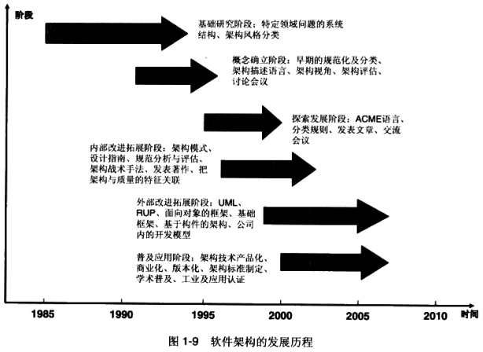
#### 1.5 软件架构的误区
介绍了3个从业人员对软件架构的认知误区：

1. 不知道架构与设计的区别：设计和编码工作不是软件架构的一切，真正的架构师必须有长期设计的工作经验，并在系统化的提升之后才可能成为合格的架构师。需要考虑商业概念、商业运作、系统结构、结构优化等这些更为宏观的方面，然后选择那些最经典的实践参考模型，才能构建出合格的软件架构。
2. 不知道系统架构该如何做：一个软件系统or软件架构在构建之初就给架构师留下了充分的创作空间。但是一个单纯为了一系列功能额实现而构建的架构，还不能称作严格意义上的软件架构。一个真正意义上的软件架构，还需要考虑如下的系统要求：
    - 架构灵活
    - 方便维护
    - 可随着业务扩展而增加
    - 架构设计人员可确定当前运行系统的下一个时刻状态
    - 最大峰值时，系统还能保持运行，性能不会明显下降
    - 系统可于其他系统进行集成（保留良好的接口）
3. 只盲目追随业界通用框架：当前存在很多产品化的、成熟的框架or中间件，的确极大方便了应用及产品开发，但也需要清楚的认识到，这些框架or中间件背后实际上隐藏了很多技术、设计、应用场景，也就是说为设计开发人员隐藏了很多系统设计开发的复杂性。很有可能发生，出了问题不知道怎么调、构件太多太复杂、多个架构集成合在一起并不能具有私人订制的可用性。

系统架构并不是简单应用一个流行的、通用的、看似很唬人的某某通用框架，从而使自己的系统过分依赖流行框架or中间件，同时把所有的系统级质量要求统统扔给这些框架or中间件，以寄希望于这些通用框架代替你去思考和处理你应该解决的问题。

实际上，我们应该寄希望于自己来构建系统架构，以满足：

1. 即使是最大峰值运行时，系统也要有很好的性能
2. 当系统面对大量并发事件时，能够很好地进行调度和并行处理
3. 当系统资源使用频繁且负荷增加时，同能够很好地协调资源的运用
4. 当重要实时系统出现错误时，能快速实现系统的自我恢复

Silver bullets do not exist. 世上没有万能的解药。

Any framework or middleware can only help you in doing your job, but it cannot do your job for you. 框架or中间件是用来帮助你的，而不是代替你去思考和工作的。

必须根据现实的系统要求（功能和非功能性要求），自己去构建适合现状的软件架构。

#### 1.6 软件架构生命周期
架构生命周期 Architecture Lifecycle 分为如下5个阶段：

1. 架构初步构建阶段
2. 架构逐步优化阶段
3. 架构成熟阶段
4. 架构老化阶段
5. 架构消亡阶段

单一产品架构的消亡，进阶到产品线架构阶段。
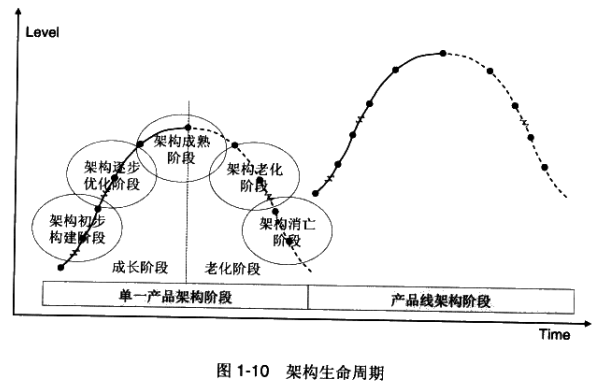

### 4. 软件架构与设计流程
介绍架构初步构建阶段的核心要点。

无论是瀑布式软件开发流程、迭代式的RUP、敏捷开发流程、CMM/CMMI、各公司自己定制的流程等，基本都遵循了“V-Model”这个注明的软件开发流程模型。

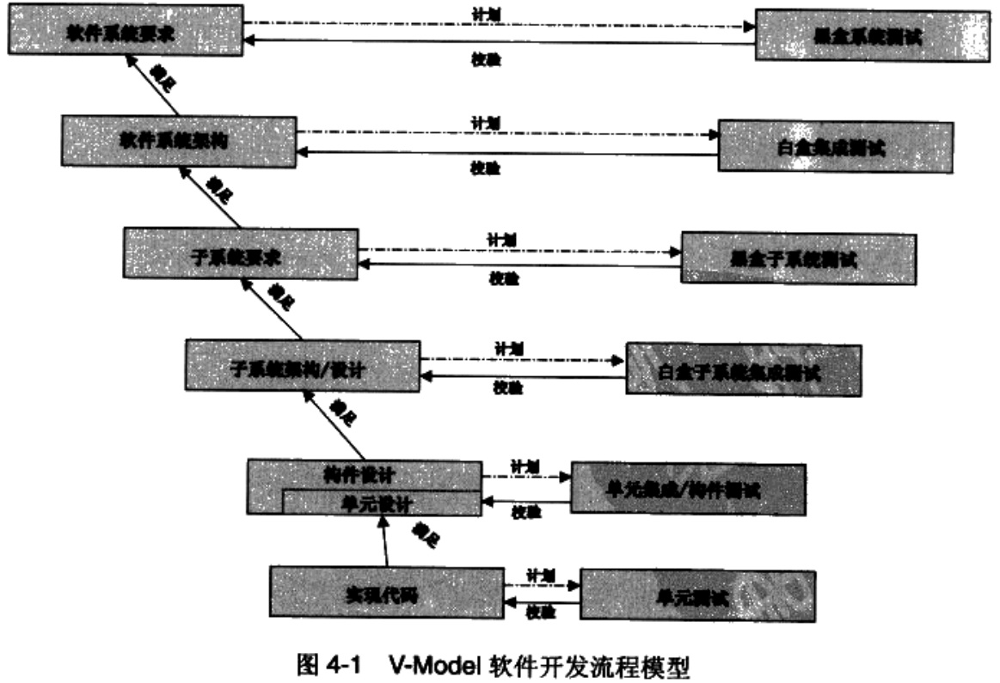

V-Model是继经典的瀑布模型基础之上进行的改进。

瀑布模型将软件系统生命周期划分为界定系统需求、架构构建、系统设计、开发实施、测试和运维这几个重要阶段，即系统生命周期的六个重要阶段。每个阶段都是按照自上而下、依次顺序（所谓瀑布式的）、一步一个任务来完成的，前一个任务没有完全结束前，后续的任务不能开始，具有强时序性。

瀑布模型存在缺点：系统开发前期积累下来的大量架构问题、子系统及构件的设计问题、编码的bug等只有在系统开发后期才能被发现，从而带来大量返工，甚至会造成系统开发“定时炸弹”

V-Model 克服了这些缺点，将测试活动提前，以并行的方式在系统开发早期就开展各项测试活动，这样能够尽早进行系统级校验、子系统及构件级校验等工作。

软件系统架构构建的活动发生在“软件系统要求”、“软件系统架构”、“子系统要求”这三个阶段。

软件系统设计活动主要发生在“子系统架构/设计”、“构件设计/单元设计”这两个阶段。

但同时 V-Model 也存在一些问题：模型中只能看到一些大的方面，但是并没有看到一些至关重要的细节，比如在做每个活动之前，必需的输入、每个活动的具体步骤、必需的输出这些是什么。它不能精细的回答实际工作中的一些问题。

这里提出系统架构BABSC流程模型：
B. 构建商业架构概念
A. 构建应用架构概念
B. 确立和稳定架构基线
S. 子系统架构及设计
C. 构件与单元设计

#### 4.1 构建商业架构概念
架构是在构建架构之前，需要先建立一系列的系统化概念，回答 what （系统的要求）、 when （实现的时间）、 who （负责的角色）、 how （实现的方法）、 why （实现的目的）这些问题。

用户需求收集/分析不代表系统的要求。要形成真正的架构概念，需要架构人员依靠自身在软件系统构建上的实践经验，结合系统构建时所要求的重点考虑的视角，一点一滴德逐步组织并最终形成完整准确的商业架构概念，并最终汇总出系统的要求。

系统需求与系统需求这两个词在系统架构师的眼里有微妙的差异。

构建商业架构概念主要是指利用各种商业建模手段，全面、清晰地构建商业领域内的组织结构关系、商业功能、商业流程、信息交互、商业结构地理分布、商业规则和约束条件、商业目的、战略决策等商业概念。

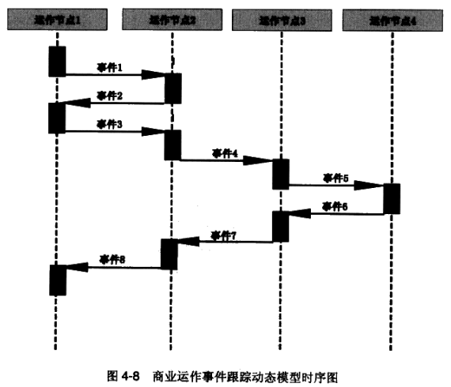

1. 产品/项目信息概览
    - 项目识别信息
    - 范围
    - 目标及实现方法
    - 项目背景
    - 工具及文档
    - 意见及建议
2. 商业及系统术语字典
    - 汇总商业术语：运作节点、运作活动、信息单元、系统节点、系统集群、系统功能、性能参数、技术标准、技术领域
    - 制定及规范商业/系统数据的元数据
    - 将系统架构术语及系统实现术语进行分类及规范
    - 将商业业务术语与系统架构及实现的术语进行映射与统一
3. 商业运作总体概念：清晰准确描述商业运作的主线业务流程、商业任务、商业使命、商业目标、总体商业运作模式、参与机构和组织、资源分布与协同、主要角色及其完成的任务、运营模式与外部环境的交互等概念信息。
4. 商业组织结构：不仅要构建商业内部组织结构的层次关系，还要确定商业部门or组织进协作的职能层次结构，以及各部门在商业流程和活动中进行协同工作时担当的角色。
5. 商业运作节点及信息交换：商业运作节点指可以产生、消费及处理消息的商业运作架构中的功能单元。
6. 商业运作事件跟踪模型：商业运作事件跟踪动态模型时序图
7. 商业运作活动/流程模型
8. 商业运作状态变化模型：状态机
9. 商业数据信息交换矩阵
10. 商业数据模型：商业数据模型的构建不是等同于系统级逻辑数据模型。
11. 商业运作规则及约束：包括规章制度、指南、操作规范鞥商业强制要求、

#### 4.2 构建应用架构概念
商业架构概念的完成有助于系统架构人员全面、清晰、准确地构建一个商业所涉及的内部及外部各种重要的概念：组织结构划分、人员角色及职能分工、业务流程组成、业务活动顺序、业务信息交换与信息依赖、业务规则要求等静态及动态商业特征。

应用架构概念与商业架构概念的区别主要在于应用架构考虑以下方面：

#### 4.3 确立和稳定架构基线
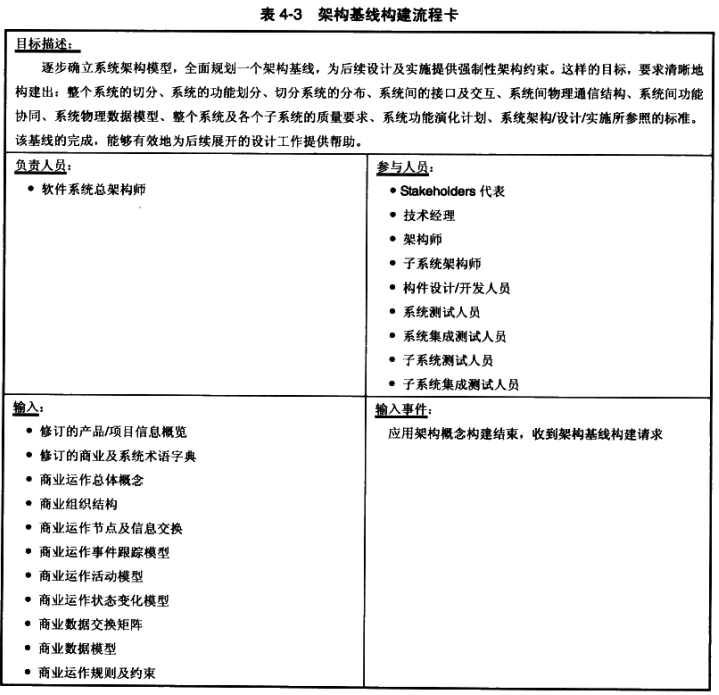
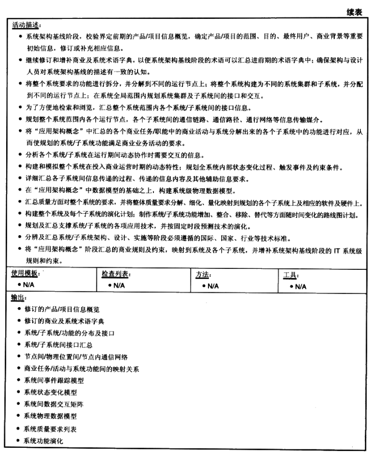
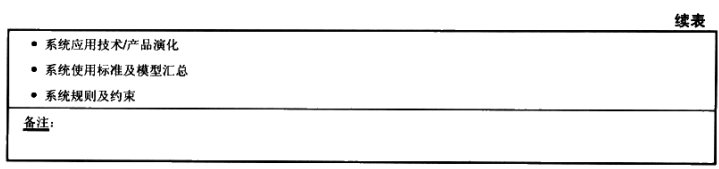
#### 4.4 子系统架构及设计
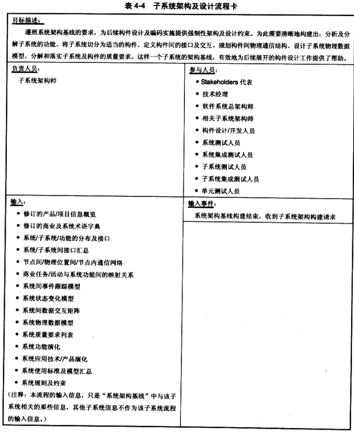
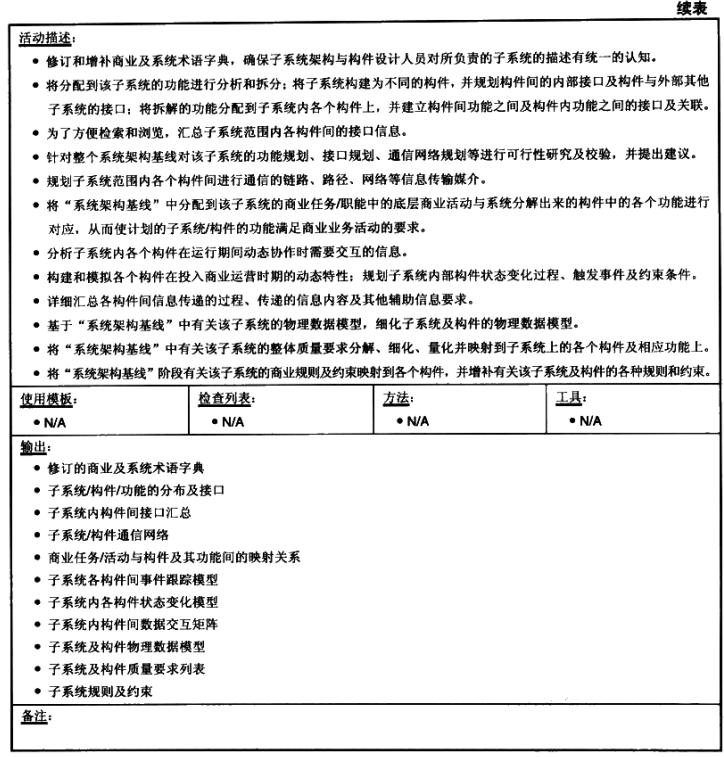
#### 4.5 构件与单元设计
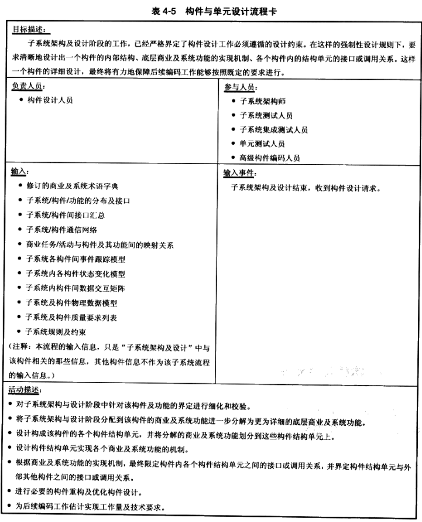
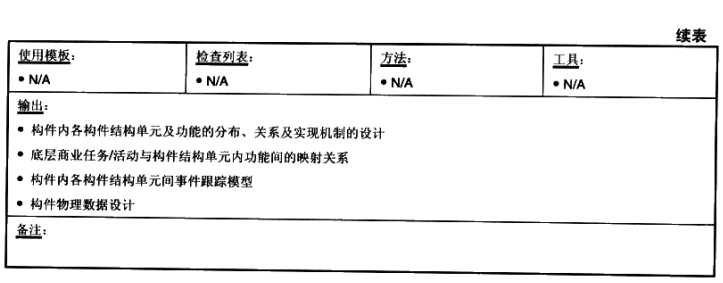
#### 4.6 架构/设计流程中的角色和职责
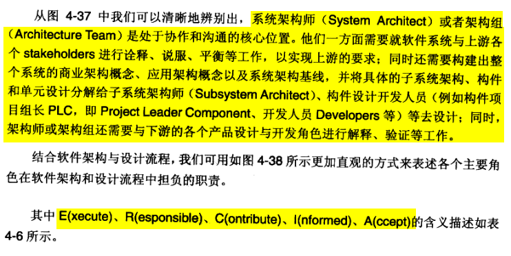

## 参考资料
1. [软件架构的艺术](https://book.douban.com/subject/3669563/)
2. [架构设计——架构知识体系](https://zhuanlan.zhihu.com/p/42830778) ：这里把架构分成业务架构（俯视架构）、应用架构（剖面架构/逻辑架构）、技术架构（系统架构）、代码架构（开发架构）、部署架构（实际物理架构）几类，比较概要的介绍了一下，感觉可以参考
3. [万字干货：如何画好一张架构图？](https://mp.weixin.qq.com/s?__biz=MzU5Mjc0MTM4NA==&mid=2247486873&idx=1&sn=7af14703fd865794ddbe332d5bf38fe2&chksm=fe1a58fec96dd1e8896cacb90dccbe50ba66d7f3d50a998d3bdc2df107e7c25e501816b73484&mpshare=1&scene=24&srcid=&sharer_sharetime=1592308051033&sharer_shareid=5b9bdd8cc7c063922f0b84441b8cdc3e&key=c6895a4a7d7f12efd7fc2b8286921312ed642300d54b96f261c1734d36d62aa62fcf212b36ef7020a8eeebf50dec9243a1c8525961493e3aa9e346978c52c251469adc32bff7f6b3ffe1afdcd71c984a42d4b2a9ea500e08501315fd026d76e6b1c7fd4e63e26628f3abc137173c18853083bc9ca96112ba014ec8600bd2258c&ascene=14&uin=NzM5MTc3ODA5&devicetype=Windows+10+x64&version=62090529&lang=zh_CN&exportkey=A8LJ2W%2B2ly%2FL3Y3c7q3RDbQ%3D&pass_ticket=m9aF%2Fy16%2F6pxEkDtgvltHIrCjASypbzMnuZjgJ%2B3zgTl%2B9h1DH5GrboOOkJxOuJ3&wx_header=0)：写得比较详细
4. [如何画好架构图](https://mp.weixin.qq.com/s?__biz=MzAwMDAwNjk4Ng==&mid=2657232135&idx=1&sn=4aff4e5051ab141aeb20717ef47f73c5&chksm=81790b22b60e82345162e1a8bbd1b7c74f30aaf21964928b433eaa6349932778cf41193793db&scene=0&xtrack=1&key=e534089e1c3a5a835951b090a8d80024bfc1ff3374986fd74b3532c00810016af0bfae2d12e26bb5853d989c81013d249fb4f405b13531c5297a420e9e8fbec46c0330a4e42216b014ddb05a7753d4df5d2ace5295a357417bf85c258454eaf9b3e1ec1ab8c88045a56d6dcc47512c85a05581416d598a0e9e8ba6bcd11d7c84&ascene=14&uin=NzM5MTc3ODA5&devicetype=Windows+10+x64&version=62090529&lang=zh_CN&exportkey=A1TiodQQ%2BlK2LvMtIE2dGMQ%3D&pass_ticket=m9aF%2Fy16%2F6pxEkDtgvltHIrCjASypbzMnuZjgJ%2B3zgTl%2B9h1DH5GrboOOkJxOuJ3&wx_header=0)

